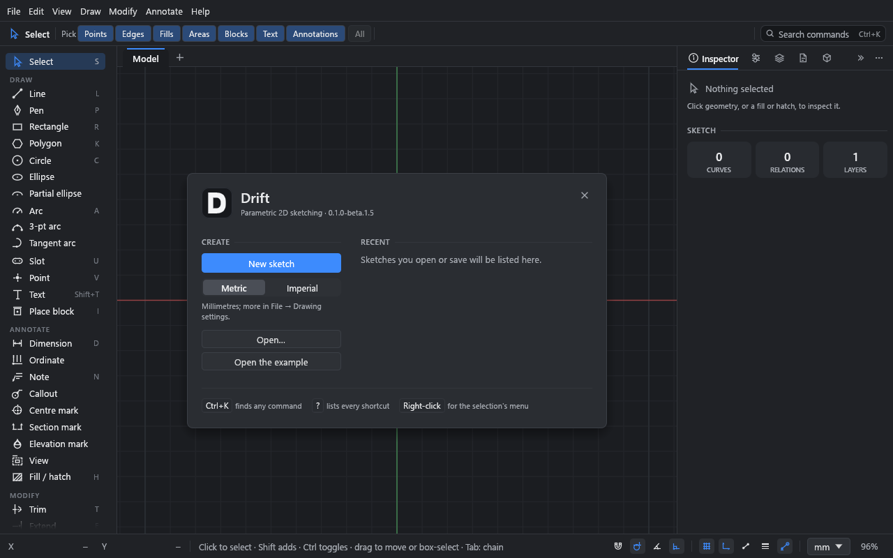
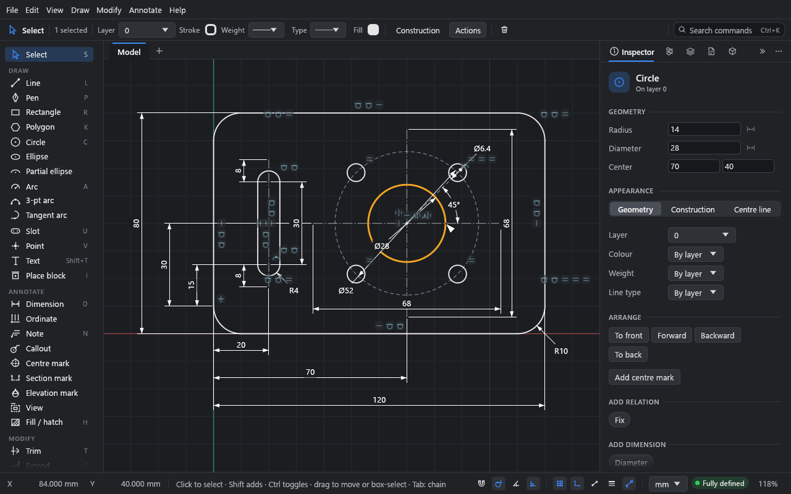
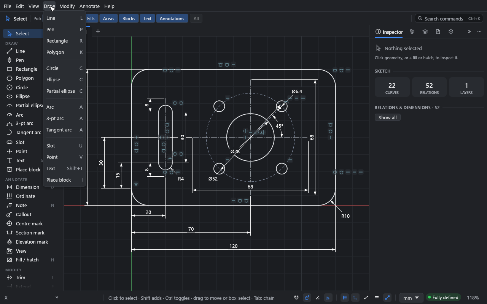
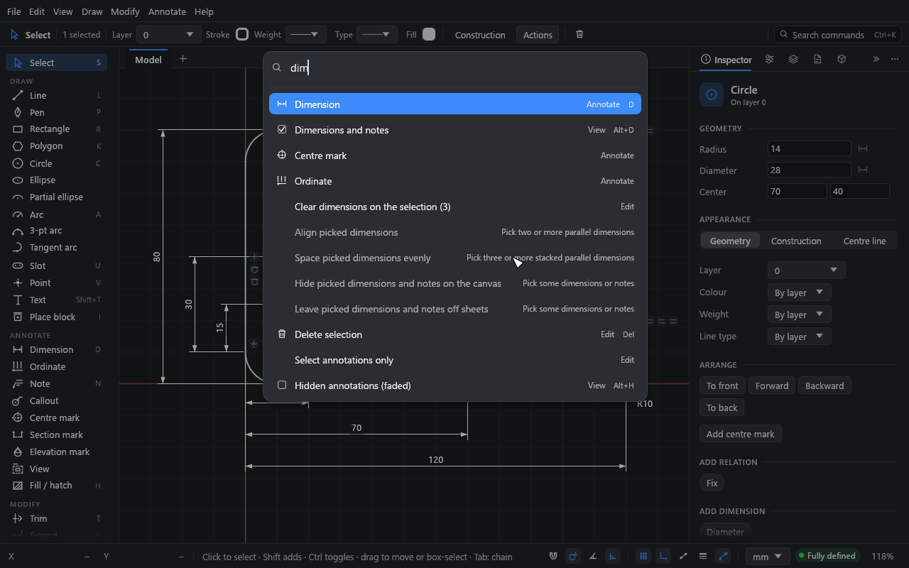
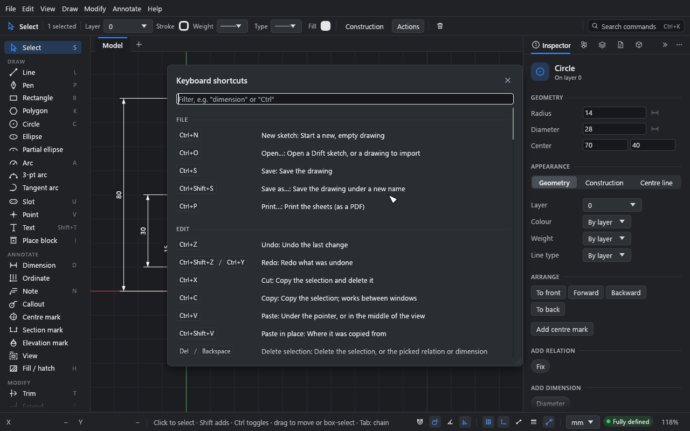

# Getting started

This page gets Drift running, shows you round the window, and covers the things you'll do in
every session: navigating, finding commands and saving.

## Install Drift

Drift is in beta, and its builds aren't signed yet. Your computer will warn you the first
time you open one.

### Windows

Download from the [download page](https://drift-website-c9y.pages.dev/download/):

- **`Drift-<version>-windows-x64-setup.exe`**, the installer. It installs for your user
  only (no administrator rights needed), adds Drift to the Start menu, can add a desktop
  icon, and can make `.drift` files open in Drift.
- **`Drift-<version>-windows-x64.zip`**, the portable version. Unpack it anywhere and run
  `drift.exe`.

If Windows SmartScreen says it protected your PC, click **More info**, then **Run anyway**.

### macOS

Download **`Drift-<version>-macos-universal.dmg`** from the
[download page](https://drift-website-c9y.pages.dev/download/). It runs on Apple silicon and
Intel Macs. Open the disk image and drag **Drift** to **Applications**.

The first time, macOS Gatekeeper may refuse to open it. Right-click (or Control-click)
**Drift** in Applications and choose **Open**, then **Open** again. On recent macOS versions
you may need **System Settings → Privacy & Security → Open Anyway** instead.

Double-clicking a `.drift` file doesn't open it in Drift on macOS yet. Use **File → Open…**,
or drop the file on Drift's window. (Drop a DWG, DXF, SVG, PDF or Illustrator file and Drift
asks whether to open it as a new drawing or import it into the one that's open.)

### Linux

There is no Linux version yet. Use Drift in the browser.

### In the browser

Open <https://drift-website-c9y.pages.dev/app/>. It's the same program, and may be a little
ahead of the installers. It uses WebGPU where the browser has
it, and WebGL2 otherwise.

In the browser:

- **Save** downloads the file, and **Open** asks you to pick one.
- Your sketch is kept in the browser's storage between visits.
- Fonts installed on your computer aren't available. Use **Add a font file…** in a font
  menu instead.

### Updating

Drift updates itself. When it starts it asks GitHub whether there is
a newer release. If there is, a notice at the bottom right shows what's new, with three
choices:

- **Update now** downloads the new version and checks it (see below). Drift then closes,
  installs it and opens again. If your sketch has unsaved changes you're asked to save
  first. **Cancel** there keeps the download, and **Help → Restart to update to …** installs
  it later.
- **Later** hides the notice until Drift next starts.
- **Skip this version** stops it being offered. A newer one still is, and **Help → Check
  for updates…** shows a skipped one again.

To check at any time, use **Help → Check for updates…**. To stop the check at start, turn
off **Edit → Preferences… → Updates & Labs → Check for updates when Drift starts**. The check only
asks GitHub (`api.github.com`) for the list of Drift releases. Nothing about you or your
drawings is sent.

Before anything runs, Drift checks the download against the release's checksums. It also
checks that those checksums are signed with Drift's release key, which is built into the
app. A download that fails either check is never run.

- **Windows:** this works if you used the installer. The update installs the same way as
  before, without asking questions. If Drift was installed for all users, Windows asks for
  administrator approval. With the portable zip, the notice links to the release page and
  you update by hand.
- **macOS:** Drift replaces itself in the folder it's in (usually Applications). If it
  can't write there, it says so and you update by hand from the disk image. Updates
  downloaded this way don't trigger the Gatekeeper warning again.
- **The browser:** the browser version is always the latest.

If the check fails (no connection, or GitHub is busy), the status bar says so briefly and
nothing else happens.

## The start screen

Drift opens with a start panel over an empty sketch.

Under **Create**:

- **New sketch** closes the panel. Pick a tool and start drawing.
- **Metric** or **Imperial**, below it, sets the new sketch's units: millimetres, or feet
  and inches. More formats are in **File → Drawing settings…**, and the units menu in the
  status bar switches them at any time.
- **Open…** opens a `.drift` sketch, or a DWG, DXF, SVG, PDF or Illustrator file as a new
  drawing. To bring a drawing into the one that's open, use **File → Import…** or drop the
  file on the window (see [Underlays and DXF import](tutorials/11-underlays-and-dxf.md)).
- **Open the example** opens a dimensioned mounting plate to explore.

**Recent** lists the last seven sketches you've opened or saved; **File → Open recent**
keeps ten.

The panel also goes as soon as you pick a tool or click the canvas. Ctrl+N brings it back
with a new sketch, and **File → Show the start panel** shows it over an empty, unsaved
sketch.

> Drift restores your last session when it starts, so after the first run you'll usually
> see your previous sketch instead.

## Open the example

Click **Open the example** (or **File → Open example**). You get a mounting plate: an outline
with rounded corners, a slot, a bore and four bolt holes, fully dimensioned.

The window has six parts:

1. **The menu bar.** **File**, **Edit** and **View**, then **Draw**, **Modify** and
   **Annotate** with every tool and command and its key, and **Help**.
2. **The tool palette** (left). **Select** at the top, then **Draw**, **Annotate** and
   **Modify** tools. Each shows its shortcut letter (in a narrow window, just its icon).
   Hover over a tool for a description. If the window is short, the list scrolls.
3. **The top bar.** On the left, the active tool and its options. With **Select** and
   nothing picked, it shows the pick filters: **Points**, **Edges**, **Fills**, **Areas**,
   **Blocks**, **Text** and **Annotations** (see [Pick filters](tutorials/04-editing.md#pick-filters)).
   With something picked, it shows how many, then the selection's **Layer**, **Stroke**
   (colour, weight, line type), **Fill**, a **Construction** button, an **Actions** menu
   and **Delete**. On the right is the **Search commands** field.
4. **The canvas** (middle). Geometry, dimensions and relation symbols. The green and red
   lines are the Y and X axes through the origin. Above it, a tab for the **Model** and one
   for each sheet, and **+** for a new sheet.
5. **The panels** (right). **Inspector**, **Parameters**, **Layers**, **Sheets** and
   **Blocks**, docked as tabs. Click a tab's icon to switch.
6. **The status bar** (bottom). Pointer coordinates on the left, the active tool's hint in
   the middle, and on the right: drawing aids (snap to grid, perpendicular and tangent
   snap, angle snap, auto relations), display toggles (grid, origin axes, thin lines and
   others), the units menu, the sketch's status, and the zoom. A chip appears when
   relations or dimensions are switched off (click it to show them again), or when curves
   lie on top of each other.

Click the bore (the large circle) with the **Select** tool. The **Inspector** shows its
radius, diameter and centre as fields you can type into, its appearance, and the relations
and dimensions you can add to it.

### Colours on the canvas

By default curves are coloured by how well they are defined, as in SolidWorks:

| Colour | Meaning |
|---|---|
| Blue | Under-defined: it can still move. |
| White (black in the light theme) | Fully defined. |
| Red | Over-defined or conflicting. |
| Orange | Picked. |

The status bar says the same in words: **Fully defined**, **N DOF free** or **N conflicting**.
Shift+C switches to each curve's own and its layer's colours, for a drawing that looks like
the printout.

### Panels

You can rearrange the panels:

- Drag a tab along its bar to reorder the tabs, onto the canvas to float the panel, or onto
  the other side's tabs to dock it there.
- Drag a floating panel's header onto the top or bottom of another floating panel to stack
  them in one window, as in Photoshop or Affinity.
- Right-click a tab, or use its **⋯** menu, to dock, float or close it.
- The **»** button collapses a dock to a narrow strip of icons.
- Ctrl+\ hides every panel for a clear view, and brings them back.
- **View → Panels** shows or hides each one, and **Reset panel layout** puts them all back
  in the right dock.

Ctrl+L shows or hides the **Layers** panel on its own.

## Navigate

| To | Do this |
|---|---|
| Zoom | Scroll the mouse wheel (it zooms at the pointer), or pinch on a trackpad. |
| Pan | Drag with the middle or right mouse button, or scroll with two fingers on a trackpad. |
| Fit everything | Shift+F, or double-click the middle button. |
| Fit the selection | Shift+Z. |
| Zoom to a set size | Click the zoom percentage in the status bar: fit, selection, 25% to 400%, and **100% (life size)**. |

Drift tells a mouse wheel from a trackpad by how it scrolls. If it guesses wrong (a
free-spinning wheel, or a touch mouse), set **Edit → Preferences… → General → Mouse and
trackpad** to **Zoom** or **Pan**. With **Pan**, Ctrl+scroll zooms.

Ctrl+' hides or shows the grid.

## Find any command: the command palette

Press Ctrl+K (or Ctrl+Shift+P), or click **Search commands** in the top bar. Type a few
letters of any tool, view setting, panel or command, and press Enter. Arrow keys move
through the list and Esc closes it. Commands you've used recently come first. AutoCAD's
command names and aliases work too (MOVE, RO, TR, OFFSET…); what can't run yet, such as
**Rotate** with nothing picked, is dimmed and says why.

Every command is also in the menus: **Draw**, **Modify** and **Annotate** have the tools,
**Move**, **Rotate**, **Scale** and the patterns, each with its key.

## Keyboard shortcuts

Press ? (or **Help → Keyboard shortcuts**) for the full list. Type in its filter field to
find a key or a command.

The essentials:

- Each tool has a letter: L line, R rectangle, C circle, A arc, D dimension, T trim, and so
  on. Pressing C, A, U or F again cycles through related tools.
- Esc cancels what you're doing. Pressed again, it returns to the **Select** tool. With a
  dialog open, Esc closes it.
- Enter or a right-click finishes a polyline. With the **Select** tool and nothing in
  progress, Enter or Space repeats the last command or tool.
- Ctrl+Z undoes and Ctrl+Y (or Ctrl+Shift+Z) redoes. Every edit can be undone, and a drag
  is one step.

On a Mac, use Cmd wherever this guide says Ctrl, and Option wherever it says Alt. The menus
show the Mac symbols (⌘, ⇧).

See [Keyboard shortcuts](reference/keyboard-shortcuts.md) for every key.

## Right-click menu

With the **Select** tool, right-click on the canvas. With something under the pointer or
picked, the menu has edit actions, **Add relation** and **Add dimension** submenus,
**Move to layer**, **Select chain** and more. On empty canvas it has select all, zoom to
fit, the grid and snap switches, and the command palette.

## Save your work

- Ctrl+S saves and Ctrl+Shift+S saves as. Drift saves `.drift` files.
- Ctrl+N starts a new sketch and Ctrl+O opens one.
- Drift asks before closing, or before replacing the sketch, when there are unsaved changes.
- The session is saved automatically every ten seconds and when you quit, and restored when
  you start Drift again. That's a safety net, not a substitute for saving. If it can't be
  restored, Drift keeps it as a file and says where (see
  [Files and compatibility](reference/files.md#session-and-autosave)).
- Exporting a PDF, SVG or DXF never replaces your `.drift` file. Ctrl+S always writes the
  sketch.

> **Compatibility.** Older files always open in newer builds. A file saved by a newer build
> usually opens too: what this build doesn't know is kept, and Drift asks before a save
> would lose any of it. Only a file from a build that changed the format in a breaking way
> is refused (Drift says the file is too new). See [Files and compatibility](reference/files.md).

## If something goes wrong

- **Help → About Drift → Copy details** copies the version, renderer and system for a bug
  report.
- Drift watches its own memory use. It warns at 3 GB and closes itself at 8 GB, so a fault
  can't freeze the computer. Your sketch is restored the next time it starts.

## Next

Start the first tutorial: [Your first sketch](tutorials/01-first-sketch.md).
