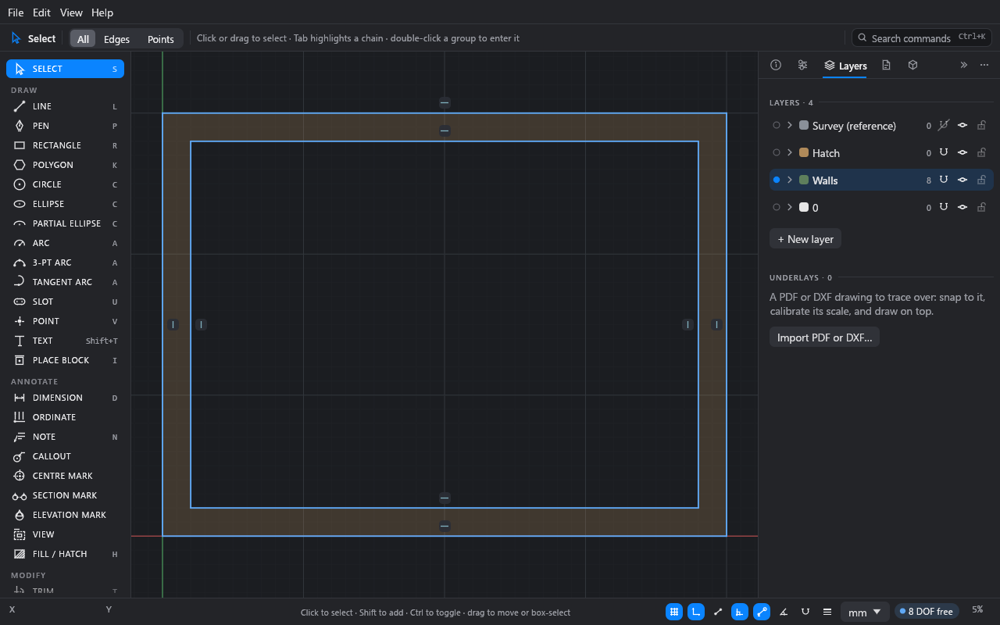

# Panels

Drift has five panels. They start docked as tabs on the right of the window.

- Click a tab's icon to bring that panel to the front.
- Drag a tab along its tab bar to reorder the tabs: the tab follows the pointer and the
  others make room.
- Drag a tab out of its bar and it follows the pointer:
  - onto another dock's tabs to dock it there (a bar shows where it will go);
  - onto the top or bottom of a floating panel to stack it there, in the same window
    (a bar along that edge shows which);
  - onto the canvas to float it on its own.
- A floating panel on its own moves by its header. Dragged over a dock, the dock lights up
  to take it; over the top or bottom of another floating panel, it stacks there.
- In a stack, drag a panel's header to pull it out, the dotted strip along the top to move
  the whole stack, and the line between two panels to share the height differently.
- Right-click a tab, or use the **⋯** menu, to dock, float or close it.
- **»** collapses the dock to a strip of icons. A narrow window collapses both docks.
- **View → Panels** shows or hides each panel, **Hide all panels** (Ctrl+\) clears them all
  away, and **Reset panel layout** puts them back.

The layout is remembered between sessions.

## Inspector

What's picked, and what you can do with it. Its contents depend on the selection.

| Picked | The Inspector shows |
|---|---|
| Nothing | A summary: the numbers of curves, relations and layers. |
| One curve or point | Its **Geometry** as fields: a line's **Length**, **Angle**, **Start** and **End**; a circle's or arc's **Radius**, **Diameter** and **Center**; a point's **Position**. Typing a size sets the dimension that drives it, or adds one (shown as **dim**). Typing a position or angle moves the geometry as far as its relations allow. Fields apply when you press Enter or Tab, or click elsewhere; Esc puts the old value back. |
| Curves | **Appearance** (**Geometry** / **Construction** / **Centre line**, **Layer**, **Colour**, **Weight**, **Line type**, each "By layer" unless set), **Add relation** and **Add dimension** buttons for what fits, **Pin measurement**, **Pattern**, the **Relations & dimensions** on the selection (each with **×**; **Clear relations** and **Clear dimensions**), and **Delete selection**. |
| Circles | **Add centre mark** (or **Add N centre marks**). |
| A dimension | **Driven (reference)**, its **Text** (**Prefix**, **Suffix**, chips, **Under line**, **Show instead**), **Tolerance**, and **Show** (**On the canvas**, **On sheets, in print and export**). |
| A note, callout or mark | Its text or label, leader, sheet and direction, and **Show**. |
| A fill or hatch | Its **Style**, **Layer**, draw order and **Area**. See [Fills and hatches](../tutorials/06-fills-and-hatches.md). |
| A text | Its words, **Height**, **Angle**, **Font**, **Align**, **Spacing** and **Wrap**, and **Convert to curves**. |
| A block copy | **Block**, **Placement**, **Layer**, **Edit block**, **Explode** and **Select all copies**. |
| A group | Its **Name**, **Members**, **Edit group** and **Ungroup**. |
| A closed area (with area picking on) | **Area**, **Perimeter**, **Centroid** and **Holes**, and **Fill** / **Hatch** buttons. |

With the **Fill / hatch** tool active, the **Inspector** shows the style for **New fills**
instead.

While a block is being edited, **Editing block** and **Finish editing** sit at the top.

## Parameters

The drawing's settings and its parametric side.

- **Units:** **Metric** or **Imperial**, the **Format**, **Decimals** (or **Round to** a
  fraction, and **Show 0'**), and **Angles** decimals. See [Units](units.md).
- **Variables:** name, expression, kind and slider for each; a row to add one. See
  [Parameters](../tutorials/03-parameters.md).
- **Variants:** apply, **Update**, delete, **Save current**, and **Show other variants as
  ghosts**.
- **Snapshots:** **Take snapshot** and **Restore** (this session only).
- **Pinned measurements:** live values, with **Unpin**.
- **Drafting:** **ISO 129** or **ASME Y14.5**, then scale, text height, **Arrows**,
  **Arrow size**, **Ext. gap**, **Ext. past**, text placement, **Zeros**, **Dual units**,
  **Colour** and the drawing's **Font**. See [Annotation](../tutorials/09-annotation.md).
- **Hatch patterns:** patterns imported into the drawing, and **Import .pat…**.

## Layers

Ctrl+L shows or hides it.

- Each layer is a row: a dot, its colour, name, the number of curves on it, and snap, show
  and lock switches. The filled dot and highlighted row mark the **current layer**, where
  new geometry goes. Click anywhere on a row to make that layer current; double-click the
  name to rename it.
- The list reads top down as the layers stack: the top layer draws over the ones below it,
  on the canvas and in output. Drag a row up or down to change the order; a line shows
  where it will go. New layers start at the top, and layer **0** starts at the bottom.
- The magnet switch turns snapping to a layer's geometry off or on. With it off, the
  pointer doesn't snap to that layer (or to block copies on it), but you can still pick
  and edit its geometry. Use it for busy reference layers you're drawing over.
- Click a row's arrow (**Colours and line settings**) to open it: **Stroke** colour
  (**Auto** is black or white to suit the theme), **Fill** colour (**Same as stroke** by
  default), **Line** weight and type, **Output** (**Printed and exported**), **Select all**,
  **Move here** and **Delete** (its geometry moves to layer 0).
- Right-click a row to select its curves or move the selection there.
- **+ New layer** adds a layer and makes it current. **Move selection here** moves what's
  picked to the current layer.
- Layer **0** always exists and can't be deleted.

Hidden layers aren't drawn, picked or snapped to, but their geometry still solves. Locked
layers are drawn and can be snapped to and dimensioned against, but not picked; the solver
holds their geometry still. A hatch or area whose outline is on a locked layer can't be
moved, turned or scaled either: Drift says the layer is locked.

The **Underlays** section, below the layers, lists the drawing's underlays. See
[Underlays and DXF import](../tutorials/11-underlays-and-dxf.md).

Geometry takes its colour, weight and line type from its layer unless you set them on the
geometry itself (in the **Inspector**, or the top bar's **Stroke** menus).

## Sheets

Sheets, views, title blocks and output: **New sheet**, **Show sheet** / **Back to model**,
**Views** (every view in the drawing and the sheets it's on: drag one onto the sheet, or
**Place on sheet**, **Zoom to view**, **Delete view**), **Paper** (with **Colour**,
**Greyscale** or **Black & white**), **On this sheet** (with **Add view**, **Remove from
sheet** and **Align with**), **Title block**, **Logo**, **Revisions**, and **Output**
(**PDF…**, **SVG…**, **DXF…**, **Print…**) and **Delete sheet**. See
[Sheets and output](../tutorials/10-sheets-and-output.md).

## Blocks

- **New block** (a name and **Make**), when something is picked.
- A search field, over the drawing's blocks and the whole library.
- **In the drawing:** the drawing's blocks, a thumbnail of each and how many copies are
  placed. Click a block to place copies; right-click it to rename it, select its copies or
  delete it. **Purge unused** deletes the blocks with no copies.
- **Library:** a category (**Doors**, **Windows**, **Kitchen**, **Bath**, **Furniture**,
  **Laundry and utility**, or all of them), its families and their sizes as tiles. Click a
  tile to add that block (once) and place copies; a tile already in the drawing is
  outlined. **Add all** adds every block shown without placing them.

See [Blocks](../tutorials/07-blocks.md).
