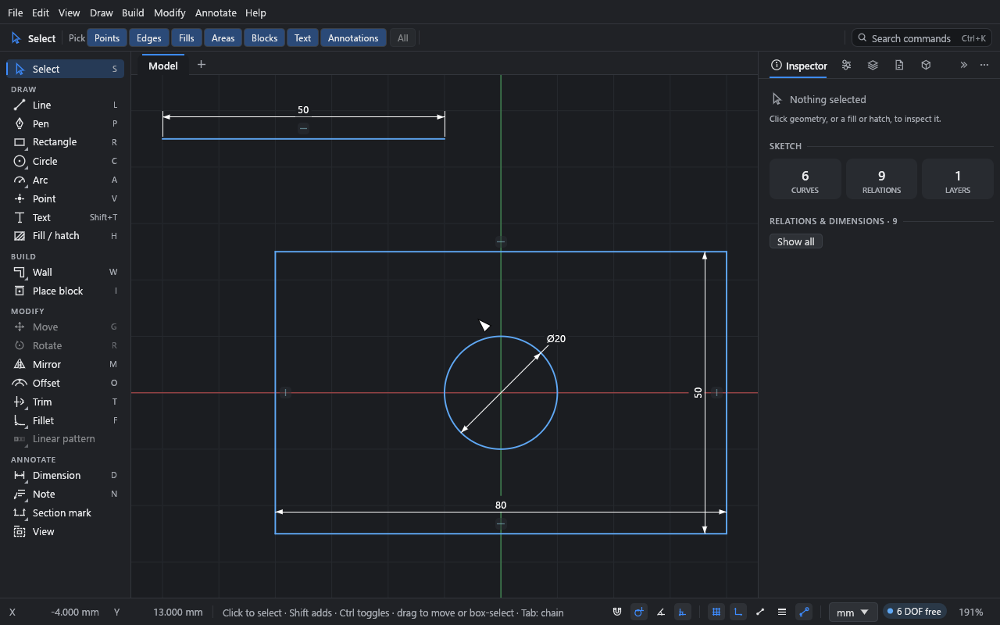
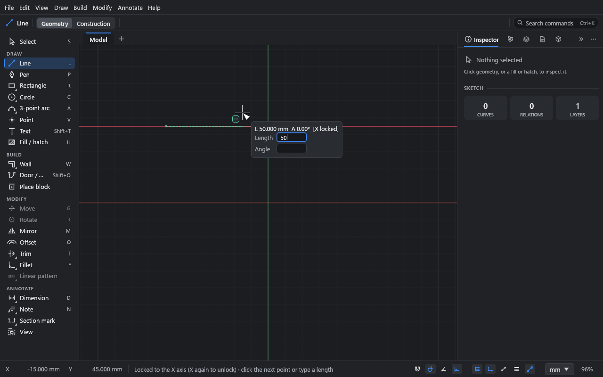
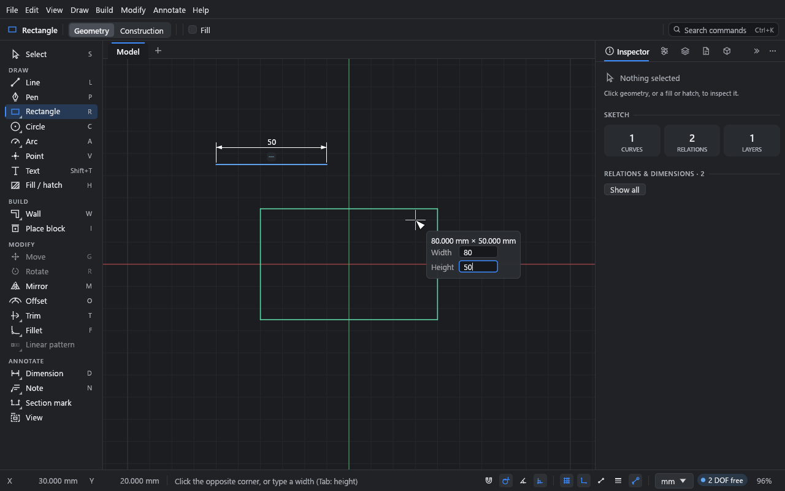

# Your first sketch

**What you'll make:** an 80 × 50 mm plate with a 20 mm hole in the middle, and a 50 mm line
above it. Along the way you'll use snapping, typed sizes, Alt for free placement and the
X / Y axis locks.

Time: about 10 minutes.

## Before you start

Start a new sketch (Ctrl+N, or **New sketch** on the start panel). Check that
**Auto relations** is on: its switch in the status bar at the bottom (a corner with a square
mark) is highlighted. It is by default; Shift+Alt+R turns it off and on.

The sketch is in millimetres unless you've changed it. The status bar's units menu (it
shows **mm**) switches units at any time without moving anything; see
[Units](../reference/units.md).

## Draw a line, locked to the X axis

1. Press L (or click **Line** in the tool palette).
2. Click on the canvas to place the start point, somewhere above and left of the origin.
3. Move the pointer to the right. A preview follows it, and a label beside the pointer shows
   the length (**L**) and angle (**A**).
4. Press X. The line locks to the X axis: it stays level wherever the pointer goes, and the
   hint in the status bar says so. (Y locks it upright. Press the same key again to unlock.)
5. Type `50`. The digits go straight into the **Length** field beside the pointer; you don't
   need to click anything first.

   

6. Press Enter. The line is placed, exactly 50 mm long, in the direction of the pointer.
7. The Line tool carries on from the end you just placed, so you can draw a chain. Press Esc
   to stop the chain. (Enter or a right-click also finishes it.)

The line gets a dimension (the **50** above it) and a horizontal relation (the small **—**
symbol). Typed sizes become dimensions, and the axis lock adds the matching horizontal or
vertical relation. That's what **Auto relations** does. With it off, the same steps draw a
plain line with nothing attached.

> **Typing values.** Typing starts as soon as you press a digit, `.`, `-`, `(` or `=`. Tab
> moves to the next field (for a line: **Angle**), Backspace deletes, Enter applies and Esc
> stops typing. Units work anywhere: `2in`, `25mm`, `1'-6"`, `30deg`. A bare number is in
> the sketch's display unit.

## Draw a rectangle with typed sizes

1. Press R for the Rectangle tool.
2. Click where the first corner goes. Click near (−40, −25): the pointer's coordinates are
   in the status bar's bottom left. Don't worry about being exact.
3. Move the pointer up and to the right. The direction you point is the direction the
   rectangle grows.
4. Type `80`, press Tab, and type `50`. The preview shows the rectangle at that size.

   

5. Press Enter.

Typing works for the first point too: before the first click, type the X coordinate, Tab,
the Y coordinate, and Enter.

The rectangle comes with horizontal and vertical relations on its sides, and dimensions for
the width and height you typed. It's still blue: nothing says where it is yet. You'll pin
it down in the next tutorial.

## Draw a circle on the origin

1. Press C for the Circle tool.
2. Move the pointer to the origin, where the red and green axes cross. A ring appears when
   the pointer snaps to it. Click.
3. Move outwards, type `20` (the diameter) and press Enter.
4. Press Esc to go back to the **Select** tool.

Pressing C again, while the Circle tool is active, switches to the Ellipse tool, and again
to Partial ellipse. A works the same way for arcs (centre, 3-point, tangent), F for fillet
and chamfer, and U for the three kinds of slot.

## Snapping and inference

As you draw, the pointer snaps to what's near it, and a marker shows what it found:

- **End points, centres, midpoints and quadrants** of curves.
- **A point along a curve** (nearest-on-curve).
- **The origin.**
- **The grid**, if **Snap to grid** is on (Shift+G, or the status bar).

Snapping onto an existing point connects to it: the two curves share that point. Snapping
onto a curve or a midpoint keeps the new point there with an **On curve** or **Midpoint**
relation (when **Auto relations** is on).

**Inference lines** help you line things up. Hover over an existing point for a moment, then
move away: a dashed guide appears when the pointer is level with it or straight above or
below it. These guides add no relation.

Lines drawn nearly horizontal or vertical snap straight and get the relation.

### Perpendicular and tangent

While you draw a line, two more snaps look back at where the segment starts:

- **Perpendicular** (marked ⊥): near the point on a line where a line from your start would
  meet it square, the pointer snaps there. On a circle or arc it snaps to the points along
  the radius through your start.
- **Tangent** (marked with a small circle on a line): near a point where a line from your
  start would just touch a circle or arc, the pointer snaps there.

Drawing on from the end of a line, an arc, a partial ellipse or a pen curve, a dashed guide
shows when the new segment is square to the line, or carries on along the curve's tangent. Move close to it and the point
goes exactly on it. (Square to a horizontal or vertical line is simply vertical or
horizontal.)

With **Auto relations** on, the line keeps what you snapped to: a **Perpendicular** or
**Tangent** relation, with its end kept on the curve. A line square onto a circle runs
through its centre. Edit the drawing and it stays square or tangent.

Real points (end points, centres) win over these snaps, and they win over midpoints,
quadrants and points along a curve. Turn them off with **Perpendicular & tangent** in the
status bar, next to the grid snap.

**Angle snap**, in the status bar next to the grid snap, makes lines turn in steps: every
1°, 5°, 15° or 45°.

### Place freely with Alt

Hold Alt while you click to place a point exactly where the pointer is, with no snapping.
Use it when a snap keeps pulling you onto geometry you don't want to touch.

## Finish

Press Shift+F to fit the drawing in the window. Save it with Ctrl+S; you'll use it in the
next tutorial.

## What you learned

- L, R and C pick the Line, Rectangle and Circle tools; pressing a key again cycles through
  related tools.
- Type sizes while drawing: Tab moves between fields, Enter applies.
- X and Y lock a line to an axis.
- Snapping connects new geometry to old; Alt turns it off for one click.
- With **Auto relations** on, typed sizes become dimensions and straight lines get
  horizontal and vertical relations.

## Next

[Constraints and dimensions](02-constraints-and-dimensions.md): make the rectangle fully
defined, and see what happens when you ask for too much.
