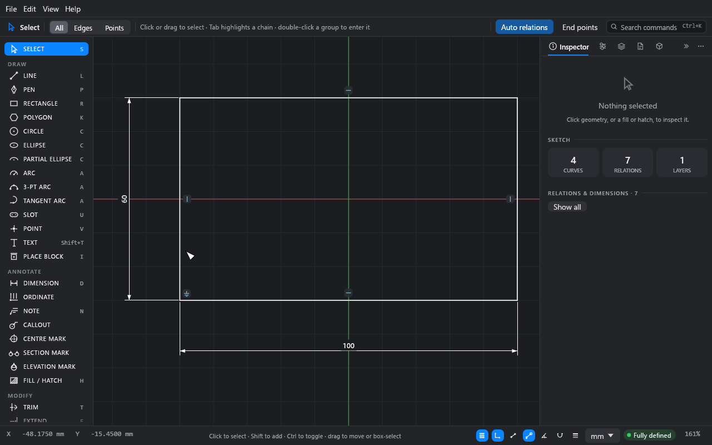
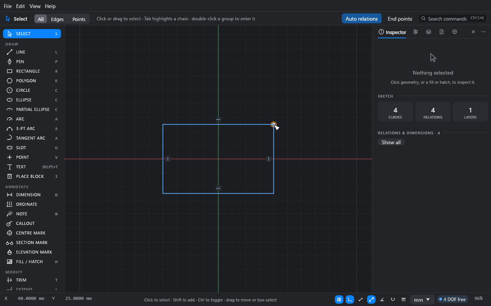
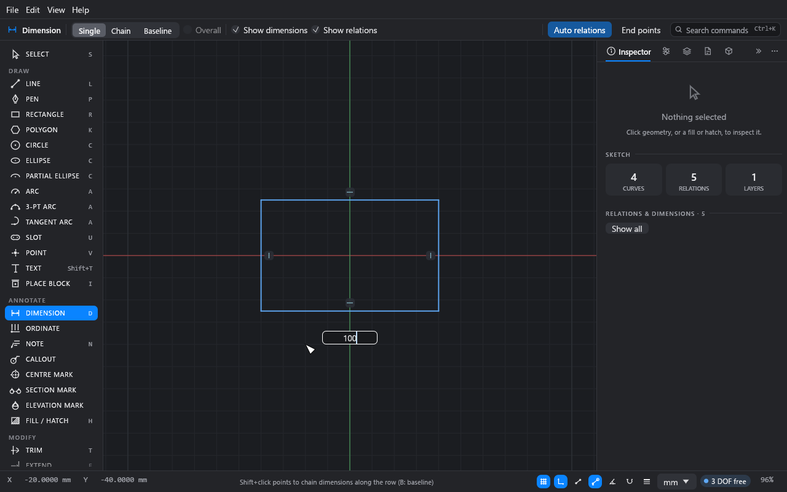
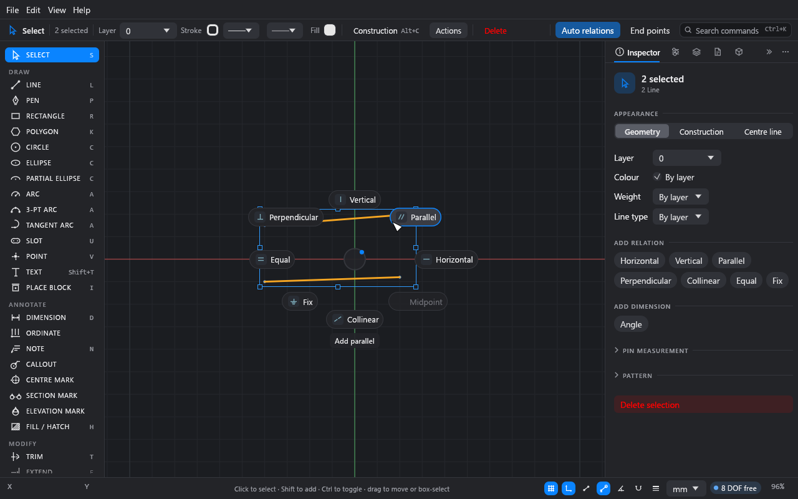
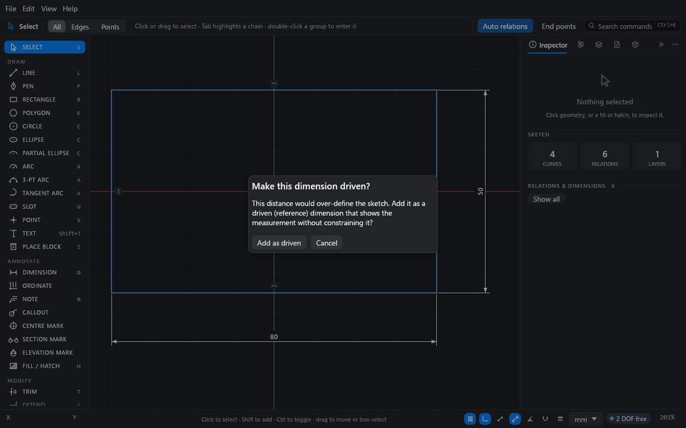
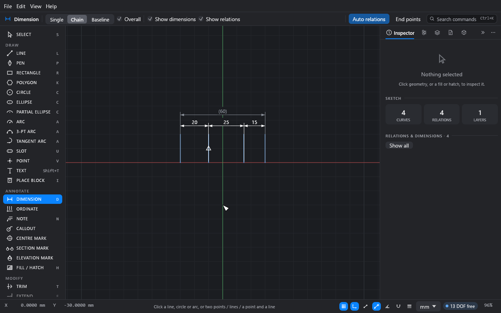

# Constraints and dimensions

**What you'll make:** a 100 × 60 mm rectangle that is fully defined: it can't move or stretch
unless you change a dimension. You'll then ask for one dimension too many and see how Drift
handles it.

Time: about 15 minutes.

## The idea

A sketch in Drift is held in shape by two kinds of constraint:

- **Relations** say how geometry relates: horizontal, vertical, parallel, perpendicular,
  tangent, equal, coincident, concentric, collinear, coradial, midpoint, on curve,
  symmetric, and fix.
- **Dimensions** give sizes: lengths, distances, radii, diameters and angles.

Each point or curve can move in a number of ways, its **degrees of freedom** (DOF). Each
constraint takes some away. When none are left, the sketch is **fully defined**. Drift
solves the constraints continuously: drag something and everything connected follows,
keeping every constraint true.

You don't have to fully define a sketch. Under-defined geometry is fine for exploring; it
just means some things can still move.

## 1. Draw a rectangle and read its status

1. Start a new sketch (Ctrl+N).
2. Press R and click two opposite corners.
3. Press Esc.

The rectangle is blue (under-defined), and the status bar says **4 DOF free**: it can move
left-right and up-down, and stretch in width and height. The small symbols on its sides are
its relations: **—** for horizontal and **|** for vertical. The Rectangle tool adds those
for you.

Try dragging a corner with the **Select** tool. The rectangle stretches but stays
rectangular. Ctrl+Z puts it back.

**View → Free directions** draws small arrows showing which way each point can still move.

## 2. Add dimensions with the Dimension tool

1. Press D for the **Dimension** tool.
2. Click the bottom side, a little away from its middle. (Clicking right at the middle of a
   line picks its midpoint instead; that's useful later.)
3. Move the pointer below the rectangle and click to place the label.
4. A value field opens on the canvas with the current length selected. Type `100` and press
   Enter. The rectangle stretches to 100 mm.

   

5. Click the left side, click to the left of it to place the label, type `60` and press
   Enter.
6. Press Esc.

The status bar now says **2 DOF free**: the size is set, but the rectangle can still slide
around.

The Dimension tool works out the kind of dimension from what you click:

| Click | You get |
|---|---|
| A line | Its length. |
| A circle | Its diameter. |
| An arc | Its radius. |
| Two points | The distance between them: aligned, horizontal or vertical, depending on where you place the label. |
| Two lines | The angle between them, or the distance between them if they run alongside each other (within 1° of parallel). |
| A point and a line | The distance from the point to the line. |

A point can also be a line's midpoint: click near the middle of the line.

After you click the geometry, you can click other geometry to change the dimension before
you place it.

## 3. Fix a corner

1. Press Esc to go back to the **Select** tool.
2. Click the lower-left corner point.
3. In the **Inspector**, under **Add relation**, click **Fix**.

   You can also right-click the point and choose **Add relation → Fix**, or use the
   relations pie (below).

The rectangle turns white and the status bar says **Fully defined**. A ground symbol marks
the fixed point.

## Adding relations

There are three ways to add a relation to what you've picked. Each offers only the
relations that fit the selection (for two lines: parallel, perpendicular, equal, collinear
and so on).

- **The Inspector's Add relation buttons.**
- **The right-click menu's Add relation submenu.**
- **The relations pie.** Hold Q, flick the pointer towards a relation and let go. Or tap Q
  and click one. Each relation always sits in the same place (horizontal to the right,
  vertical up, parallel and tangent upper right, and so on), so you learn the flicks.

In the pie, a relation that's already on the selection is lit, and choosing it takes it off.
Ones that don't fit are dimmed. One that would over-define the sketch says so before you
choose it.

To pick two things, click the first and Shift+click the second.

## Automatic relations

With **Auto relations** on (the top bar), Drift adds relations as you draw: horizontal and
vertical for straight lines, coincident where you snap to a point, on curve where you snap
to a curve, midpoint where you snap to a midpoint, tangent for tangent arcs, and so on. The
modify tools (trim, fillet, offset, mirror…) add theirs too.

Turn it off to draw plain geometry with nothing attached. Relations and dimensions you add
yourself are never affected.

## Edit a dimension

- **Change its value:** double-click the label and type. Any expression works: `60 + 15`,
  `2in`, or a variable name (see [Parameters](03-parameters.md)).
- **Move its label:** drag it.
- **Pick it:** click the label. The **Inspector** shows its text, tolerance and display
  settings (see [Annotation](09-annotation.md)). Delete removes it.
- **Sizes in the Inspector:** a picked line's **Length**, or a circle's **Radius** and
  **Diameter**, can be typed into. If a dimension drives that size, the dimension changes.
  If not, one is added (with **Auto relations** off, the size just changes).

Alt+D hides or shows all dimensions; Alt+R does the same for relation symbols.

## 4. Ask for one dimension too many

The rectangle's top side must be 100 mm, because the bottom is 100 mm and the sides are
vertical. Dimension it anyway:

1. Press D and click the top side, then place the label above.

Drift doesn't add a dimension that would over-define the sketch. Instead it asks:

2. Click **Add as driven**.

A **driven** (reference) dimension shows a measurement but doesn't constrain anything. It's
grey with its value in parentheses, like `(100)`, and it updates as the geometry changes.
To switch a dimension between driving and driven, pick it and use the **Driven (reference)**
checkbox in the **Inspector**. Switching back to driving is checked like a new dimension.

## When a sketch is over-defined

Drift refuses a relation or dimension that conflicts with others, that adds nothing new,
or that would collapse geometry (a line both horizontal and vertical), and says why in a
message at the bottom of the canvas.

If a sketch does end up conflicting (for example after an import or an edit elsewhere),
the curves involved turn red and the status bar says **N conflicting**. To fix it:

- **Remove a relation:** click its symbol on the canvas to pick it, and press Delete. Or
  pick the geometry and use the **×** beside the relation in the **Inspector**'s list.
- **Make a dimension driven** with the **Driven (reference)** checkbox.
- **Clear everything on the selection:** pick the geometry and use **Clear relations** or
  **Clear dimensions** (in the **Inspector**, the right-click menu or the command palette).
  That removes every relation or dimension on those curves and their points, including
  ones that tie them to geometry you didn't pick. Shared corners stay joined. It's one undo
  step.

## Chains, baselines and overall dimensions

For a row of dimensions, set the Dimension tool's mode in the top bar:

- **Single** (default): one dimension at a time. After a horizontal or vertical dimension,
  Shift+click more points to continue the row.
- **Chain**: after the first dimension, each point or line you click adds the next
  dimension along the row. A line counts from its nearer end; walls can be clicked anywhere
  along them, and the chain runs from wall to wall.
- **Baseline**: each dimension is measured from the same base, each a step further out.
- **Overall** (with **Chain**): when the row ends, an overall dimension is added outside it,
  as a reference.

An empty click, Enter or Esc ends the row. B switches between chain and baseline while you
go. Dimensions in a row that would over-define the sketch become driven automatically.

## What you learned

- Relations and dimensions take away degrees of freedom. The status bar counts what's left,
  and colours show it: blue (free), white or black (fully defined), red (conflicting).
- D dimensions whatever you click; where you place the label decides the kind.
- Q opens the relations pie; the **Inspector** and right-click menu offer the same.
- An extra dimension becomes driven instead of over-defining the sketch.

## Next

[Parameters](03-parameters.md): drive dimensions from named variables, and switch between
variants.
