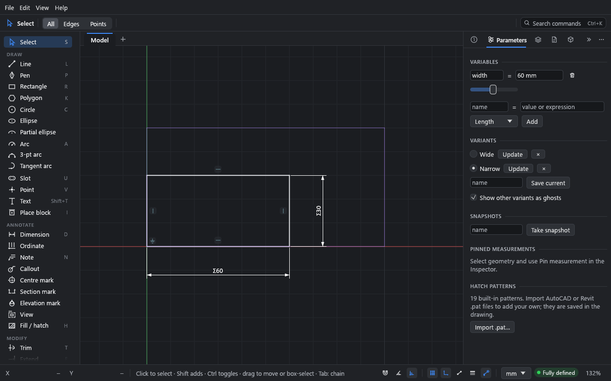

# Parameters

**What you'll make:** a panel whose width is a named variable, `width`, and whose height is
always half of it. You'll save two options, *Wide* and *Narrow*, and switch between them.

Time: about 10 minutes.

## Before you start

You need a rectangle with its width and height dimensioned and one corner fixed. Use the
one from [Constraints and dimensions](02-constraints-and-dimensions.md), or draw a new one:
R and two clicks, then D on the bottom and on one side, then pick a corner and **Fix** it.

## 1. Add a variable

1. Open the **Parameters** panel: click its tab (the sliders icon) beside **Inspector**.
2. Under **Variables**, type `width` in the **name** field and `100` in the
   **value or expression** field.
3. Leave the kind on **Length** and click **Add** (or press Enter).

The variable appears with its value and a slider. The kind can be **Length**, **Angle** or
**Number**; mixing kinds wrongly (adding a length to an angle) is an error with a plain
message.

## 2. Link dimensions to it

1. Double-click the width dimension on the canvas.
2. Type `width` and press Enter.
3. Double-click the height dimension, type `width / 2` and press Enter.

Linked dimensions show **Σ** before their value. Their text is the expression, so
double-clicking one shows `width / 2` again.

> A leading `=` is optional in a dimension's value field: `=width/2` and `width / 2` do the
> same. While drawing you need it; see below.

## 3. Drive the sketch

- **Type a new value:** click the variable's value field, type `120` and press Enter. The
  panel resizes and its height follows.
- **Scrub it:** drag the slider. The sketch re-solves live as you drag. A value the sketch
  can't take is skipped, and releasing the slider makes one undo step.

Each change is one undo step. A change that would break the sketch (a negative length, or a
conflict) is refused with the reason, and nothing moves.

## 4. Save options

An option is a state of the drawing you can come back to in one step. It is saved in the
file. Each option is one of two kinds, chosen beside **Save current**:

- **Values only:** the variables' values. Applying it sets them, and the sketch follows.
- **Whole sketch:** a copy of everything in the drawing. Applying it brings the drawing back
  as it was, which is good for trying something out.

1. Set `width` to `100`. Under **Options**, type `Wide` in the **name** field, leave the kind
   on **Values only** and click **Save current**.
2. Set `width` to `60`. Save it as `Narrow`.
3. Click the dot beside an option's name to apply it. The option the drawing is in is marked.
4. **Update** stores the drawing as it is now in that option, and **×** deletes it.
   Double-click a name to rename it. Each of these is one undo step.
5. Click an option's eye to draw it faintly behind the sketch as a ghost. Ghosts are
   worked out again when an edit is finished, not while you drag.

The command palette (Ctrl+K) can also save an option, apply one, or show its ghost.

## Expressions

Anywhere Drift takes a value (a dimension, a variable, a field in the **Inspector**, a size
typed while drawing), you can type an expression:

- Arithmetic: `+ - * / ^` and brackets.
- Functions: `sqrt abs min max hypot round floor ceil sin cos tan asin acos atan atan2`,
  and the constant `pi`.
- Units on any term: `100mm + 2in`, `30deg`, `1'-6 1/2"`. A unit after a term applies to
  the whole product before it, so `100/2 mm` is 50 mm.
- Variables by name: `width / 10`, `hypot(width, depth)`.
- Variables can use other variables. A circular reference is reported
  (`circular reference: a → b → a`), and a variable can't be deleted while something uses
  it. Renaming a variable updates every expression that uses it.

While drawing, typing starts on a digit, so to start a typed value with a variable name,
press `=` first: `=width/2`. Once typing has started, letters go into the field.

Bare numbers take the display unit for lengths (inches for feet-and-inches) and degrees for
angles, also inside an expression: `spacing + 60` adds 60 mm in a millimetre drawing (a
bare number in a product is just a factor: `spacing * 2`). Drift writes the unit into the
stored expression (`spacing + 60 mm`), so changing the display units later never changes a
value.

## Pinned measurements

To keep an eye on a distance, length or angle that isn't dimensioned, pick the geometry,
open **Pin measurement** in the **Inspector**, and pin it. Pinned measurements are listed
with live values under **Pinned measurements** in the **Parameters** panel, and update as you edit.
**Unpin** removes one.

## What you learned

- Variables live in the **Parameters** panel; a dimension linked to one shows **Σ**.
- Sliders scrub a variable and re-solve live.
- Options store variable values or the whole sketch; an option's eye shows it as a ghost.
- Expressions with units and variables work in every value field.

## Next

[Editing](04-editing.md): select, move, rotate, scale and reshape geometry.
