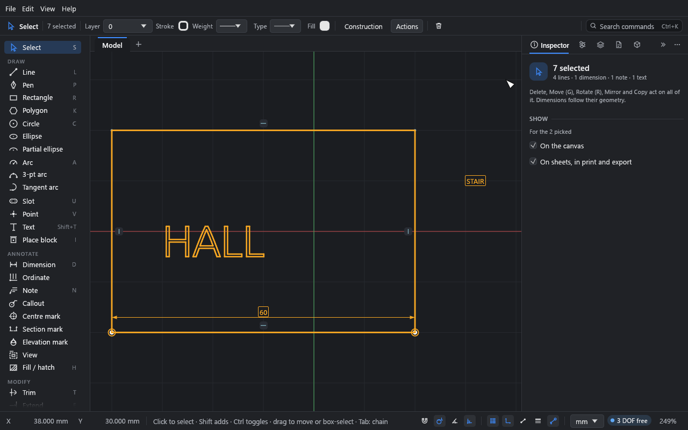
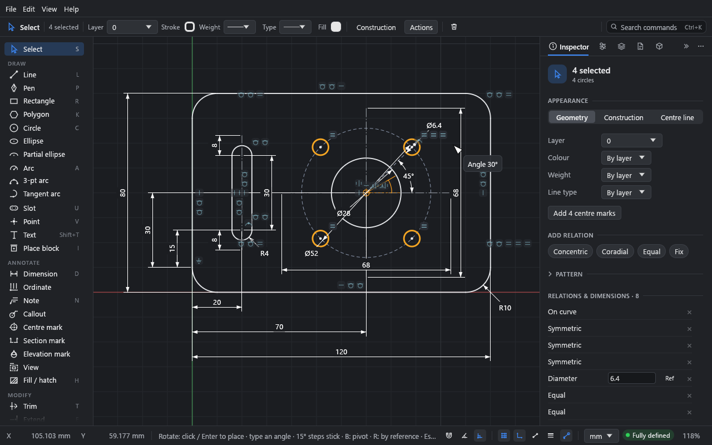
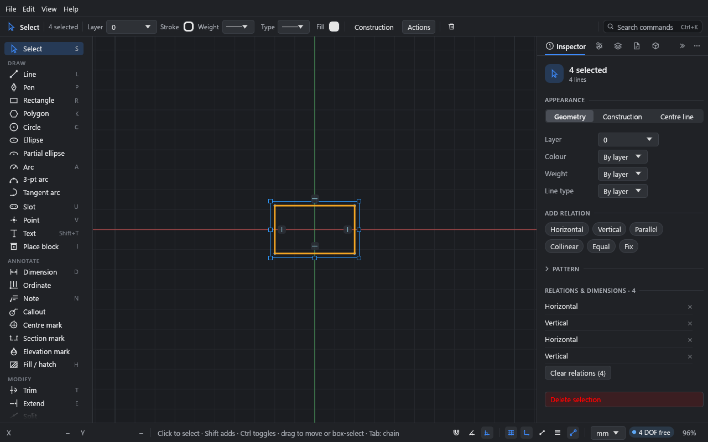
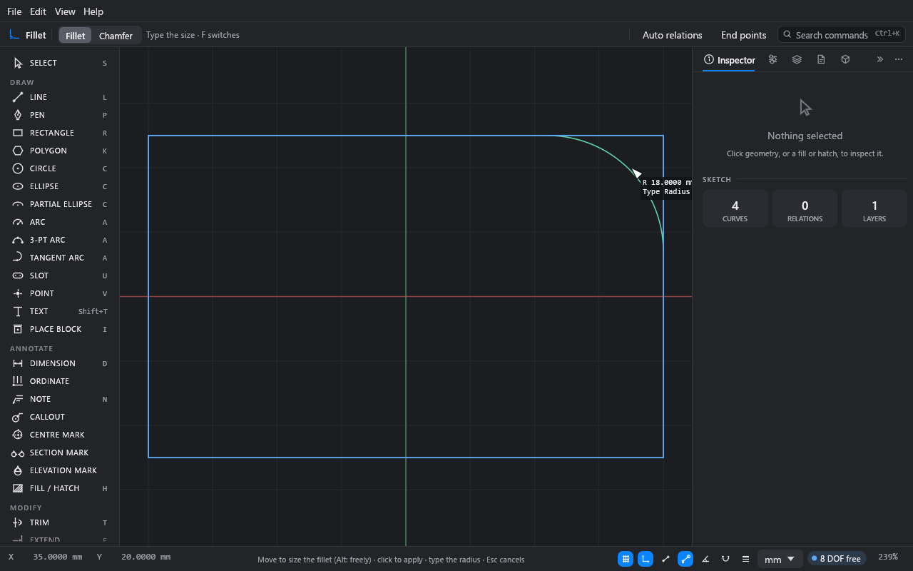

# Editing

**What you'll do:** work on the example plate and a rectangle of your own: pick things in
different ways, move and turn them with typed values, scale with handles, and reshape
corners and outlines with the modify tools.

Time: about 20 minutes. Each section stands alone.

Open the example (**File → Open example**) to follow along. It's an unsaved copy, so you
can't harm it.

## Select

With the **Select** tool (S, or Esc from any tool):

| To | Do this |
|---|---|
| Pick one thing | Click it. |
| Add to the selection | Shift+click. |
| Toggle in or out | Ctrl+click. |
| Pick everything inside a box | Drag from left to right (a window selection). |
| Pick everything the box touches | Drag from right to left (a crossing selection). |
| Pick a line's midpoint | Click near the middle of the line. |
| Pick everything (that the pick filter lets through) | Ctrl+A. |
| Clear the selection | Esc, or click empty canvas. |

Clicking inside a fill or hatch picks it. Clicking inside an empty outline picks nothing, so
a box selection can start there. (To pick a closed area and measure it instead, turn off
**File → Drawing settings… → Closed areas and fills → Pick an area only where it is
filled or hatched**; it is saved with the drawing.
A picked area shows its area, perimeter and centroid in the **Inspector**.)

### Pick filters

With nothing picked, the top bar shows what the Select tool picks: a toggle for each kind
of thing, all on by default. Turn any off, in any mix, as with the selection filters in
AutoCAD, Rhino or Vectorworks:

| Toggle | Picks |
|---|---|
| **Points** | End points, centres and standalone points. With **Edges** off, a box takes every point inside it. |
| **Edges** | Lines, arcs, circles, ellipses and curves (and the relation symbols on them). |
| **Fills** | Solid fills and hatches. With **Edges** off, a click inside a shape picks its fill without its outline. |
| **Areas** | Empty closed areas (to measure or fill them). |
| **Blocks** | Copies of blocks, and groups as a whole. Off, a click on a grouped line picks just that line. |
| **Text** | Sketch text. |
| **Annotations** | Dimensions, notes, callouts, centre marks, ordinates, and section and elevation marks. |

- **Alt-click** or **double-click** a toggle to pick only that kind.
- **All** turns every toggle back on.
- While a filter is on, the **Select** tool in the toolbar has an orange dot; hover over it
  to see what is picked.

The filter applies to clicks, boxes, hover and Select all (Ctrl+A). It isn't saved with the
drawing. The command palette has each one too (Ctrl+K, "Select fills only", "Select
everything").

### Text and annotations in a selection

A box picks text, dimensions and annotations as well as geometry, as in AutoCAD:

- A window (dragged left to right) takes a dimension when all of it is inside the box: its
  number, its dimension line and its extension lines. A note, callout or mark is taken when
  its text, leaders and lines are all inside, and a text when its whole outline is.
- A crossing box (dragged right to left) takes anything it touches.

Shift+click adds a dimension, note or text to what is picked; Shift+drag adds a whole box.
With a mix picked, the **Inspector** sums it up ("4 lines · 1 dimension · 1 note · 1 text")
and shows where the annotations appear. What you do then acts on all of it:

- **Delete** removes all of it, as one undo step.
- **Move** (G, dragging, the arrow keys) and **Rotate** (R) take the text and annotations
  along. A note keeps its leader's tip on the geometry it points at; its text moves. Callouts,
  centre marks and ordinates follow their geometry, and dimensions always do.
- **Mirror**, **Shift+D** and **Ctrl+C / Ctrl+V** copy them with the geometry. Mirrored text
  still reads forwards, and a mirrored section mark looks the other way. A copied section or
  elevation mark is a new mark, not linked to the original's view.

### Chains with Tab

Hover over a curve and press Tab. The whole chain it belongs to (curves joined end to end)
is highlighted, as in Revit. Click to pick the chain; Shift+click adds it, Ctrl+click takes
it away. Press Tab again to go back to the single curve.

With nothing under the pointer, Tab widens the current selection to whole chains.

## Move with G

The plate is fully defined, so its geometry can't move. Draw something free to move: press
R and click two corners beside the plate, then press Esc.

1. Drag a box round the new rectangle, from left to right, to pick its four sides.
2. Press G. The rectangle follows the pointer.
3. Press X to lock the move to the X axis (Y for the Y axis).
4. Type `10` and press Enter. The rectangle moves exactly 10 mm.

Without an axis lock, type the X offset, Tab, then the Y offset. Press B to choose a
different base point first: click a point (it snaps), then move. Click or Enter places; Esc
or a right-click cancels. Snapped and typed moves land exactly.

G moves a line picked by its midpoint too, from the midpoint.

### Moving a picked area or hatch

A picked hatch (or area) moves with its outline: press G, or drag inside it. Lines that
aren't part of it but share a corner with it, like a wall running on past a room, behave
according to **Auto relations**:

- **On:** the joins hold, so those lines stretch to follow.
- **Off:** the outline lets go of them. They stay where they are and the join is split.
  One Ctrl+Z puts it back, joined.

Picked lines moved on their own always stretch the lines joined to them.

Other ways to move:

- **Drag** picked geometry. Drop an end point on another point to join them. X or Y while
  dragging locks the drag to that axis, as in a G move (press it again to unlock); once
  locked, type a distance and press Enter to place it exactly.
- **Arrow keys** nudge the selection one grid step; Shift+arrow, ten.
- **Inspector fields:** type a new **Start**, **End**, **Center** or **Position**. The
  geometry moves as far as its relations let it.

## Duplicate, copy and paste

- Shift+D duplicates the selection in place and starts moving the copy, as in Blender.
- Ctrl+C, Ctrl+X and Ctrl+V copy, cut and paste. Paste lands under the pointer and goes
  straight into a move. Ctrl+Shift+V pastes in place. Copies keep their relations and
  dimensions, and the clipboard works between Drift windows.

## Rotate with R

1. Pick the rectangle you moved.
2. Press R. The guide shows the pivot (the middle of the selection), where you started and
   the angle so far.
3. Move the pointer round. Multiples of 15° stick as you pass them.
4. Type `30` and press Enter for an exact turn, or click.

Press B to pick a different pivot; it snaps to points and the grid. Esc or a right-click
cancels. While turning, snapping onto a point gives the exact angle to it.

### Rotate by reference

To turn an edge onto a line, as AutoCAD's Rotate → Reference does:

1. Pick the geometry and press R.
2. Press B and click the pivot, for example the corner the edge starts from.
3. Press R again and click the reference: the edge's other end, or any point along it.
4. Move to the target line and click when the pointer snaps onto it. The edge turns to meet
   it.

A typed angle turns that far from the reference.

Quarter turns are exact. A turn by another angle removes horizontal and vertical relations
inside the selection, and Drift says so. Geometry held in place by its relations (like the
plate's holes) can't be turned. Without a selection, R is the Rectangle tool.

## Scale with the transform handles

Pick two or more curves (or a picked area) with the **Select** tool. A box with handles
appears round them.

| Drag | To |
|---|---|
| A corner handle | Scale. |
| A side handle | Stretch in one direction. |
| Just outside a corner | Turn the selection about the box's middle. |

While dragging:

- Shift keeps the shape (scales evenly).
- Ctrl scales about the middle instead of the opposite corner.
- Alt scales the dimensions too.

Without Alt, dimensions and relations hold: a dimensioned width stays as it is while a free
height stretches. With Alt, every driving length entirely inside the selection takes its
new, scaled value. The width and height then step through round sizes, finer as you zoom
in; turn that off with **Edit → Preferences… → Drawing aids → Round sizes when scaling with dimensions
(Alt)**. Each scale is one undo step.

## Trim, extend and split

- **Trim** (T): click a piece of a curve to remove it, up to the curves that cross it. Or
  drag across several pieces: the drag leaves a trail and trims everything it crosses.
- **Extend** (E): click near the end of a line or arc to lengthen it to the next curve.
- **Split** (in the tool palette; no key): click a curve where it should be cut in two. A
  circle or ellipse becomes two halves.

These work on lines, arcs, circles, ellipses and pen curves. With **Auto relations** on,
the pieces stay related (a split line's parts stay collinear; trimmed ends stay on the
cutting curve).

## Fillet and chamfer

1. Draw a rectangle (R and two clicks).
2. Press F for the **Fillet** tool.
3. Click a corner. Move the pointer inwards: the fillet passes under the pointer, sized in
   round steps (hold Alt for any size).

   

4. Click to apply it. Or type a radius and press Enter.

A second click without moving reuses the last size. Esc or a right-click cancels.

Press F again for the **Chamfer** tool. Type its distance, and Tab for a second distance.

A fillet or chamfer takes the look of the corner's lines: round a corner of construction
lines and the arc is construction too.

A fillet or chamfer that's already there can be resized: click it with the same tool, or
drag a fillet's arc with the **Select** tool. Its lines keep their directions. To put the
sharp corner back, right-click it and choose **Remove fillet** or **Remove chamfer**.

## Offset and mirror

- **Offset** (O): click a curve. Its whole connected chain is picked. Click the side to
  offset to, or type the distance and press Enter. Corners rejoin. Offset lines stay
  parallel to the original, at a dimensioned distance.
- **Mirror** (M): pick the geometry first with **Select**, press M, and click the line to
  mirror about. The copies are held symmetric to the originals.

## Patterns

Pick geometry, then open **Pattern** in the **Inspector**:

- **Linear:** a **Count** and a spacing (**Spacing X**, **Y**), then **Make linear pattern**.
- **Circular:** a **Count**, an **Angle** and a centre (**Centre X**, **Y**), then
  **Make circular pattern**. 360° spreads the copies evenly round the circle.

Copies keep the relations within the selection. The fields take expressions.

## Groups

- Ctrl+G groups the selection; Ctrl+Shift+G ungroups. (Also in **Edit** and the top bar's
  **Actions** menu.)
- Clicking any member picks the whole group, and moves and turns take it together.
- Double-click a group to edit inside it: members pick one by one, and anything you draw
  joins the group. Esc, or a click outside, leaves it.
- The **Inspector** shows a picked group's name (rename it there), member count,
  **Edit in place**, **Ungroup** and **Make block** (see
  [Groups and blocks](07-blocks.md#groups-and-blocks): a group is one thing; a block is a
  thing you reuse).

## Delete and undo

- Delete (or Backspace) deletes the selection. A fill goes with its boundary.
- Ctrl+Z undoes, Ctrl+Y or Ctrl+Shift+Z redoes. The **Edit** menu names what it will undo.

## What you learned

- Click, Shift, Ctrl and box selection; filters; Tab for chains.
- G moves and R rotates, with X / Y locks, typed values and B for the base point or pivot.
  R again rotates by reference.
- The transform box scales and stretches; Alt scales the dimensions with it.
- T, E, F, O and M trim, extend, fillet, offset and mirror; Split and patterns are in the
  palette and **Inspector**.

## Next

[Temporary dimensions](05-temporary-dimensions.md): set distances between walls the way
Revit does.
