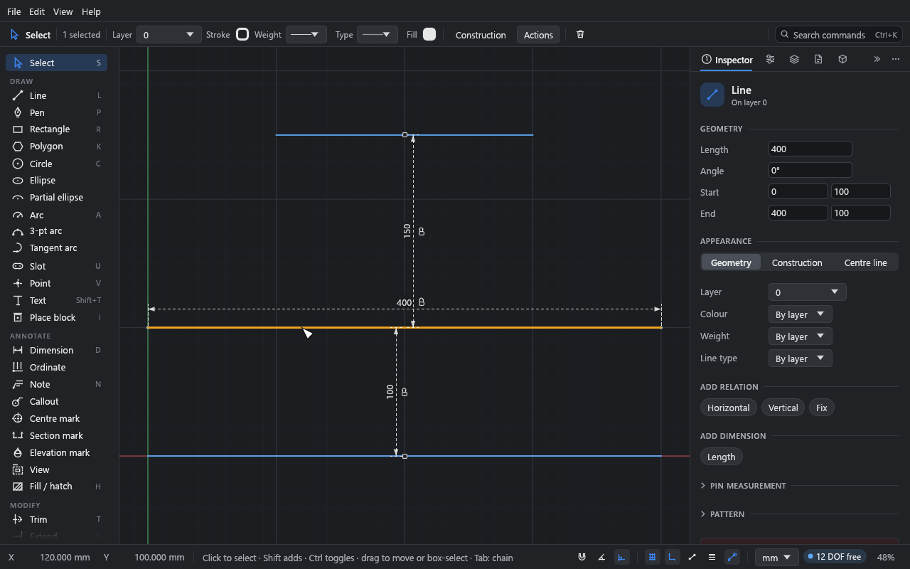
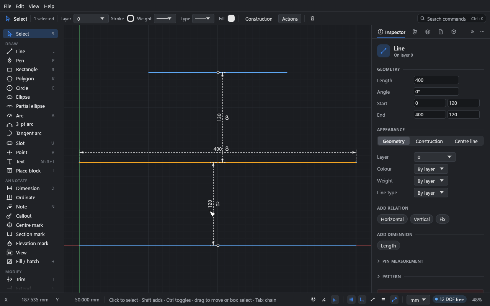

# Temporary dimensions

**What you'll do:** draw three walls and set the distance between two of them by typing a
value, the way Revit's temporary dimensions work. Then keep one of those distances as a real
dimension.

Time: about 5 minutes.

## How they work

Pick one line, circle or arc with the **Select** tool and dashed dimensions appear beside it:

- **A line:** its length, and the distance to the nearest parallel line alongside it on
  each side.
- **A circle:** its diameter.
- **An arc:** its radius.

Sizes a real dimension already shows are left out. Nothing is added to the sketch until you
ask.

## 1. Draw three walls

1. Press L, click a start point, move the pointer to the right, type `400` and press Enter.
   Press Esc to end the line.
2. Draw a second line the same way, about 100 above the first. Press Esc.
3. Draw a shorter line (type `200`) about 150 above that one. Press Esc twice to get back
   to **Select**, and Shift+F to fit them in the window.

The exact distances between the lines don't matter.

## 2. Pick the middle wall

Click the middle line, away from its middle (clicking right at its middle picks the
midpoint instead).

## 3. Type a new distance

1. Click the value between the middle wall and the bottom wall.
2. Type `120` and press Enter.

The middle wall moves so it's 120 from the bottom wall. The bottom wall stays where it is:
the picked geometry is what moves. The distance to the top wall updates.

It's one undo step, and nothing is left holding the wall at 120. If the wall's own
relations hold it in place, Drift says so and nothing moves.

Typing the line's length changes its length; for a circle or arc, its size. The far end
stays put.

## 4. Keep it as a dimension

Click the lock beside a value. It becomes an ordinary dimension where it stands, and from
then on holds that distance. (If the sketch already holds that distance, it's added as a
driven dimension instead, shown in parentheses.)

## 5. Measure to something else

Each temporary dimension that measures to other geometry has a small square at its far end.
Drag the square onto a point, or onto another line beside the picked one, to measure to
that instead. The choice is kept as long as the same curve stays picked.

## Turning them off

**Edit → Preferences… → Drawing aids → Show temporary dimensions on the picked geometry.**

Temporary dimensions don't yet appear for points, for two picked curves, or between a wall
and the walls that cross it.

## What you learned

- Picking one line, circle or arc shows its size and the gaps to its neighbours.
- Typing a value moves the picked geometry; the lock makes the value permanent.
- The square at the far end chooses what to measure to.

## Next

[Fills and hatches](06-fills-and-hatches.md).
