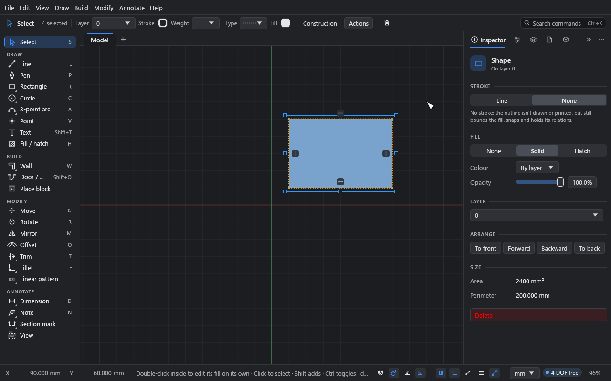

# Fills and hatches

**What you'll make:** the example plate, hatched, with its bore filled solid. Then you'll
copy a style with the eyedropper and set a hatch's origin and angle on the canvas.

Time: about 10 minutes.

## How fills work

A fill or hatch fills a **closed area**: a region bounded by solid curves. Holes inside it
(islands) are left out. Fills are associative: when the geometry changes, the fill
follows. If curves of its outline are deleted, it takes the area its seed is in now (the
point where it was first clicked), and a notice says so; with no area left there, it goes.
If an edit cuts open the outline of one of its holes, the hole stays out of it: the fill keeps
to the part of its area that is still closed off from the hole. If its boundary breaks some
other way (a gap opened), the fill keeps its last shape and the **Inspector** offers
**Re-pick boundary**. When an edit brings two fills onto one area (two
filled shapes trimmed into one outline, the wall between two filled rooms deleted), the one
drawn on top keeps the area and the other is removed; a notice says so, and undo brings it
back.

Where two shapes' lines lie along each other, each fill is bounded by its own shape's lines,
so picking or moving one doesn't bring the other's lines along.

Construction geometry doesn't close areas. Neither, if you turn on **File → Drawing settings… →
Closed areas and fills → Find closed areas on each layer separately**, do curves on other layers.

## 1. Choose the style first

1. Open the example (**File → Open example**).
2. Press H for the **Fill / hatch** tool.
3. In the top bar (or the **Inspector**, under **New fills**), choose **Hatch**. Leave the
   pattern as it is.

The tool's settings are the style of the *next* fill, whatever is picked.

## 2. Fill

1. Move the pointer over the plate, between the holes. The area that will be filled is
   highlighted.
2. Click. The plate is hatched; the bore, the slot and the bolt holes stay open.
3. In the top bar, choose **Solid**.
4. Click inside the bore. It's filled solid.

A fill you've just made stays picked. Clicking a fill again with the tool gives it the
current style.

## Fill as you draw

With the **Rectangle**, **Polygon**, **Circle**, **Ellipse**, **Slot** or **Pen** tool
active, tick **Fill** in the top bar and choose **Solid** or **Hatch** and the colour or
pattern: every closed shape you draw comes out filled in that style, as part of the same
undo step (a pen path is filled when you close it on its first point). The style is the
Fill tool's, so the eyedropper and the **Inspector**'s **New fills** section set it too.

## Shapes

A shape drawn with one of those tools (or a pen path closed on its first point) is recorded
as one shape, whether or not it is filled. Its fill is the area inside its own outline,
whatever else crosses it or lies inside it, and it stays whole through splits, fillets and
chamfers of its sides. A fill clicked inside such a shape with the Fill tool is the shape's
too. Deleting or trimming away a side opens the shape: its fill then takes the area that what
is left of the shape, with the curves around it, still closes around the fill (a filled ring
trimmed through between two lines becomes a cut ring, with the cut-out part left empty), and
a notice gives the new area. If nothing closes around it, the fill keeps its last area until
the ends meet again, and the notice says so. Trimming open the outline of a hole in a shape
works the same way: the hole is never filled (moving a hole, even across the outline, changes
nothing). While its fill covers such an area, the shape picks, moves and copies as an area
fill does. Trimming two shapes into each other joins them into one shape with one fill (the
one drawn on top). Shapes lying inside a shape are left out of its fill as holes, as they are
of any area's; a shape with a fill of its own covers what is beneath it anyway.

## 3. Copy a style with the eyedropper

Hold Alt and click a fill or hatch with the **Fill / hatch** tool. Its style becomes the
style for new fills. Or click **Pick up a style** and then click the fill; Esc leaves the
eyedropper. It works on the fills inside block copies too.

## 4. Edit a fill

Pick a fill with the **Select** tool by clicking inside it. Inside a filled **shape** (see
[Shapes](#shapes)), the click picks the whole shape, its outline with its fill, as in a
drawing program: **Duplicate** (Shift+D), copy and paste, move and **Delete** act on all of
it, and a copy is a shape of its own with its own fill. A fill of an area among several
shapes' lines is picked on its own.

A picked shape shows in the **Inspector** as one object, whether you picked it by its fill
or by its whole outline (a group of it, say):

- **Stroke:** **Line** or **None**. With a line: its **Colour**, **Weight** and **Line
  type**, each "By layer" unless set. **None** hides the outline: it isn't drawn or
  printed (it shows dashed only while picked or hovered), but it still bounds the fill,
  snaps and keeps its relations.
- **Fill:** **None**, **Solid** or **Hatch**. For a solid fill: **Colour** and **Opacity**.
  For a hatch: **Pattern**, **Scale**, **Angle** (for one picked hatch, under **Pattern
  alignment** below), **Size** (**Drafting** or **Model**), the
  **Lines** colour and **Weight**, and a **Background** colour. **None** removes the fill
  and leaves the shape, picked by its outline.
- **Layer** (the outline and the fill move together), **Arrange** (see
  [What draws over what](#what-draws-over-what)), **Area** and **Perimeter**, and
  **Delete** (the whole shape).

A fill of an area among several shapes' lines (a room among walls, say) is a fill of its
own: its **Inspector** shows its **Style** (as **Fill** above, without **None**), **Layer**,
**Arrange**, **Area**, **Perimeter** and **Centroid**, and **Delete**.

When the picked curves include whole filled shapes and more (a group of a shape and other
lines), the curves' **Inspector** has a **Fill** section for those shapes too.

Any curve can be given no stroke the same way: **Line type → None** in its **Inspector**.

**Drafting** patterns keep the same size on paper whatever the sheet's scale. **Model**
patterns have a real size (brick courses, block joints) and scale with the drawing, as in
Revit.

## 5. Align a hatch's pattern

Pick a hatched shape (click inside it) and its pattern gets two purple handles of its own,
inside the shape:

- The **square** handle is the pattern's origin. Drag it to move the pattern; it snaps to
  points, so you can start the pattern exactly on a corner.
- The **round** handle turns the pattern, in 15° steps (hold Alt to turn it freely).

Hover over a handle to see which is which. While the whole shape is picked, an origin on
its outline (a corner, say) is shown in the middle of the shape, clear of the transform
box's handles; the pattern still starts where the origin is.

For one picked hatch, the **Inspector** has **Pattern alignment** (in **Fill** for a shape,
in **Style** for the hatch of an area among several shapes' lines):

- **Origin**: type X and Y (units, variables and expressions work, as in any field), or
  click a corner or the centre of the small square below them.
- **Angle**: type an angle, or click **Align to edge…** and then one of the shape's edges.
  The pattern runs along that edge, with its origin on the edge's start: the way courses of
  brick or tile are set out along a wall. Esc cancels.
- **Reset** puts the origin back on the drawing's origin and the angle at 0°.

To work on the pattern alone, **Alt-click** or **double-click** inside the shape: that picks
its fill without its outline, so the transform box is out of the way. In a group,
double-click once to go into the group (the shape is picked), and again for its fill. (A
single click inside a grouped shape picks the whole group, fills and all.)

Moving or turning a shape carries its pattern with it, so the pattern stays where it was on
the shape; stretching or mirroring it leaves the pattern where it is. Each change is one
undo step.

## Patterns

The built-in patterns are ANSI31 to ANSI38, STEEL, CONCRETE, EARTH, INSULATION, GLASS,
WOOD, GRID, DOTS and SAND, plus BRICK and BLOCK as model patterns. The pattern menu shows a
swatch of each.

To use your own AutoCAD or Revit patterns, go to **Parameters → Hatch patterns → Import
.pat…**. Imported patterns are stored in the drawing, so they travel with the file.

A fill belongs to the curves around it: move or reshape them and it follows. A line drawn
across a fill doesn't cut it: the fill keeps its whole area, and is marked **Covers 2
areas** on the canvas. Pick it and the **Inspector** offers **Fit to its seed's area**,
**Split into 2** (one fill per area, in the same style) or **Keep whole** (which clears the
mark). A curve drawn across a fill never changes its area. When an edit cuts the outline
itself (a side split where another line crosses it, say), the fill is kept whole and marked
the same way; to have it take the area where it was first clicked instead, choose **Follow
where it was first clicked** under **When an edit divides a filled area** in **File →
Drawing settings… → Closed areas and fills** (the default is **Keep whole and flag**; saved
with the drawing).

Hatches are clipped exactly to their boundary and stay crisp at any zoom. A hatch too dense
to see at the current zoom is drawn as a tint.

## What draws over what

Each fill covers what is beneath it, with its own outline drawn over it, as a drawing
program stacks shapes. Layers stack in their order in the **Layers** panel (drag them to
reorder). On a layer, each new fill goes over the ones before it, and lines that outline no
fill stay on top.

To change the order on a layer, pick fills or shapes (click inside a fill, or on any line
of its outline: the shape moves as one) and choose **Arrange** in the right-click menu, **Modify →
Arrange**, or the **Inspector** (**To front**, **Forward**, **Backward**, **To back**):

| Command | Shortcut | Moves it |
|---|---|---|
| **Bring to front** | Ctrl+Shift+] | over everything on its layer |
| **Bring forward** | Ctrl+] | over the next thing above it that it overlaps |
| **Send backward** | Ctrl+[ | under the next thing beneath it that it overlaps |
| **Send to back** | Ctrl+Shift+[ | under everything on its layer |

Lines that outline no fill can be arranged the same way, so a line can go under a fill
that covers it. Each command is one undo step, and the order is saved with the drawing.

Printing, PDF and SVG draw everything in the same order as the canvas. An SVG keeps a
named group per layer. DXF has no draw order of its own: the fills are written in this
order, which most programs follow.

The drawing setting **Fills cover what is beneath them** (**File → Drawing settings…**)
turns this off: then every fill draws beneath every line, on screen and on paper alike, as
a CAD overlay.

## Fill colours and layers

A fill takes its colour from its layer unless you give it one. Each layer has a stroke
colour and a separate fill colour (**Same as stroke** by default); set them in the
**Layers** panel or with the top bar's **Fill** swatch.

## What you learned

- H fills or hatches a closed area; set the style before you click.
- Alt+click picks up a fill's style.
- A picked hatch's square handle moves its origin; the round one turns it. **Pattern
  alignment** in the Inspector types them, or aligns the pattern to an edge.
- Drafting patterns are sized on paper, model patterns in the world.
- Each fill covers what is beneath it; **Arrange** (Ctrl+] and Ctrl+[) changes the order,
  and print matches the screen.

## Next

[Blocks](07-blocks.md).
