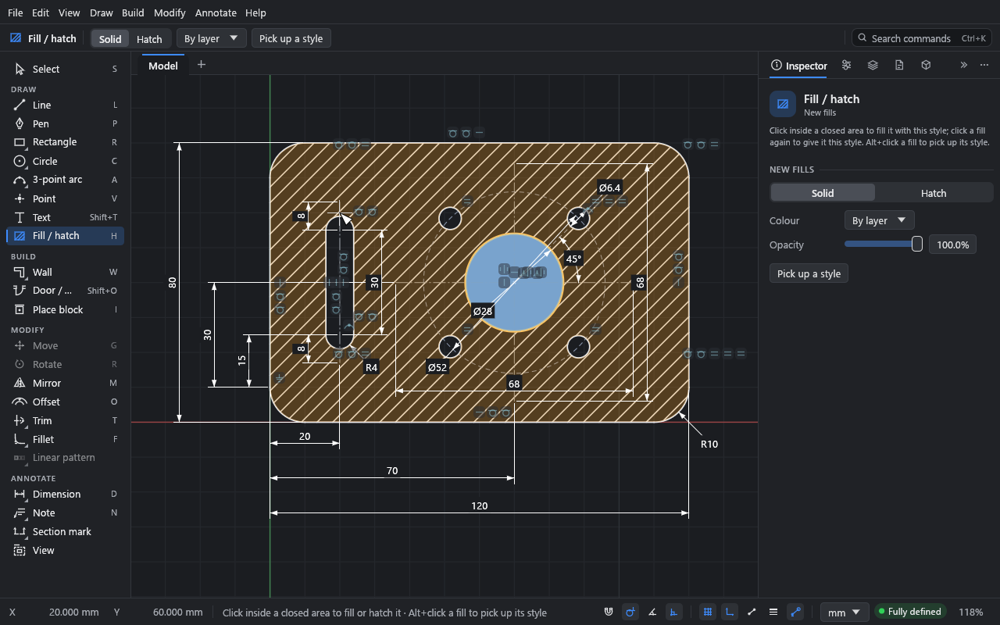
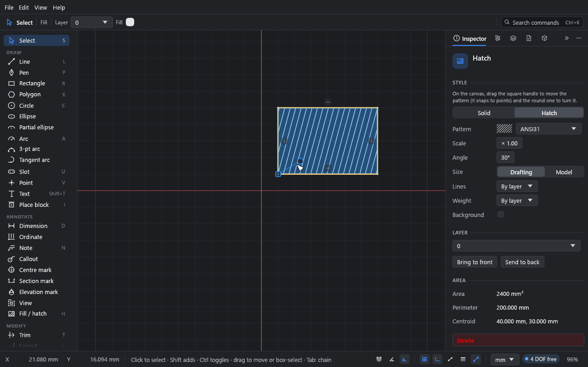

# Fills and hatches

**What you'll make:** the example plate, hatched, with its bore filled solid. Then you'll
copy a style with the eyedropper and set a hatch's origin and angle on the canvas.

Time: about 10 minutes.

## How fills work

A fill or hatch fills a **closed area**: a region bounded by solid curves. Holes inside it
(islands) are left out. Fills are associative: when the geometry changes, the fill
follows. If curves of its outline are deleted, it takes the area its seed is in now (the
point where it was first clicked), and a notice says so; with no area left there, it goes.
If its boundary breaks some other way (a gap opened), the fill keeps its last shape and the
**Inspector** offers **Re-pick boundary**. When an edit brings two fills onto one area (two
filled shapes trimmed into one outline, the wall between two filled rooms deleted), the one
drawn on top keeps the area and the other is removed; a notice says so, and undo brings it
back.

Where two shapes' lines lie along each other, each fill is bounded by its own shape's lines,
so picking or moving one doesn't bring the other's lines along.

Construction geometry doesn't close areas. Neither, if you turn on **Edit → Preferences… →
Drawing aids → Find closed areas on each layer separately**, do curves on other layers.

## 1. Choose the style first

1. Open the example (**File → Open example**).
2. Press H for the **Fill / hatch** tool.
3. In the top bar (or the **Inspector**, under **New fills**), choose **Hatch**. Leave the
   pattern as it is.

The tool's settings are the style of the *next* fill, whatever is picked.

## 2. Fill

1. Move the pointer over the plate, between the holes. The area that will be filled is
   highlighted.
2. Click. The plate is hatched; the bore, the slot and the bolt holes stay open.
3. In the top bar, choose **Solid**.
4. Click inside the bore. It's filled solid.

A fill you've just made stays picked. Clicking a fill again with the tool gives it the
current style.

## Fill as you draw

With the **Rectangle**, **Polygon**, **Circle**, **Ellipse**, **Slot** or **Pen** tool
active, tick **Fill** in the top bar and choose **Solid** or **Hatch** and the colour or
pattern: every closed shape you draw comes out filled in that style, as part of the same
undo step (a pen path is filled when you close it on its first point). The style is the
Fill tool's, so the eyedropper and the **Inspector**'s **New fills** section set it too.

## 3. Copy a style with the eyedropper

Hold Alt and click a fill or hatch with the **Fill / hatch** tool. Its style becomes the
style for new fills. Or click **Pick up a style** and then click the fill; Esc leaves the
eyedropper. It works on the fills inside block copies too.

## 4. Edit a fill

Pick a fill with the **Select** tool by clicking inside it. The **Inspector** shows:

- **Style:** **Solid** or **Hatch**. For a solid fill: **Colour** and **Opacity**. For a
  hatch: **Pattern**, **Scale**, **Angle**, **Size** (**Drafting** or **Model**), the
  **Lines** colour and **Weight**, and a **Background** colour.
- **Layer**, and **Bring to front** / **Send to back** for the order among fills on that
  layer. Fills on a higher layer draw over those on lower ones (drag layers to reorder
  them in the **Layers** panel). Fills always draw beneath curves.
- **Area**, **Perimeter** and **Centroid**.

**Drafting** patterns keep the same size on paper whatever the sheet's scale. **Model**
patterns have a real size (brick courses, block joints) and scale with the drawing, as in
Revit.

## 5. Set a hatch's origin and angle on the canvas

A picked hatch has two handles:

- The **square** handle is the pattern's origin. Drag it to move the pattern; it snaps to
  points, so you can start the pattern exactly on a corner.
- The **round** handle turns the pattern, in 15° steps.

Each drag is one undo step.

## Patterns

The built-in patterns are ANSI31 to ANSI38, STEEL, CONCRETE, EARTH, INSULATION, GLASS,
WOOD, GRID, DOTS and SAND, plus BRICK and BLOCK as model patterns. The pattern menu shows a
swatch of each.

To use your own AutoCAD or Revit patterns, go to **Parameters → Hatch patterns → Import
.pat…**. Imported patterns are stored in the drawing, so they travel with the file.

A fill belongs to the curves around it: move or reshape them and it follows. A line drawn
across a fill doesn't cut it: the fill keeps its whole area, and is marked **Covers 2
areas** on the canvas. Pick it and the **Inspector** offers **Fit to its seed's area**,
**Split into 2** (one fill per area, in the same style) or **Keep whole** (which clears the
mark). A curve drawn across a fill never changes its area. When an edit cuts the outline
itself (a side split where another line crosses it, say), the fill is kept whole and marked
the same way; to have it take the area where it was first clicked instead, choose **Follow
its seed** in **Edit → Preferences… → Drawing aids → When an edit divides a filled area**.

Hatches are clipped exactly to their boundary and stay crisp at any zoom. A hatch too dense
to see at the current zoom is drawn as a tint.

## Fill colours and layers

A fill takes its colour from its layer unless you give it one. Each layer has a stroke
colour and a separate fill colour (**Same as stroke** by default); set them in the
**Layers** panel or with the top bar's **Fill** swatch.

## What you learned

- H fills or hatches a closed area; set the style before you click.
- Alt+click picks up a fill's style.
- A picked hatch's square handle moves its origin; the round one turns it.
- Drafting patterns are sized on paper, model patterns in the world.

## Next

[Blocks](07-blocks.md).
