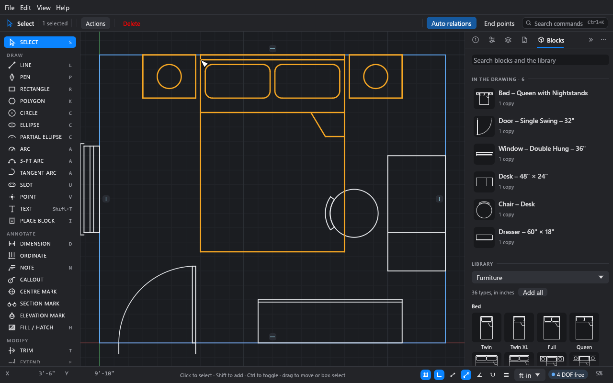

# Blocks

**What you'll make:** a 12' × 10' bedroom furnished from Drift's block library, and a block
of your own. You'll place copies, turn them as you place them, and edit a block so that
every copy updates.

Time: about 10 minutes.

## What a block is

A block is geometry drawn once and placed many times, like an AutoCAD block or a Revit
family. Each copy has its own position, angle, scale, mirror and layer. Edit the block and
every copy changes.

Copies are rigid: they aren't solved, so a drawing can hold thousands without slowing the
sketch down.

## 1. Draw the room

1. Start a new sketch (Ctrl+N), and set the units to **ft-in** at the bottom right.
2. Press R, click a first corner, type `12'`, Tab, `10'`, and press Enter.
3. Press Shift+F to fit it in the window.

## 2. The block library

Open the **Blocks** panel (the cube icon, at the end of the panel tabs). Under **Library**,
pick a category: **Doors**, **Windows**, **Kitchen**, **Bath**, **Furniture**, or **Laundry
and utility**. Each family (**Door – Single Swing**, **Base Cabinet**, **Bed**…) shows its
standard US sizes as tiles. The search field at the top searches every category, and the
drawing's own blocks: try `queen` or `36 door`.

Nothing is added to the drawing until you use it, so the list of the drawing's blocks
stays short. **Add all** adds every block shown without placing them.

The blocks are drawn to real sizes and clearances in plan, legible at 1/4" = 1'-0".
Swings, glass and bedding are thin lines; wall cabinets and door heads are hidden lines;
countertops and vanity tops have a light fill.

## 3. Place copies

1. Pick **Furniture** and click the **Queen with Nightstands** tile under **Bed**. It's
   added to the drawing, and the **Place block** tool (I) starts: a copy follows the
   pointer, snapping by its base point.
2. Click the middle of the top wall to place it. The tool keeps going, so you can place
   more.
3. Search `desk`, and click **Desk – 48" × 24"** (a tile, or the row once it's in the
   drawing). Before you click to place it against the right wall, press R to turn it 90°.
   Press R again for each further quarter turn, and X to mirror it.
4. Place a **Chair – Desk** at the desk, a **Dresser**, a **Door – Single Swing – 32"** and a
   **Window – Double Hung – 36"** the same way.
5. Press Esc to finish.

The panel lists how many copies of each block are placed. **Purge unused** deletes the
blocks that have none (Ctrl+Z brings them back).

### Base points

Each block is named "Family – Type", and every type of a family has the same base point,
so replacing a copy with another size (**Block** in the **Inspector**) keeps it in place:

| Blocks | Base point |
|---|---|
| Doors, openings, windows | The hinge side (or left end) of the opening, on the room-side face of the wall. The wall lies behind the base point, and doors swing into the room. Mirror a door for the other hand. |
| Cabinets, appliances, counters, tubs, showers, washers, dryers, furnaces | The back-left corner, on the wall. |
| Toilets, vanities, water heaters | The middle of the back, on the wall, so they stay on the plumbing line. |
| Beds, sofas, chairs, desks, dressers | The middle of the back (a bed's head wall). |
| Tables, islands, stools, free-standing tub | The centre. |

Blocks face down in the block (the wall at the top), so turn them with R to face the
room.

## 4. Change a copy

Pick a copy with the **Select** tool: click its lines or anywhere inside its outline. It
moves, turns and copies like anything else (drag, G, R, Shift+D, Delete).

The **Inspector** shows the copy:

- **Block:** pick another block to replace this one with it.
- **Placement:** **X**, **Y**, **Angle** (with 0, 90, 180 and 270 buttons), **Scale** and
  **Mirror**.
- **Layer.**
- **Edit block**, **Explode** (turn the copy back into ordinary, connected geometry) and
  **Select all copies**.

Tools snap to copies: to the corners, side middles and centre of each copy's box, its
insertion point, and the ends, middles and centres of its own curves.

## 5. Make your own block

1. Draw something: a 600 × 600 rectangle with a circle inside, for a table and a lamp.
2. Pick it all (drag a box round it).
3. Under **New block** at the top of the **Blocks** panel, type a name (or keep the
   suggested one) and click **Make**. You can also use **Edit → Make block**, or **Make
   block** in the top bar's **Actions** menu or the right-click menu.

The block's base point is the middle of what you picked, and a copy takes the geometry's
place. Fills inside the outline go into the block too: each copy fills its area, the hatch
turning, mirroring and (for model patterns) scaling with the copy.

## 6. Edit a block in place

1. Double-click a copy (or pick it and click **Edit block**).
2. The copy becomes ordinary geometry, framed as the block being edited. Change it, add to
   it, delete from it; anything you draw joins the block.
3. Press Esc, click outside, or click **Finish editing** at the top of the **Inspector**.

Every copy updates.

Right-click a block in the **Blocks** panel to rename it, select its copies or delete it.
Deleting a block deletes its copies.

## Blocks and other programs

DXF export writes blocks and their copies as BLOCK and INSERT entities, and DXF import reads
them back as blocks. See [Underlays and DXF import](11-underlays-and-dxf.md).

## What you learned

- The **Library** holds doors, windows, kitchen, bath, furniture and utility blocks in
  standard US sizes; a click adds one and places it. **Make** turns a selection into a
  block.
- Clicking a block starts placing it; R turns and X mirrors the next copy.
- Double-click a copy to edit the block; every copy follows.

## Next

[Construction geometry](08-construction-geometry.md).
