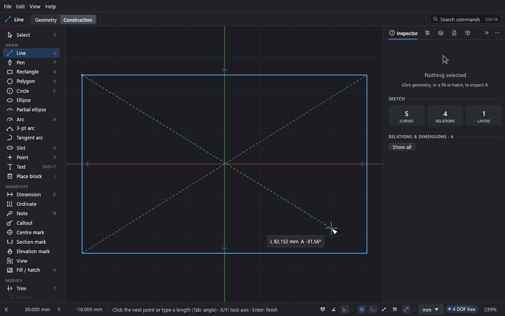

# Construction geometry

**What you'll make:** a rectangle with two construction diagonals, to find its centre, the
way you'd use guide lines on a drawing board.

Time: about 5 minutes.

## What construction geometry is

Construction geometry is a guide. It's drawn thin and dashed, it can carry relations and
dimensions like anything else, and you can snap to it. But it:

- doesn't print or export, unless you turn it on for a view on a sheet (see below),
- doesn't close areas, so fills and hatches ignore it,
- has no line weight.

Use it for centre lines, reference circles (a bolt circle), layout grids and anything else
that positions the real geometry. The example plate's bolt circle is construction geometry.

## 1. Draw construction lines

1. Draw a rectangle (R and two clicks).
2. Press L for the Line tool.
3. Press Alt+C. The top bar switches from **Geometry** to **Construction**. (You can also
   click **Construction** there.)
4. Click one corner of the rectangle, then the opposite corner. Press Esc.
5. Draw the other diagonal the same way.

The choice stays with you: every drawing tool (line, rectangle, circle, arc, slot, polygon,
pen and so on) draws construction until you switch back with Alt+C or **Geometry**. It
carries on across tools and into other files.

## 2. Use them

Each diagonal's midpoint is the rectangle's centre.

1. Press Alt+C to switch back to **Geometry**.
2. Press C and move the pointer to the middle of a diagonal. It snaps to the midpoint.
3. Click, then click again (or type a diameter and press Enter) to finish the circle.

With **Auto relations** on, the circle's centre gets a **Midpoint** relation to the
diagonal, so the circle stays in the middle when the rectangle changes size.

## 3. Turn existing geometry into construction

1. Pick the curves with the **Select** tool.
2. Press Alt+C, or click **Construction** in the top bar.

Press Alt+C again to turn them back.

The **Inspector**'s **Appearance** section has the same choice for picked curves, with a
third option: **Geometry**, **Construction** or **Centre line**. A centre line prints (as a
chain line) but, like construction, doesn't close areas.

## Show it on a sheet

Sometimes the guides belong on paper: a setting-out drawing, a grid, a bolt circle you want
the fabricator to see. Each view has a **Construction** switch under **Show**, off to start
with (see [Sheets and output](10-sheets-and-output.md)). Turn it on and that view's
construction geometry prints as thin, light grey dashes, in a curve's own colour if it has
one. The sheet's **Colours** setting applies: greyscale keeps it grey and black & white
makes it black, still thin and dashed. Points, and the edges an import drew around its
fills, stay off the sheet.

## What you learned

- Alt+C switches a drawing tool between drawing geometry and construction.
- With the **Select** tool, Alt+C turns picked curves into construction and back.
- Construction geometry guides and constrains, and never closes an area. It prints only in
  views whose **Show** has **Construction** ticked.

## Next

[Annotation](09-annotation.md).
