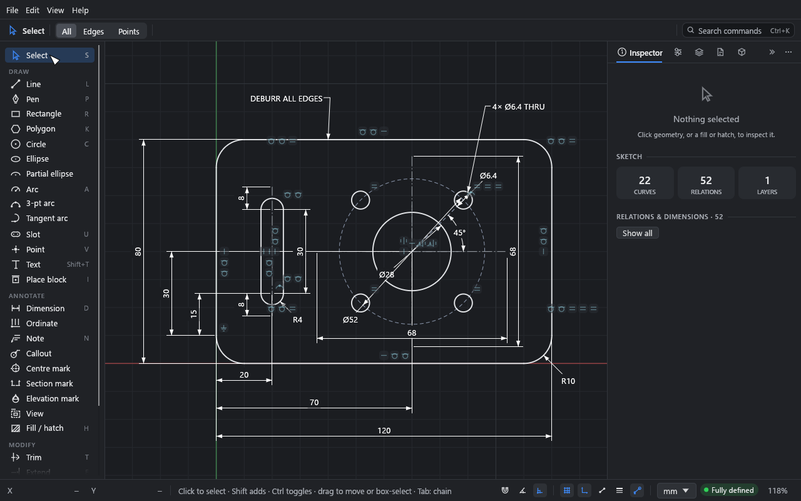
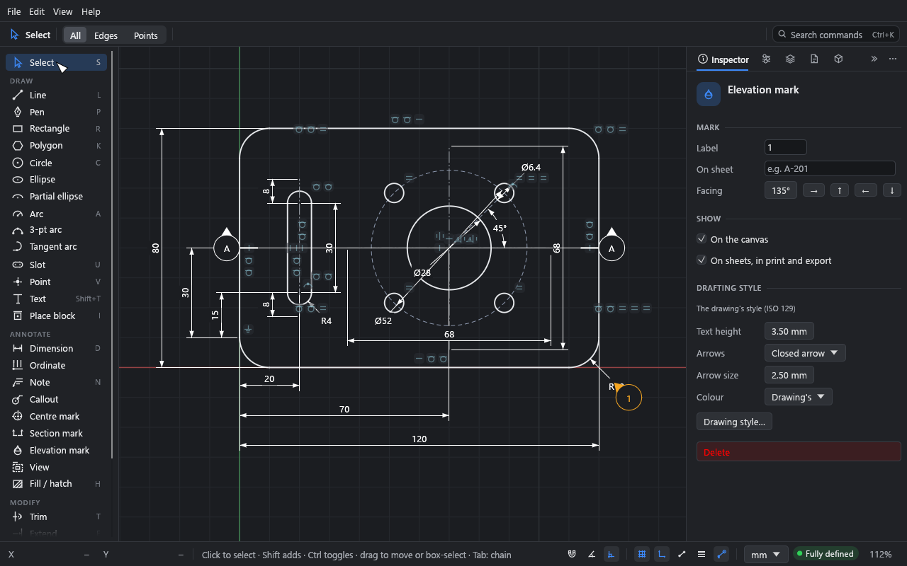
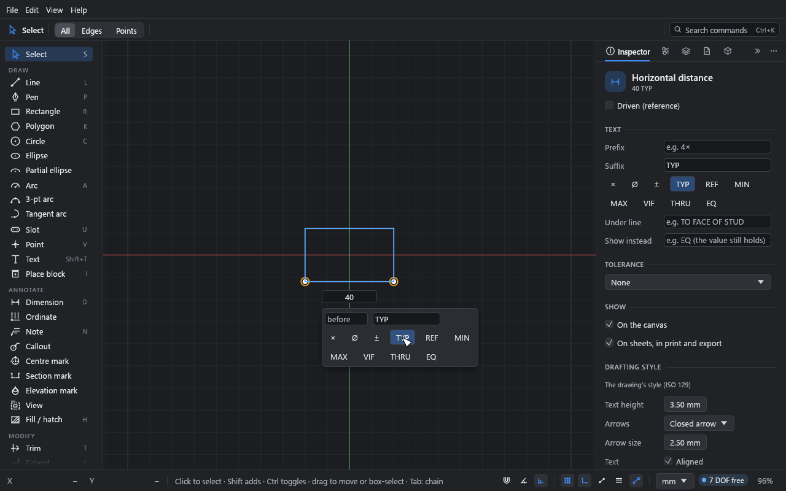

# Annotation

**What you'll make:** the example plate, annotated for the workshop: a note with a leader, a
centre mark, a hole callout, section and elevation marks, and a dimension marked TYP. Then
you'll hide some annotations on the canvas or leave them off the sheets.

Time: about 15 minutes.

Open the example (**File → Open example**). The annotation tools are in the **Annotate**
group of the tool palette.

## 1. A note with a leader

1. Press N for the **Note** tool.
2. Click the plate's top edge. That's where the leader's arrow goes.
3. Click above the plate, where the text goes.
4. Type `DEBURR ALL EDGES` and press Enter. (Shift+Enter starts a new line; Esc cancels.)

For a note without a leader, click empty canvas in step 2 and go straight to typing.
For several leaders, Shift+click more geometry after the first, then click where the text
goes.

Leaders attach to points, or anywhere along a line or curve, so they follow the geometry
when it moves.

### More leaders, and changing them

Pick a note with **Select** and it shows grips:

- **+** on either side of the text: drag from one to anything to add a leader there.
- A square at each leader's end: drag it to attach the leader somewhere else.
- A circle at a bent leader's bend, or at a curved leader's middle: drag it to move the
  bend, or to bow the curve further, less, or the other way.
- A diamond where a leader meets its shoulder: drag it along the text's line to lengthen
  or shorten the shoulder (all the way in turns the shoulder off).

Click a leader's line to pick just that leader, and press Delete to remove it. The text stays
where it is. **Add leader** in the **Inspector** does the same as a **+**: click it, then
click what the leader points to.

The **Inspector** lists the note's leaders. For each:

- **End:** **Arrow**, **Open arrow**, **Dot** or **None**.
- **Shape:** **Straight**, **Bent** (through a bend you can drag), or **Curved** (drag its
  middle to bow it).
- **Shoulder:** a short level line into the text, as on Revit and SolidWorks notes; its
  length is set on the canvas.
- **×** removes it.

### The text

The **Inspector**'s **Style** section sets the note's text: a **Size** of its own (or the
drafting style's), **B**old and *I*talic, **Align** (left, centre or right), **Wrap** to a
width, a **Frame** (a box or a rounded box) and **Mask what's behind it**, which puts paper
behind the text so it reads over hatches and lines. Double-click a note to edit its text.

## 2. A centre mark

1. Click **Centre mark** in the tool palette.
2. Click the bore.

Click another circle, arc or point next, and you get a centre line through both centres.
Click two lines to get a centre line midway between them. Esc stops.

To mark several circles at once, pick them with **Select** and click **Add centre marks**
in the **Inspector**.

## 3. A hole callout

1. Click **Callout** in the tool palette.
2. Click one of the bolt holes.
3. Click where the text goes.

Drift counts the holes of the same size: the callout reads **4× Ø6.4 THRU**. Pick it to
change the suffix to **TAP**, **CBORE** or **CSK**. Click a chamfer's line instead to get
`2 × 45°` (or `2 × 3` for unequal legs).

## 4. Ordinate dimensions

1. Click **Ordinate** in the tool palette.
2. Click the point to measure from. It reads 0.
3. Click more points. Each gets its X distance from the origin point, lined up in a row.
4. Press Y to measure Y distances instead (X to go back). Esc finishes.

## 5. Section and elevation marks

1. Click **Section mark**, then click where the cutting line starts and where it ends.
   Press X or Y before the second click to keep it along an axis. Each end gets a flag
   with the next free letter (A, then B…).
2. Click **Elevation mark**, click where the mark goes, then click towards what it looks
   at. X and Y keep it to an axis; Alt allows any angle. It gets the next free number.

Pick a mark to edit it in the **Inspector**: its **Label**, **On sheet** (the sheet it's
drawn on, shown in the lower half of the flag, such as `A-201`), and which way it looks
(a section's **Direction** has **Flip**, to look the other way, and **Swap ends**; an
elevation's **Facing** has an angle and →, ↑, ←, ↓ buttons). Drag a mark to move it whole.

## 6. Dimension text

Double-click a dimension's value. Under the value field are:

- **before** and **after** fields, for text either side of the value.
- **Chips** that toggle common text on and off: **×**, **Ø**, **±**, **TYP**, **REF**,
  **MIN**, **MAX**, **VIF**, **THRU** and **EQ**.

Pick a dimension (click its value once) for more in the **Inspector**:

- **Prefix** and **Suffix**, and the same chips.
- **Under line:** a second line of text under the dimension line, such as
  `TO FACE OF STUD`.
- **Show instead:** text shown in place of the value, such as `EQ`. The dimension still
  holds its value; only the text changes. (Tolerances and dual units aren't shown with it.)
- **Tolerance:** **None**, **Symmetric** (±), **Deviation** (stacked + and −), **Limits**
  (stacked) or **Fit** (such as `H7`).
- **Driven (reference)**, as in [Constraints and dimensions](02-constraints-and-dimensions.md).

## 7. Hide annotations, on the canvas or on sheets

Every dimension and annotation has two switches, in the **Inspector**'s **Show** section:

- **On the canvas.** Turned off, it isn't drawn and can't be picked. A hidden dimension
  still holds its value.
- **On sheets, in print and export.** Turned off, it stays on the canvas (marked with a
  struck-through sheet badge) but is left out of sheets, PDF, SVG, DXF and printing.

Shift+click picks several dimensions and notes to change at once. The right-click menu has
**Hide on canvas** and **Leave off sheets** too.

To bring hidden ones back, press Alt+H (or **View → Hidden annotations**, or click the
**N hidden** pill in the status bar). Hidden annotations then show faded, so you can pick
them and switch them back on. Alt+H again hides them.

Alt+D hides or shows every dimension and note at once (**View → Dimensions and notes**).
That's a view setting; it doesn't change the drawing.

## The drafting style

The look of dimensions and notes is set for the whole drawing in **File → Drawing
settings… → Drafting**:

- **ISO 129** or **ASME Y14.5**. ISO writes text aligned above the dimension line; ASME
  writes it horizontal, in a break in the line.
- Text height, **Arrows** (closed, open, tick, dot) and **Arrow size**, extension line gap
  and overshoot (**Ext. gap**, **Ext. past**), leading and trailing **Zeros**, and
  **Dual units**.
- **Colour** on the canvas (paper output isn't affected), and a **Font** for all
  annotation and title-block text. A font you pick is kept inside the drawing, where its
  licence allows, so it looks the same on another computer and in PDFs.

Sizes are paper sizes: text set 3.5 mm high prints 3.5 mm high, whatever the sheet's
scale.

### One dimension or note in its own style

Pick a dimension (or several, or a callout, mark or note) and open the Inspector's
**Drafting style** section. Each row shows what it is drawn with. Change one, say
**Arrows** to **Tick** for a detail, and that setting becomes the object's own: its label
turns blue and a reset arrow appears beside it. Everything you leave alone keeps following
the drawing, so a later change to the drawing's style still reaches it.

- The reset arrow puts one setting back to the drawing's; **Reset all** puts them all back.
- Text height, arrows and arrow size, aligned text, zeros, dual units and colour can be
  overridden. The standard and the scale belong to the drawing.
- A note keeps its own text size in its **Style** section, as before.
- **Drawing style…** at the foot of the section opens the drawing's settings.

## What you learned

- N places notes (with a leader if you start on geometry); **Callout**, **Centre mark**,
  **Ordinate**, **Section mark** and **Elevation mark** are in the **Annotate** group.
- Double-click a dimension for before / after text and chips like TYP and EQ.
- Each annotation can be off the canvas or off the sheets; Alt+H shows hidden ones.
- The drafting style is the drawing's (**File → Drawing settings…**); a picked dimension or
  note can override any of it for itself, with a reset arrow to go back.

## Next

[Sheets and output](10-sheets-and-output.md).
