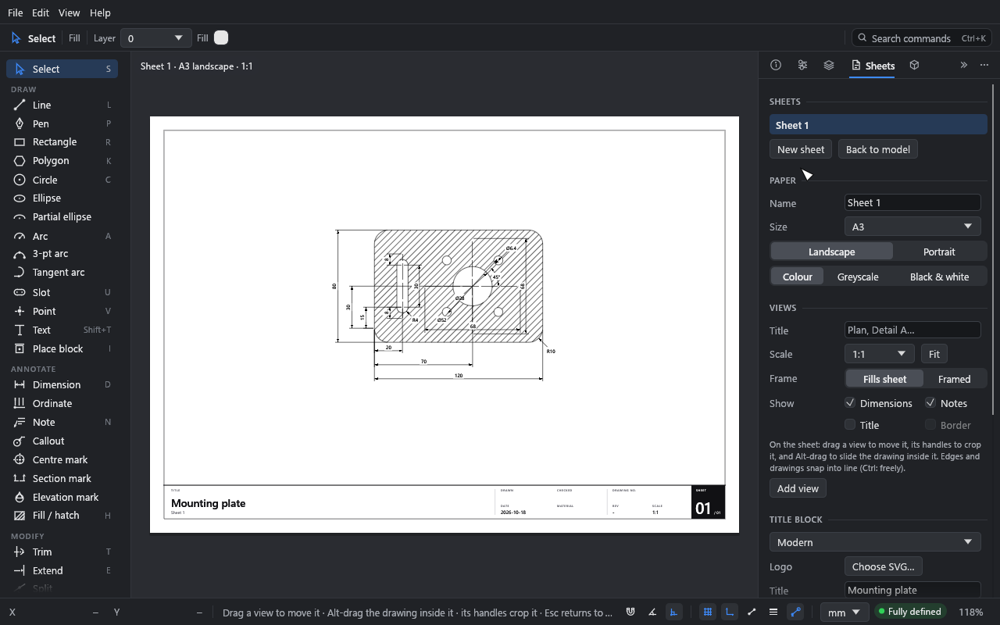
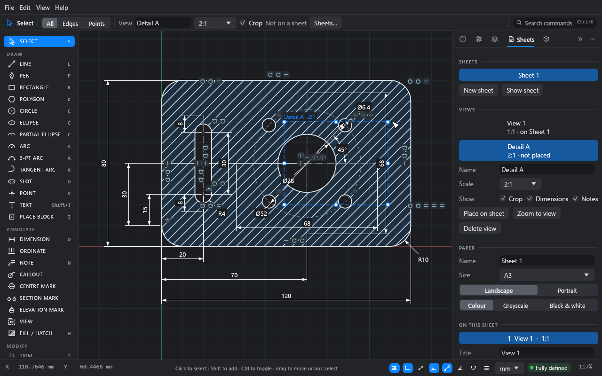
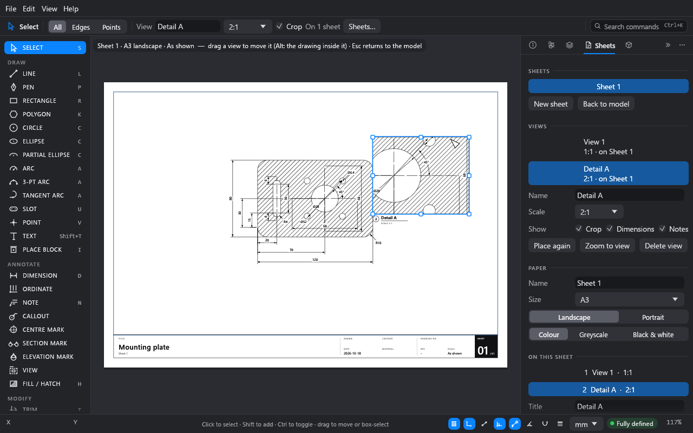

# Sheets and output

**What you'll make:** an A3 sheet of the example plate with a title block, a 2:1 detail of
the bore drawn as a view on the canvas and placed on the sheet, and a PDF of it.

Time: about 20 minutes.

## The idea

You draw in **model space**, at full size. A **view** is a named crop of the model at a
scale, like a Revit view with its crop region. You draw it on the canvas, where its crop
and name show. A **sheet** is a piece of paper with a title block. You place views on it,
and move them around the paper.

The sheet shows the view, not a copy of it. Reframe a view's crop, on the canvas or on a
sheet, and every sheet it's on follows. One view can go on several sheets (Revit allows
only one). What you see in the sheet preview is exactly what prints.

## 1. Make a sheet

1. Open the example (**File → Open example**). Hatch the plate if you like (see
   [Fills and hatches](06-fills-and-hatches.md)).
2. Click **+** in the tabs over the canvas (or **New sheet** in the **Sheets** panel).

Drift makes sheet **A-101**, A3 landscape, with the **Modern** title block. It also makes a
view of the whole drawing, **View 1**, and places it to fill the drawing area, at the
largest standard scale at which the drawing, dimensions included, clears the title block.
The sheet is shown, with its settings in the **Inspector**. The next sheet you make is
**A-102**, and so on.

The tabs over the canvas are the model and each sheet: click one to show it. On a sheet,
scroll to zoom, drag with the middle or right button to pan, and press Shift+F to fit the
sheet. The rail holds what you can do on paper: **Select**, **Add view** and **Back to
model**. Esc, or the **Model** tab, returns to the model; picking a drawing tool (from a
menu or the command palette) takes you back to the model with it.

Sheets are in the order of their tabs, which is the order they print in. To change it,
drag a tab (or a row of the **Sheets** list) to where it should go. Right-click a tab or
row for more:

- **Duplicate with views:** a copy right after it, numbered on (A-101 makes A-102, or the
  next number free), with its paper, title block and fields, and copies of its views. The
  copies are views of their own, so you can change them without changing the first. The
  revisions stay with the original.
- **Duplicate empty:** the same, without the views.
- **Move earlier** / **Move later**, and **Delete sheet**.

## 2. Set up the paper and title block

Click bare paper on the sheet (or its title block) and the **Inspector** shows the sheet:

- **Sheet:** its **Number** (A-101), **Name** and **Status** (what it's issued for: type
  one, or pick **For review**, **For permit**, **For construction** and so on from the menu
  beside it). Its tab and the Sheets list show the number and name.
- **Paper:** **Size** (A4 to A0, ANSI A to E) and **Landscape** or **Portrait**.
- **Colours:** how the sheet prints (see [Colour, greyscale or black & white](#colour-greyscale-or-black--white)).
- **Title block:** **Modern**, **ISO 7200**, **ASME Y14.1** or **None**. Then the fields:
  title, drawn by, checked, company, material and date (**Today** fills it in). The scale,
  the sheet number ("1 / 2") and the revision fill themselves in.
- **Project settings…:** what every sheet shares (see below).

### The project

**File → Drawing settings → Project** holds what every sheet's title block shares: the
project's **Name** (the title on every sheet), **Number**, **Client**, **Address** and
**Company**. Your first sheet names the project after the file; change it once here and
every sheet follows.

A sheet's own **Title** or **Company**, typed in its Inspector, wins over the project's.
Left empty, the field shows the project's in grey ("· from project").

**Title block fields** says what else the title blocks carry:

- **Mechanical:** each sheet's material.
- **Architectural:** the client, the project number and each sheet's status, and on paper
  A3 and larger the address too. Material is left out.

A drawing from an earlier version of Drift, with the same title (or company) on every
sheet, opens with it as the project's.
- **Logo:** **Choose SVG…** puts a logo in the title block. It's kept in the drawing.
- **Revisions:** **Add revision** adds a row with the next letter, today's date and the
  author. The latest revision shows in the title block.

## 3. Draw a view on the canvas

1. Click the **Model** tab (or press Esc) to go back to the model.
2. Pick the **View** tool (under **Annotate** in the toolbar).
3. Drag a rectangle round the bore, or click two opposite corners.

The new view is called **View 2**, at the scale of the last view made. Its crop shows as a
dashed rectangle with its name and scale above it. It's picked, with grips, and you're back
on the select tool. The top bar shows the view:

4. Type `Detail A` for its name, and choose **2:1** from the scale menu.

With the select tool:

- **Click a crop's edge or name** to pick its view. Geometry under the pointer comes first,
  so a crop never gets in the way of picking a line.
- **Drag a picked crop's grips** to reframe it, or **drag its edge or name** to move it.
- **Esc**, or a click anywhere else, lets it go. **Delete** deletes the view. If it's on a
  sheet, Drift asks first, in the Sheets panel.

### Showing and hiding crops

Crops and their names are for working on the canvas. They never print or export.

- **View → View crops** (Shift+Alt+B) shows or hides every crop.
- A view's own **Crop** switch (in the top bar, or the **Views** list) hides just that one,
  like Revit's **Crop Region Visible**. A hidden crop can't be picked on the canvas, but you
  can still pick its view in the list. Its crop then shows faintly while picked.

## 4. The Views list

The **Views** section of the Sheets panel lists every view in the drawing, with its scale
and the sheets it's on (or **not placed**).

- **Click** a view to pick it. Its crop shows on the canvas with its grips.
- **Double-click** it, or click **Zoom to view**, to see its crop in the model.
- For the picked view: **Name**, **Scale**, and **Show**: **Dimensions**, **Notes**,
  **Construction** and **Crop**. Dimensions, notes and construction geometry are shown or
  hidden in this view wherever it's placed.
- **Referenced by** lists the section and elevation marks that point at the view. Click
  one to pick it in the model.
- **Delete view** deletes it. If it's on sheets, Drift asks first, and deleting takes it
  off them all. Marks that pointed at it are unlinked in the same step. Undo brings it all
  back.

## 5. Put the view on the sheet

1. Click the sheet's tab, **A-101**.
2. Drag **Detail A** from the **Views** list onto the sheet, and let go where it should go.
   You can also click **Place on sheet**: Drift puts it beside the views already there.

**Add view** in the rail (or V on a sheet) does both steps from the sheet: the canvas
shows the model with the **View** tool, you drag the crop, and the new view goes on the
sheet on free paper, at the largest standard scale that fits there, picked. Esc gives up.

The view goes on the sheet with its title under it. Its frame is its crop at its scale: a
50 × 40 crop at 2:1 is 100 × 80 mm on the paper.

On the sheet:

- **Drag a view** to move it on the paper. It stays inside the border (hold Ctrl to take it
  past). A view that fills the drawing area has nowhere to go, so a plain drag on it does
  nothing.
- **Drag its handles** to crop it. The drawing stays where it is on the paper, and the
  view's crop in the model changes with it.
- **Alt-drag** inside it to slide the drawing within the frame. This moves the crop over
  the model.

Cropping or sliding a view changes it on every sheet it's on, and on the canvas.

Views snap as you drag them: their edges and middles line up with other frames and the
drawing area, and drawings at the same scale line up level or in line with each other.
Dashed guides show what lined up. Hold Ctrl to place freely.

### The views on a sheet

Pick a view by clicking it on the sheet. The **Inspector** shows the views on the sheet
(**Views on this sheet**), and for the picked one:

- **Title:** its name. Tick **Title** under **Show** to print the name, with the scale
  beneath it, under the view.
- **Scale:** choose from the menu. The crop stays as it is in the model, so the frame
  grows or shrinks on every sheet the view is on. Metric scales run from 10:1 to 1:10000.
  Architectural scales (3" = 1'-0" down to 1/32" = 1'-0") and engineering scales
  (1" = 10' to 1" = 200') are offered too, with your drawing's units first.
- **Fit:** the largest scale at which the whole drawing fits the frame, centred. The frame
  stays as it is on the paper, and the crop changes to suit.
- **Fill drawing area:** frames the view to the sheet's whole drawing area, after a change
  of paper size, say.
- **Show:** **Dimensions**, **Notes**, **Construction**, **Title** and **Border**.
  **Construction** puts the view's construction geometry on the sheet as thin, light grey
  dashed lines (off to start with). It prints and exports to PDF and SVG as the preview
  shows it, in the sheet's **Colours**. Points and an import's fill edges stay out.
- **Referenced by:** the marks that point at the view.
- **Layers:** untick a layer to leave it out of this view, wherever the view is placed:
  a setting-out layer in the plan but not in the details, say. Dimensions and notes on
  nothing but that layer's geometry go with it. A layer hidden or set not to print in the
  **Layers** panel is greyed out here: it's off in every view.

If the views on a sheet have different scales, the title block's scale reads **As shown**.

A view's number on a sheet is its place in **Views on this sheet**, from 1. A section or
elevation mark linked to the view reads that number over the sheet's number (`2 / A-101`),
on the canvas and in print. When a view is on several sheets, marks read the first one.
See [Annotation](09-annotation.md) for **Make view**.

**Align with** lines the picked view up with another one: **Left**, **Centre**, **Right**,
**Top**, **Middle**, **Bottom**, **Drawings level** or **Drawings in line**.

**Remove from sheet** (in the Inspector, or Delete on the sheet) takes the picked view off
the sheet. The view
stays in the drawing, in the **Views** list, to place again. A sheet can be empty.

### Drawings from before views

In drawings made before views came in, each view a sheet held becomes a view of its own.
It's named after its title, or its sheet. Every sheet prints as it did. A view that filled a
sheet keeps its crop if you change the paper size. Click **Fill drawing area** to frame it
to the new paper.

## 6. Output

From the **Sheets** panel's **Output** section, or **File → Export**:

| Output | What you get |
|---|---|
| **PDF…** | The sheets you choose, one page each, at true scale and true line weights. With several sheets, a dialog lists them: tick the ones to export (**All**, or **This sheet**). Each keeps its number in the set (a reissued A-102 still reads 2 / 5). Without any sheets, the drawing fitted to A3. Text stays selectable. |
| **SVG…** | The current sheet, at true scale, in millimetres. |
| **DXF…** | The model at full size (not the sheets), with its layers and line types, in the drawing's units. |
| **Print…** (Ctrl+P) | Asks which sheets as **PDF…** does, writes the PDF and opens it in your system's PDF viewer (a new tab in the browser), to print from there. |

Exporting never replaces your `.drift` file.

### Colour, greyscale or black & white

Under **Paper**, each sheet has its own colour choice. The sheet preview shows it, and the
PDF, SVG and print come out the same:

| Choice | On paper |
|---|---|
| **Colour** | Layer and item colours, as drawn. |
| **Greyscale** | Every colour becomes its grey (by how light it is). Light fills stay light and dark ones dark. |
| **Black & white** | Like a CAD monochrome plot style. Lines, text and hatch lines print black. Solid fills print as their grey, so a dark fill doesn't hide the lines on it. White stays white: the masks behind dimension text, and lettering knocked out of a dark box (the Modern title block's sheet number). |

A new sheet starts in **Colour**. The choice is saved with the sheet. It doesn't change DXF,
which is the model, not a sheet: DXF keeps the layer and item colours.

What goes on paper:

- Points, hidden layers and layers whose print flag is off are left out, and so are the
  layers a view leaves out (its **Layers**).
- Construction geometry is left out, except in views whose **Show** has **Construction**
  ticked. DXF never has it: DXF is the model, not a sheet.
- Views' crops and names on the canvas are left out. Only the sheet's frames (with
  **Border**) and titles print.
- Dimensions and notes are left out where a view's **Show** says so, where they're set off
  sheets, or of views they aren't in (their **In views**; see
  [Annotation](09-annotation.md)).
- Drafting hatch patterns are sized for the sheet's scale.

About DXF:

- It's written as DXF R12, which every CAD program reads. Ellipses and pen curves go out
  exactly, as ELLIPSE and SPLINE entities. Those are newer than R12: most programs read
  them, but a strict R12 reader may skip them.
- Blocks go out as blocks (BLOCK and INSERT). Dimensions and notes go out as plain lines and
  text on a layer called **ANNOTATIONS**, so they no longer measure. Fills go out as solid
  triangles.
- To bring DXF in, see [Underlays and DXF import](11-underlays-and-dxf.md). A DXF's
  layouts come in as sheets, and each of their viewports as a view.

## What you learned

- A view is a named crop of the model at a scale. Draw it with the **View** tool, and
  reframe it with its grips.
- **View → View crops** and each view's **Crop** switch show or hide crops. Crops never
  print.
- Views go on sheets from the **Views** list. Reframing a view changes every sheet it's on,
  and one view can be on several sheets.
- **New sheet** lays the drawing out on paper with a title block, at a fitting scale.
- PDF prints every sheet; SVG the current one; DXF the model at full size.
- Each sheet prints in colour, greyscale or black & white, as its preview shows.

## Next

[Underlays and DXF import](11-underlays-and-dxf.md).
