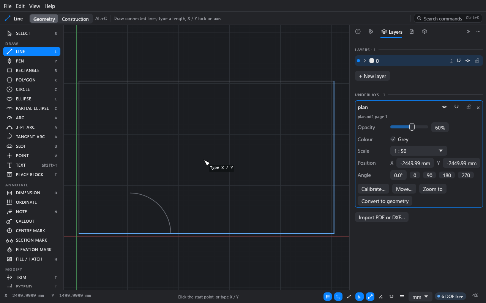

# Underlays and DXF import

There are two ways to bring another program's drawing into Drift:

- **As an underlay:** a PDF or DXF placed behind your sketch to trace over. You can snap to
  it, but not edit it, and it never prints.
- **As geometry:** a DXF whose lines, arcs, text, hatches and blocks become ordinary Drift
  geometry you can edit.

**What you'll do:** trace a room from a 1:50 PDF plan, then look at what a DXF import gives
you.

Time: about 10 minutes.

## Part 1: trace over a PDF

### 1. Import the PDF

1. Choose **File → Import underlay…** (or **Import PDF or DXF…** in the **Layers** panel)
   and pick a PDF. You can also drop a PDF on Drift's window.
2. For a PDF of several pages, choose the page.

The page comes in at its paper size, with its lower-left corner on the origin, drawn faded
grey behind the sketch. The **Layers** panel opens with the underlay picked.

PDF underlays read the vector drawing: lines, curves, rectangles and filled shapes (as
their outlines). Text and images are skipped. Scanned (raster) PDFs have nothing to read.

### 2. Set its scale

A plan drawn at 1:50 comes in 50 times too small. Either:

- **Pick the scale:** in the underlay's **Scale** menu, choose the scale it was drawn at,
  such as **1 : 50** or 1/4" = 1'-0". Or
- **Calibrate it:**
  1. Click **Calibrate…**.
  2. Click a point on the underlay whose distance you know, such as a wall end. It snaps.
  3. Click the other end.
  4. Type the real distance (`5000`, or `16'-5"`) and press Enter.

  Drift rescales the underlay about the first point and reports the scale it found.

### 3. Trace

Draw over it with any tool. Tools snap to the underlay's end points, midpoints, centres,
quadrants and to points along its curves. Your sketch's own points win when both are
close.

Points snapped on an underlay are new points: they aren't tied to it.

### Underlay settings

Each underlay in the **Layers** panel has:

- Switches for visible, snap and locked.
- **Opacity** and **Colour** (grey by default).
- **Scale**, **Position** (X, Y) and **Angle** (with 0, 90, 180 and 270 buttons).
- **Move…**: click a point on the underlay, then where it should go.
- **Zoom to**, and **×** to delete it.
- **Convert to geometry**: turn the underlay into lines, arcs and circles on the current
  layer, with touching ends joined, so you can edit them.

Underlays are kept inside the `.drift` file. They never print or export.

## Part 2: import a DXF as geometry

1. Choose **File → Import…** and pick the file. Or drop a DXF on the window.
2. The drawing is added to the open sketch, in its own units (read from the file; a file
   that doesn't say is read in your display unit).
3. A report window lists what came in, anything left out, and anything read with changes.
   **Copy this report** copies it, and **Check sketch…** looks for gaps (see
   [Checking a sketch](12-sketch-checker.md)).

What comes in:

- Lines, arcs, circles, ellipses, polylines (with arcs) and splines, as Drift curves.
  Touching ends share points, so outlines stay connected and can be constrained.
- Layers, with their colours, line weights, line types and on / off, locked and plot
  settings.
- Text and paragraph text, as sketch text.
- Hatches, as live fills.
- Blocks and their inserts, as Drift blocks and copies (nested, arrayed and unevenly scaled
  ones are expanded into curves).
- Dimensions, as the lines and text they're drawn with. They look the same but no longer
  measure.
- Paper-space layouts, as sheets, with their viewports as views.

What doesn't (yet): associative dimensions, what's drawn directly on a layout (title blocks,
notes), MLEADER, TOLERANCE, images, 3D solids, tables, and binary DXF. DWG files aren't
read: save them as DXF first.

Drift's DXF export is described in [Sheets and output](10-sheets-and-output.md#5-output).

## Part 3: import SVG, PDF and Illustrator artwork

Drawings made in Illustrator (with or without CADTools), Inkscape, Affinity or Figma, and PDFs
from any CAD program, come in the same way. Illustrator `.ai` files are read through the PDF
copy of the artwork Illustrator saves in them, so **Create PDF Compatible File** must have been
on when the file was saved (it is unless someone turned it off). Files from Illustrator 8 and
earlier aren't read.

1. Choose **File → Import…** and pick an SVG, PDF or `.ai` file. Or drop one on the window.
2. In the dialog, choose:
   - **Editable geometry** or **Underlay to trace**.
   - The **page** (an **artboard**, for an Illustrator file).
   - **Drawn at**: the scale the drawing is at on its paper. At 1:50, 1 mm on the paper is
     50 mm in the sketch. The dialog shows how big that makes it. Where it can, Drift
     **suggests** a scale and sets it: it reads the drawing's dimensions (`28 1/2"`, `3'-6"`,
     `3600`) and measures the lines they're written along, and, failing those, reads the
     scales written on it (`SCALE: 1/4" = 1'-0"`). It says which it used, how many agreed, and
     how confident it is, and names a second scale when some views look to be at one.
     Architectural sheets often have views at several scales: check the suggestion is the
     one for the view you want. A scale you've chosen is never replaced.
   - **Then calibrate**, if you don't know the scale or want to check it. Once it's in,
     click two points on it (a wall's ends, say) and type their real distance: the import
     is scaled to fit, about the first point.
   - What to do with **edges of shapes that are filled but not outlined**: construction
     (they shape the fill and don't print, so it looks as it did) or lines (they print).
   Under **Before you import**, the dialog lists what won't come across as it looks
   (gradients, transparency, images left out, clipping it couldn't apply) and warns about a
   very large drawing. Above about 400,000 curves it won't import as geometry: bring it in
   as an underlay, or split it first.
3. A report lists what came in and anything left out.

What comes in:

- Paths and shapes, as lines, arcs, circles and Béziers. Curves that are pieces of a circle
  come back as true arcs and circles. Touching ends share points.
- Strokes: colour, line weight and dashes (as the nearest Drift line type).
- Fills, as live solid fills in their colour, holes and all.
- Layers: Illustrator's and Inkscape's layers, and a PDF's layers, hidden, locked or
  non-printing as the file has them. Anything outside a layer goes on a layer named after
  the file.
- Text, as sketch text, with dimension fractions put back together (`28 1/2"`). PDF text in
  a font that doesn't say what its characters are (rare) is counted in the report.

Imported artwork has no relations or dimensions: it is free to move and edit, and you add
constraints where you want them.

Clipping is applied: what a clipping path, a mask or the edge of the artboard hides is left
out, strokes are trimmed exactly where they leave it, and fills are cut to rectangular and
other convex clips. A fill crossing a clip of another shape comes in whole, and the dialog
says so.

What doesn't come across: images, gradients (they come in as their first colour, so
presentation artwork will look different), transparency, blend modes and soft masks. Illustrator's brushes, width
profiles and effects come in as the filled shapes they draw, and text converted to outlines
comes in as shapes. An SVG
from Illustrator is read at Illustrator's size, 72 units to the inch.

Drift's own SVG export opens well in Illustrator and Inkscape: each layer is a named group
(Inkscape shows them as layers; in Illustrator, **Release to Layers** makes layers of
them), and curves that meet are joined into one path.

## What you learned

- **File → Import underlay…** puts a PDF or DXF behind the sketch to trace; calibrate it
  from two points and a known distance.
- **File → Import…** brings a DXF in as editable geometry, with a report of what changed.
- An SVG or PDF comes in the same way, as geometry or an underlay, at the scale it was drawn
  at or calibrated from two points.

## Next

[Checking a sketch](12-sketch-checker.md).
