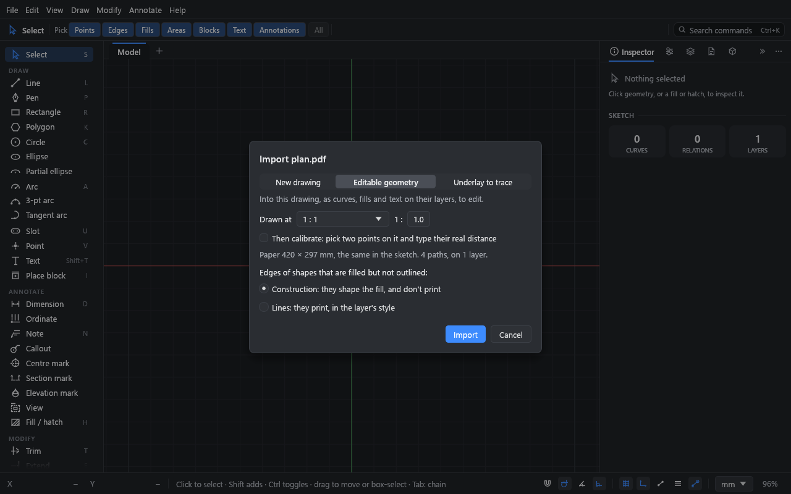
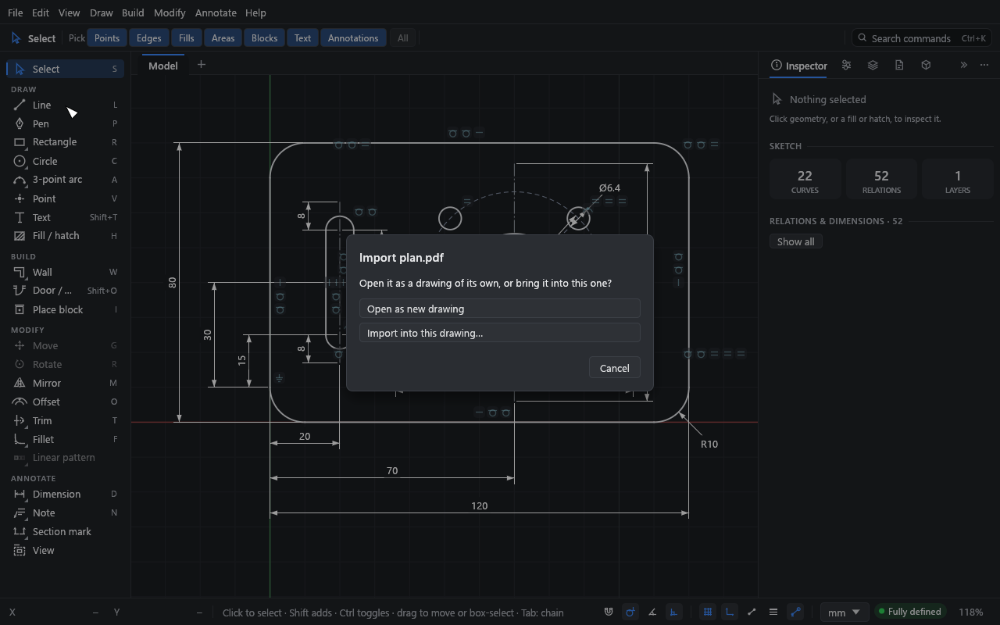

# Underlays and DXF import

Every drawing from another program comes in one way: **File → Import…**. It takes DWG,
DXF, SVG, PDF and Illustrator (`.ai`) files, and its dialog asks how the drawing comes in:

- **As an underlay:** a drawing placed behind your sketch to trace over. You can snap to
  it, but not edit it, and it never prints.
- **As geometry:** its lines, arcs, text, hatches and blocks become ordinary Drift geometry
  you can edit.

Either way, the dialog has the same scale controls for every format (see
[The import dialog](#the-import-dialog)).

**What you'll do:** trace a room from a 1:50 PDF plan, then look at what a DXF import gives
you.

Time: about 10 minutes.

## Part 1: trace over a PDF

### 1. Import the PDF

1. Choose **File → Import…** and pick a PDF. **Import…** in the **Underlays** section of
   the **Layers** panel does the same, with the dialog already set to **Underlay to
   trace**. You can also drop a PDF on Drift's window and choose **Import into this
   drawing…**.
2. In the dialog, choose **Underlay to trace**, and the page for a PDF of several pages.
3. Set **Drawn at** to the scale the plan was drawn at, such as **1 : 50** or
   1/4" = 1'-0". Drift suggests one where it can read it from the drawing.
4. Click **Import**.

The page comes in at that scale, with its lower-left corner on the origin, drawn faded
grey behind the sketch. The **Layers** panel opens with the underlay picked.

PDF underlays read the vector drawing: lines, curves, rectangles and filled shapes (as
their outlines), and its pictures unless you turn off **Bring in images as pictures**. Text
is skipped. A scanned PDF comes in as its picture.

### 2. Check or correct its scale

If you didn't know the scale, the plan may be the wrong size. Either:

- **Pick the scale:** in the underlay's **Scale** menu, choose the scale it was drawn at,
  or type it after **1 :**. Or
- **Calibrate it** (or tick **Then calibrate** in the import dialog to go straight to it):
  1. Click **Calibrate…**.
  2. Click a point on the underlay whose distance you know, such as a wall end. It snaps.
  3. Click the other end.
  4. Type the real distance (`5000`, or `16'-5"`) and press Enter.

  Drift rescales the underlay about the first point and reports the scale it found.

### 3. Trace

Draw over it with any tool. Tools snap to the underlay's end points, midpoints, centres,
quadrants and to points along its curves. Your sketch's own points win when both are
close.

Points snapped on an underlay are new points: they aren't tied to it.

### Underlay settings

Each underlay in the **Layers** panel has:

- Switches for visible, snap and locked.
- **Opacity** and **Colour** (grey by default).
- **Scale** (the same 1 : n menu as the import dialog, for every format), **Position**
  (X, Y) and **Angle** (with 0, 90, 180 and 270 buttons).
- **Move…**: click a point on the underlay, then where it should go.
- **Zoom to**, and **×** to delete it.
- **Convert to geometry**: turn the underlay into lines, arcs and circles on the current
  layer, with touching ends joined, so you can edit them.

Underlays are kept inside the `.drift` file. They never print or export, pictures
included.

## Part 2: import a DXF as geometry

1. Choose **File → Import…** and pick the file. Or drop a DXF on the window and choose
   **Import into this drawing…**.
2. In the dialog, keep **Editable geometry**. **Drawn at** is 1 : 1 for a drawing made full
   size, as CAD drawings usually are; set it for one drawn at paper size. Click **Import**.
3. The drawing is added to the open sketch, in its own units (read from the file; a file
   that doesn't say is read in your display unit).
4. The status bar says what came in. If anything was left out, read with changes or lies
   far off, a report window lists it: **Copy** copies the report, **Select them** picks
   what lies far off, and **Check sketch…** looks for gaps (see
   [Checking a sketch](12-sketch-checker.md)).

What comes in:

- Lines, arcs, circles, ellipses, polylines (with arcs) and splines, as Drift curves.
  Touching ends share points, so outlines stay connected and can be constrained.
- Layers, with their colours, line weights, line types and on / off, locked and plot
  settings.
- Text and paragraph text, as sketch text.
- Hatches, as live fills, at their real size.
  - Each hatch brings its own pattern: AutoCAD's (AR-CONC, AR-BRSTD, EARTH, …) and your
    office's come in exactly, and are added to the drawing's patterns. Where Drift has the
    same pattern (ANSI31, say), its own is used.
  - Hatches inside blocks come in as the block's fills.
  - Solid fills (and AutoCAD's SOLID shapes, such as dimension arrowheads) come in opaque, or
    as transparent as the file says. A gradient comes in as a solid fill in its first colour.
- Blocks and their inserts, as Drift blocks and copies, mirrored ones included (nested,
  arrayed and unevenly scaled ones are expanded into curves).
  - Parts drawn "by block" take each copy's colour, line type and weight. A block placed in
    several colours becomes one block per colour.
  - A dynamic block's copies are named after the dynamic block, not `*U12`.
  - If the drawing already has a block of the same name, it's used only when it's the same.
    Otherwise the new block gets a name of its own, such as **Door (2)**.
  - External references (xrefs) are other files, so they don't come in. The report names
    each one and where it is: bind them in AutoCAD first, or import those files too.
- Dimensions, as the lines and text they're drawn with. They look the same but no longer
  measure.
- Paper-space layouts, as sheets, with their viewports as views.

What doesn't (yet): associative dimensions, what's drawn directly on a layout (title blocks,
notes), MLEADER, TOLERANCE, images, 3D solids, tables, and binary DXF.

DWG files (AutoCAD R14 to 2018) come in the same way: choose **File → Import…** and pick a
`.dwg`, or drop it on the window. Drift reads it as it reads DXF, with the same report. A
damaged file is read as far as it can be, and the report says so.

Drift's DWG and DXF export is described in
[Sheets and output](10-sheets-and-output.md#about-dwg-and-dxf).

## Part 3: import SVG, PDF and Illustrator artwork

Drawings made in Illustrator (with or without CADTools), Inkscape, Affinity or Figma, and PDFs
from any CAD program, come in the same way. Illustrator `.ai` files are read through the PDF
copy of the artwork Illustrator saves in them, so **Create PDF Compatible File** must have been
on when the file was saved (it is unless someone turned it off). Files from Illustrator 8 and
earlier aren't read.

1. Choose **File → Import…** and pick an SVG, PDF or `.ai` file. Or drop one on the window
   and choose **Import into this drawing…**.
2. In the import dialog, choose the options below.
3. The status bar says what came in; a report opens if anything was left out.

### The import dialog

The same dialog opens for every format. It has:

- **New drawing**, **Editable geometry** (in this drawing) or **Underlay to trace**.
- The **page** (an **artboard**, for an Illustrator file).
- **Drawn at**: the scale the drawing is at on its paper. At 1:50, 1 mm on the paper is
  50 mm in the sketch. The dialog shows how big that makes it. Where it can, Drift
  **suggests** a scale and sets it: it reads the drawing's dimensions (`28 1/2"`, `3'-6"`,
  `3600`) and measures the lines they're written along, and, failing those, reads the
  scales written on it (`SCALE: 1/4" = 1'-0"`). It says which it used, how many agreed, and
  how confident it is, and names a second scale when some views look to be at one.
  Architectural sheets often have views at several scales: check the suggestion is the
  one for the view you want. A scale you've chosen is never replaced.
- **Then calibrate**, if you don't know the scale or want to check it. Once it's in,
  click two points on it (a wall's ends, say) and type their real distance: the import
  is scaled to fit, about the first point.
- **Bring in images as pictures**, for a PDF or Illustrator file with photos or scans in
  it (on unless you turn it off). As geometry or a new drawing, they come in as pictures
  on an underlay, placed over the fills that came in with them and under their lines, so a
  picture on a filled background shows. The underlay's **Pictures** setting in the
  **Layers** panel puts them back beneath the drawing, or on another layer; **Arrange**
  moves them among that layer's fills. As an underlay to trace, they stay with the
  underlay, beneath the drawing.
- What to do with **edges of shapes that are filled but not outlined**: construction
  (they shape the fill and don't print, so it looks as it did) or lines (they print).

Under **Before you import**, the dialog lists what won't come across as it looks
(gradients, transparency, images left out, clipping it couldn't apply) and warns about a
very large drawing. Above about 400,000 curves it won't import as geometry: bring it in as
an underlay, or split it first.

A DWG or DXF has no pages and no suggested scale (it is usually full size, 1 : 1), but
**Drawn at** and **Then calibrate** work the same way.

### Dropping a file on the window

Drop a `.drift` file on Drift's window to open it. Drop a DWG, DXF, SVG, PDF or `.ai` file
and Drift asks where it should go:

- **Open as new drawing:** a new drawing of its own, with the file's contents as geometry.
  The import dialog follows, set to **New drawing**, for the page, the scale and
  calibrating. If the drawing open now has unsaved changes, Drift asks before it goes.
- **Import into this drawing…:** the import dialog, set to **Editable geometry**; choose
  **Underlay to trace** there to trace over it instead.

**File → Open…** takes the same files, as new drawings, through the import dialog. A file that can't be read leaves
the drawing open now as it is.

What comes in:

- Paths and shapes, as lines, arcs, circles and Béziers. Curves that are pieces of a circle
  come back as true arcs and circles. Touching ends share points.
- Strokes: colour, line weight and dashes (as the nearest Drift line type).
- Fills, as live solid fills in their colour, holes and all.
- Layers: Illustrator's and Inkscape's layers, and a PDF's layers, hidden, locked or
  non-printing as the file has them. Anything outside a layer goes on a layer named after
  the file.
- Text, as sketch text, with dimension fractions put back together (`28 1/2"`). PDF text in
  a font that doesn't say what its characters are (rare) is counted in the report.

Imported artwork has no relations or dimensions: it is free to move and edit, and you add
constraints where you want them.

Clipping is applied: what a clipping path, a mask or the edge of the artboard hides is left
out, strokes are trimmed exactly where they leave it, and fills are cut to rectangular and
other convex clips. A fill crossing a clip of another shape comes in whole, and the dialog
says so.

What doesn't come across: an SVG's images, gradients (they come in as their first colour, so
presentation artwork will look different), transparency, blend modes and soft masks. Illustrator's brushes, width
profiles and effects come in as the filled shapes they draw, and text converted to outlines
comes in as shapes. An SVG
from Illustrator is read at Illustrator's size, 72 units to the inch.

Drift's own SVG export opens well in Illustrator and Inkscape: each layer is a named group
(Inkscape shows them as layers; in Illustrator, **Release to Layers** makes layers of
them), and curves that meet are joined into one path.

## What you learned

- **File → Import…** is the one way in for DWG, DXF, SVG, PDF and Illustrator files: as
  editable geometry or as an underlay to trace, with a report of what changed.
- Every format gets the same scale controls: **Drawn at** 1 : n, a suggested scale where
  Drift can read one, and **Then calibrate** from two points and a known distance.
- A file dropped on the window asks whether to open it as a new drawing or import it into
  this one; the import dialog does the rest.

## Next

[Checking a sketch](12-sketch-checker.md).
