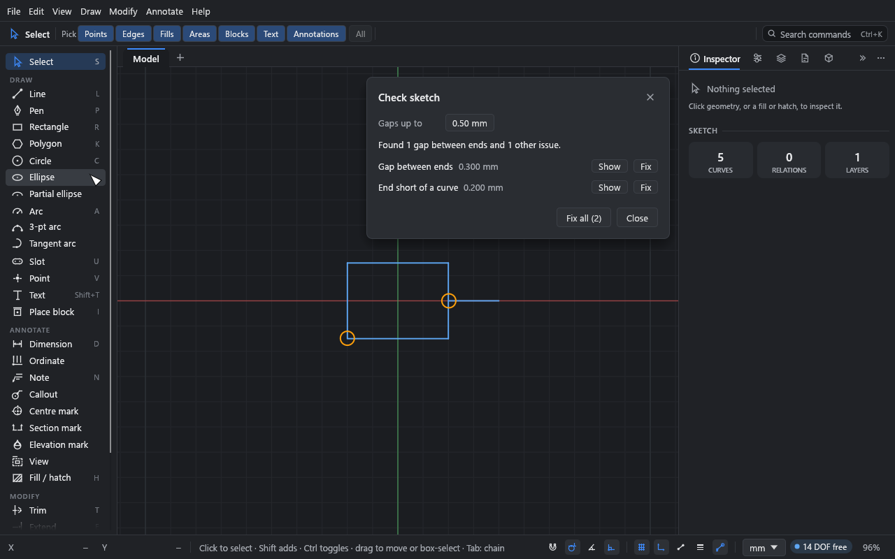

# Checking a sketch

**What you'll do:** find and fix the small gaps that stop an outline from closing, so it can
be filled, hatched or measured.

Time: about 5 minutes.

## Why outlines don't close

A fill needs a closed area. An outline that looks closed may not be: two ends a fraction of
a millimetre apart, a line that stops just short of another, or a line of no length left
over from an edit. These are common in imported DXF files.

## 1. Open the checker

Choose **Edit → Check sketch…** (or find "Check sketch" in the command palette, Ctrl+K). The
import report has a **Check sketch…** button too.

The window lists every issue it finds, and each is ringed on the canvas while the window is
open:

- **Gap between ends:** two open ends closer than the tolerance.
- **End short of a curve:** an open end that stops just short of (or just past) another
  curve.
- **Curve of no length:** a line or arc whose ends are in the same place.

An open end is the end of a solid curve that nothing else uses or holds. Construction and
locked geometry are left out.

## 2. Set the tolerance

**Gaps up to** sets how far apart ends can be and still count as meant to meet. It's
0.5 mm in a new drawing and is saved with the drawing. Ends further apart are left alone.
It's also under **Check sketch** in **File → Drawing settings…**, where **Use these area and
fill rules for new drawings** makes it the default for new drawings.

## 3. Fix

- **Show** picks the issue and zooms to it.
- **Fix** fixes one:
  - A gap's two ends are joined into one point. The end held by more relations and
    dimensions stays where it is.
  - A short end gets an **On curve** relation to the curve, which stays where it is.
  - A curve of no length is removed and its ends joined.
- **Fix all** fixes everything, as one undo step. Any fix that would break the sketch
  (a relation or dimension that can't then hold) is skipped, and Drift reports what it left.

## What the checker doesn't do

It doesn't extend lines that stop well short of where they should meet. Use **Extend** (E)
or **Trim** (T) for those.

Separately, the status bar warns when curves lie on top of each other (the same line drawn
twice, for example). Click the **N overlapping** pill (or run **Select overlapping curves** from the command
palette) to pick the ones on top; Delete then
removes them and leaves those underneath.

## What you learned

- **Edit → Check sketch…** finds gaps, short ends and curves of no length.
- **Fix all** closes them in one undo step, keeping the sketch solvable.

## Next

Look things up in the [reference](../README.md#how-the-guide-is-organised), or read
[Coming from another program](../coming-from.md).
