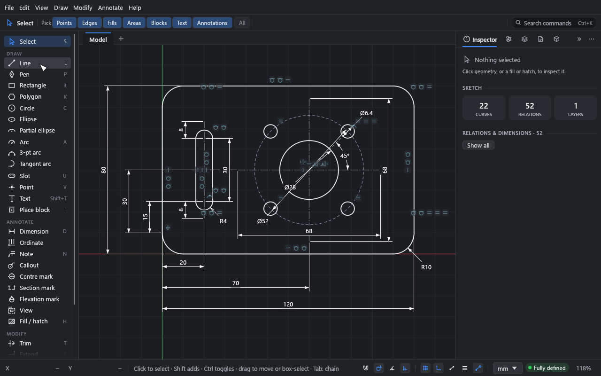
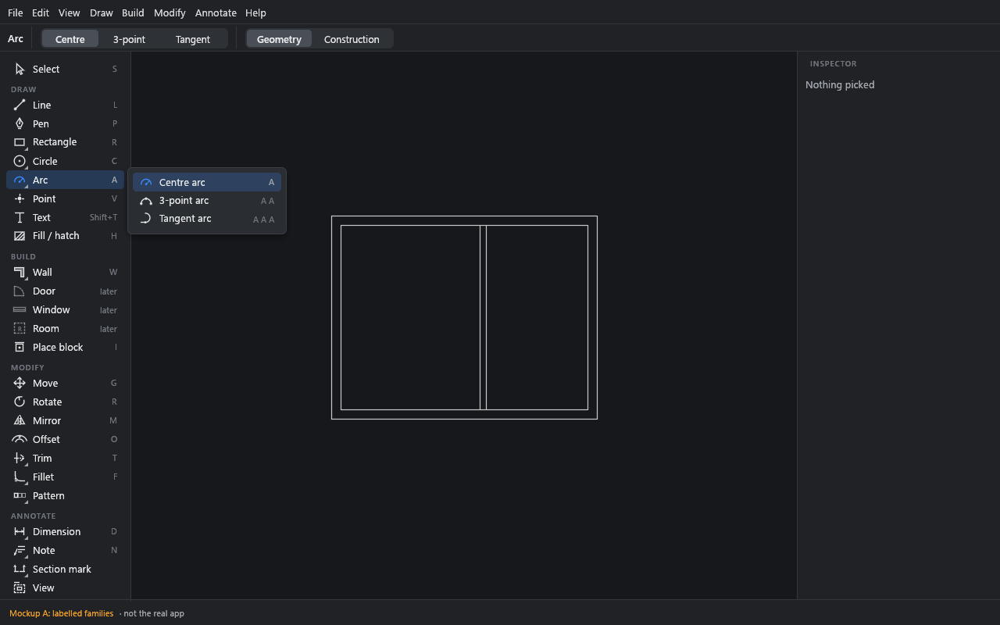
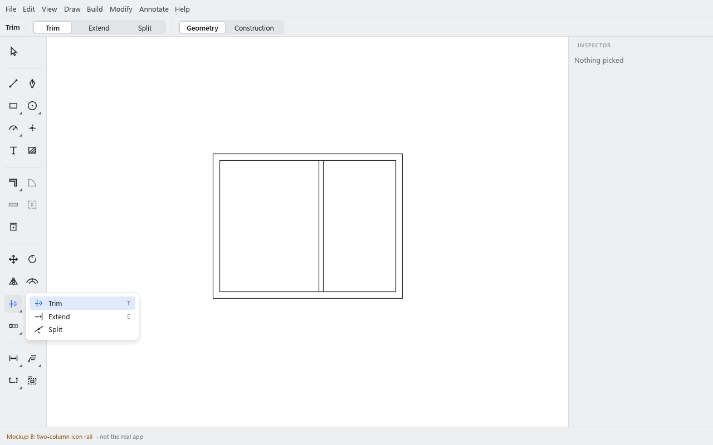
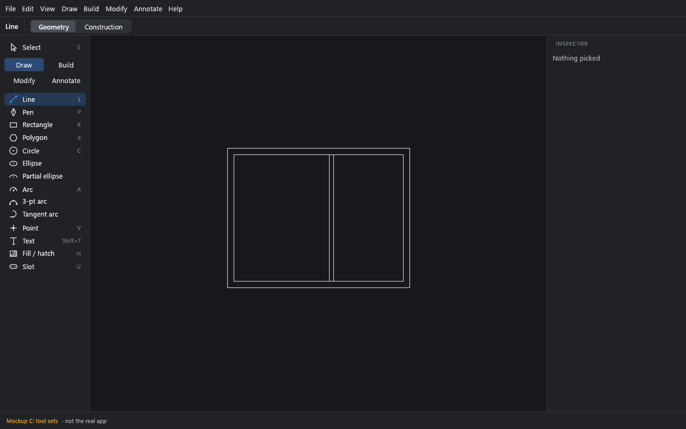

# UI audit 1: the tool rail and how tools are grouped

Status: **decided 2026-10-26: layout A** (with B's two columns in narrow windows), and the recommended answers to the other decisions in section 6, except the compact rail stays automatic (no View option). Built in the PR that adds `app/rail.rs`. The audit below is as written before the decision. Main at f91f9d2, with Walls W1 (PR #176,
`claude/walls-w1-ace1e7`) read alongside. Images are in [`ui-audit-ribbon/`](ui-audit-ribbon/):
`today-*` are the real app (headless egui_kittest, the example drawing), `mock-*` are stubbed
rails drawn with Drift's own icons, theme and row widgets. The mockups are throwaway code, not
a build.

## 1. What exists today

### 1.1 Where it lives

| Piece | Code |
|---|---|
| The rail's contents and order | `ToolKind::SECTIONS` in `crates/drift-app/src/tools/mod.rs` (a hand list, **not** the registry) |
| Drawing the rail | `DriftApp::toolbar` in `app/panels.rs`; rows `icons::tool_row`, tiles `icons::button` |
| Width | `lib.rs`: 168 px with labels when the window is ≥ 760 px wide (`WIDE_LAYOUT`), else 56 px icons only |
| On a sheet | `sheet_rail` in `app/sheet_editor.rs`: Select, Add view, Back to model |
| Keys, titles, menus, palette | the registry, `commands.rs` (#167). `ToolKind::shortcut()` reads keys from it; the rail reads only the key text |
| Tool options | the context bar, `context_ui.rs` `context_bar` / `tool_options` |

### 1.2 Every button, in order

The rail is one scrolling column: Select, then three headed sections. 31 buttons on main, 32 with
W1.

| Section | Tools (key) |
|---|---|
| — | Select (S) |
| **Draw** (14, 15 with W1) | Line (L), Pen (P), Rectangle (R), Polygon (K), Circle (C), Ellipse (C·C), Partial ellipse (C·C·C), Arc (A), 3-pt arc (A·A), Tangent arc (A·A·A), Slot (U), *Wall (W, PR #176)*, Point (V), Text (Shift+T), Place block (I) |
| **Annotate** (9) | Dimension (D), Ordinate, Note (N), Callout, Centre mark, Section mark, Elevation mark, View, Fill / hatch (H) |
| **Modify** (7) | Trim (T), Extend (E), Split, Fillet (F), Chamfer (F·F), Offset (O), Mirror (M) |

- **No flyouts.** Every variant is its own row. A cycle's key shows on its first row only
  (Circle shows C; Ellipse and Partial ellipse show nothing).
- **Tooltips** name the tool, its key, one line of what it does, and for a cycle "C again
  switches through: circle, ellipse, partial ellipse".
- **Active tool:** a faint accent tint behind the row and the icon in the accent colour; the
  context bar repeats the tool's icon and name, then its options.
- **Context bar** already switches within families: Circle / Ellipse / Partial ellipse,
  Centre / 3-point / Tangent, Straight / Centre / Arc slot, and Geometry / Construction for
  every drawing tool. So the arc and circle families are offered **twice**: as three rail rows
  and as a switch in the bar.
- **Select's** bar holds the pick filters, or with a selection the layer, stroke, fill,
  Construction, Actions (Add relation, Add dimension…) and Delete. A filter on puts an orange
  dot on the Select row.
- **Not on the rail:** Move (G), Rotate (R with a selection), Scale, Linear / Circular pattern —
  all Modify commands in the registry and menu; Walls from curves, Join / Unjoin / Explode walls
  (W1).

### 1.3 Menus and palette against the rail

The registry's categories drive the menus and palette; the rail is a separate hand list. They
disagree:

| | Rail | Menu (registry) |
|---|---|---|
| Section order | Draw, **Annotate, Modify** | Draw, **Modify, Annotate** |
| Modify order | Trim, Extend, Split, Fillet, Chamfer, Offset, Mirror | Move, Rotate, Scale, Mirror, Offset, Trim, Extend, Split, Fillet, Chamfer, patterns |
| Move / Rotate / Scale / Patterns | absent | present |
| Fill / hatch | Annotate | Annotate |
| W1's Join / Unjoin / Explode walls | — | **Edit** (should be Modify, beside Explode's sibling) |
| Relations (horizontal, coincident…) | — | none: only the selection's **Add relation** menu, the Inspector and right-click; the palette can't find "horizontal" |

### 1.4 How it fits

Measured in the screenshots (100 % scale; the canvas size is what's left between the rail, the
dock and the bars):

| Window | Rail | Rail content vs room | What's hidden | Canvas |
|---|---|---|---|---|
| 1280 × 800 | 168 px, labels | ~810 px of rows in ~700 px | **Extend, Split, Fillet, Chamfer, Offset, Mirror** (Trim is the last full row) | 802 × 669 |
| 1920 × 1080 | 168 px, labels | fits, ~150 px spare | nothing | 1442 × 949 |
| 2560 × 1440 | 168 px, labels | fits, ~500 px spare | nothing | 2082 × 1309 |
| 720 × 800 (< 760) | 56 px, icons | 31 × 38 px tiles ≈ 1,250 px in ~700 px | **all of Annotate and Modify** (the last visible tile is Place block) | 622 × 669 |

- The hidden part scrolls, with a fade at the bottom; nothing else says there's more below.
  A 1280 × 800 laptop (a 13″ MacBook Air at default scaling) or a 1366 × 768 PC never sees
  Modify without scrolling.
- With W1 merged, one more row in Draw pushes Trim out too.
- Light and dark have the same layout; light's section headers and key letters are fainter
  (see 2.6).

Also: [1920 × 1080 light](ui-audit-ribbon/today-1920x1080-light.png),
[2560 × 1440 dark](ui-audit-ribbon/today-2560x1440-dark.png),
[720 × 800 dark](ui-audit-ribbon/today-720x800-dark.png), the
[tooltip](ui-audit-ribbon/today-tooltip-dark.png) and the
[Draw](ui-audit-ribbon/today-menu-draw-dark.png) /
[Modify](ui-audit-ribbon/today-menu-modify-dark.png) /
[Annotate](ui-audit-ribbon/today-menu-annotate-dark.png) menus, each in both themes.

## 2. Judgement

Drift's users come from two directions, and the rail has to read for both:

- **AutoCAD / Vectorworks / Revit:** they think in **Draw / Modify / Annotate**, type commands,
  and expect the most used modify commands (MOVE, COPY, ROTATE, TRIM, OFFSET) in plain sight.
  Vectorworks users expect architecture in its own set (walls, doors, windows, spaces).
- **Illustrator / Affinity:** a compact rail of *families* (one slot per family, the last used
  variant showing, a small corner triangle for the flyout), and everything about the tool in the
  context bar. They judge by feel: few, well drawn icons, no scroll.

### 2.1 Discoverability and clicks

- **Good:** labels on every row at normal widths; keys shown on the row; the tooltip says what
  a tool does and how its key cycles; the context bar names the tool. A newcomer can read the
  rail top to bottom and know what Drift draws. Keep the labels.
- **Move and Rotate are invisible.** The two commands every AutoCAD user reaches for first
  live only in the Modify menu, the right-click menu and modal keys (G, R with a selection). In
  Illustrator they are tools on the rail too. Today: select, then menu → Modify → Move (3
  clicks) or know G.
- **Patterns** (ARRAY) are two menu levels deep and then open an Inspector fold.
- **Relations** have no command at all: no palette entry, no menu. "Horizontal" typed in the
  palette finds nothing. They are reached only through a selection (Actions → Add relation,
  right-click, Inspector). Selection-first is right for Drift and SolidWorks users, and they
  should stay off the rail, but the palette should find them (a later registry item).
- **Clicks for common tasks** are mostly one: pick a tool on the rail, or its key. The cost is
  not clicks but **scanning**: 31 rows (32 with walls), of which the eye has to skip the
  variants and the mechanical extras every time.

### 2.2 Grouping

- **Variants as rows.** Circle / Ellipse / Partial ellipse and Arc / 3-pt / Tangent take six
  rows for two ideas, and the context bar already has the switch. Fillet / Chamfer and Trim /
  Extend / Split are the same pattern. Families would take the rail from 32 rows (with W1) to 22,
  even with Move, Rotate and Pattern added, without removing any tool.
- **Rail order ≠ menu order.** The rail goes Draw, Annotate, Modify; the menus (and AutoCAD,
  Vectorworks, Revit) go Draw, Modify, Annotate. Modify, the most used group after Draw, is
  last and is the one that falls off the bottom.
- **Fill / hatch under Annotate.** In AutoCAD Hatch is in the Draw panel; in Illustrator fill
  is part of drawing; in Drift fills print, stack and carry poché. It belongs with Draw (or
  next to walls, as poché is what walls make).
- **Text vs Note.** Text (outlines, convertible to curves) is a drawing tool for signage and
  graphics, Note is an annotation. Keeping them apart is right; the tooltips say so.
- **View (sheet crops) in Annotate** is odd: it's about sheets, not marks. It's rare enough
  for the end of Annotate, and the sheet rail already has Add view.
- **No place for architecture.** W1 appends Wall to Draw after Slot. Doors, windows and rooms
  (W3, W4) would make Draw 18 rows. Architects coming from Vectorworks (Building Shell set)
  and Revit (Architecture tab) expect them as their own group.
- **W1's Join / Unjoin / Explode walls are in Edit.** They are modify operations on walls;
  they should be in a Build (or Modify) menu.

### 2.3 Rare tools in prime space

On the rail today, used rarely by architects and designers, and four of them frozen:

| Tool | Status | Today | Proposal |
|---|---|---|---|
| Slot | frozen | own row, key U | end of the Rectangle flyout; keep U |
| Ordinate | frozen | own row | in the Dimension flyout |
| Callout (hole/chamfer) | frozen | own row | in the Note flyout |
| Centre mark | mechanical, not frozen | own row | in the Marks flyout |
| Partial ellipse, 3-pt arc, Tangent arc | fine, but variants | own rows | flyouts (keys and bar unchanged) |
| Point | rare for architects | own row | stays (one row, construction work) — a decision |

### 2.4 Icons, labels, keys

- Icons are drawn in one consistent line style (`icons::tool`) at 18 px; good. The three arc
  icons and the three circle icons are hard to tell apart at a glance, another reason for
  families with the variant named in the bar.
- **Keys hidden on variants:** Ellipse, Partial ellipse, 3-pt arc, Tangent arc and Chamfer
  show no key, so they look keyless; the guide writes them "C, C". A flyout can show "C C".
- Labels are mixed: "3-pt arc" (abbrev.), "Fill / hatch", "Place block", "Section mark".
  In flyouts "3-point arc" fits.
- **R is both Rectangle and Rotate** (Rotate when something is picked with Select). It works,
  but a Rotate slot on the rail would show R next to Rectangle's R. The rail tooltip should say
  "R with a selection".

### 2.5 Narrow windows

- **1280 × 800:** Modify is below the fold (six of seven tools). This is the earlier review's
  I2, still true, and it gets worse with every new tool.
- **Under 760 px wide:** the icon-only column is taller than the labelled one (38 px tiles vs
  24 px rows), so more is hidden, not less: everything after Place block.
- **Wide screens** waste nothing, but the labelled rail is the same 168 px at 2560 as at 1280.
- Short windows (half-screen, 1366 × 768) lose even Annotate's tail.

### 2.6 Accessibility and contrast

- eframe is built **without accesskit** (`Cargo.toml` features: wgpu, default_fonts,
  persistence, links), so the rail's `widget_info` labels reach the tests but no screen
  reader. One feature flag; worth its own small PR.
- Section headers (10 pt caps) and the shortcut letters use `tertiary`: **3.4:1** in dark and
  **2.8:1** in light against the panel, below AA's 4.5:1. `secondary` gives 6.6:1 and 5.3:1.
- The current tool is marked by colour only (accent icon + faint tint). In light theme the
  tint is very faint; a 2 px accent bar at the row's left edge would mark it without colour
  reliance (Affinity does this).
- Targets: 24 px rows × 152 px are fine; the narrow rail's 38 px tiles are fine. A flyout must
  open on click-and-hold **and** on right-click and on a visible chevron, so it isn't
  pointer-timing only.

## 3. Three layouts

All three share these changes, which are worth doing whichever is picked:

1. **The registry drives the rail.** A `rail` table of registry ids (sections → slots →
   flyout members) replaces `ToolKind::SECTIONS`; a slot can hold any command, so Move, Rotate
   and Patterns can be on it. A test checks that every Draw / Modify / Annotate / Build tool is
   on the rail or listed as menu-only, and that rail and menu order agree.
2. **One order everywhere:** Draw, Build, Modify, Annotate, in the rail, the menu bar and the
   palette's categories. A new **Build** category for walls, Walls from curves, Join / Unjoin /
   Explode walls, and later doors, windows and rooms (moved from Edit).
3. **The frozen mechanical extras leave prime space:** Slot, Ordinate, Callout and Centre mark
   go to the end of a flyout (and stay in the menus, palette and keys). Nothing is removed.
4. **Contrast:** shortcut letters and section headers use `tertiary` (3.4:1 dark, 2.8:1 light,
   below WCAG AA's 4.5:1 for small text); use `secondary` (6.6:1 / 5.3:1).

Room needed: 31 tools today, 32 with W1, 35 with doors, windows and rooms (W3, W4). All three
layouts hold them.

### A. Labelled families (recommended)

The rail you have, with one row per **family** and a Build section. A small corner triangle
marks a family. A click picks the family's last-used tool; click-and-hold, right-click or the
key again opens the flyout (names and keys, Affinity-style list). The context bar keeps the
switch it already has for circles, arcs and slots, and gains one for Trim / Extend / Split and
Fillet / Chamfer.

| Section | Rows (flyout) |
|---|---|
| — | Select S |
| Draw | Line L · Pen P · **Rectangle** R (Polygon K, Slot U) · **Circle** C (Ellipse, Partial ellipse) · **Arc** A (3-point, Tangent) · Point V · Text Shift+T · Fill / hatch H |
| Build | **Wall** W (Walls from curves) · Door *(W3)* · Window *(W3)* · Room *(W4)* · Place block I |
| Modify | Move G · Rotate R · Mirror M · Offset O · **Trim** T (Extend E, Split) · **Fillet** F (Chamfer) · **Pattern** (Linear, Circular) |
| Annotate | **Dimension** D (Ordinate) · **Note** N (Callout) · **Section mark** (Elevation mark, Centre mark) · View |

- **25 rows** with every planned tool (22 once W1 lands, before W3/W4), instead of 35.
- Fits 1280 × 800 with ~40 px to spare (mockup). Below ~780 px of rail height, rows go from 24
  to 22 px and headers become hairlines (~110 px saved), so 1366 × 768 and 1280 × 720 fit too.
- Under 760 px wide it switches to B's two-column icons, not today's single column.
- Only in flyouts: Polygon, Slot, Ellipse, Partial ellipse, 3-point and Tangent arc, Extend,
  Split, Chamfer, Ordinate, Callout, Elevation and Centre mark. All keep their keys, menu items
  and palette entries.
- Menus follow: **Draw, Build, Modify, Annotate**, in the rail's order.

Light: [mock-a-1280x800-light.png](ui-audit-ribbon/mock-a-1280x800-light.png).

### B. Two-column icon rail (Illustrator / Affinity)

The same families and order as A, as 32 px icon tiles in two columns, 84 px wide. No labels:
the tooltip and the context bar name the tool, and the flyout lists names and keys.

- 13 rows of tiles; fits 1280 × 800 with ~70 px to spare, and 720 tall.
- **84 px more canvas** at every size.
- Harder for CAD users who read labels; new icons (wall, door, window, room) must be learnt.
- Natural as A's narrow mode, and as an opt-in "Compact tool rail" (View menu) for people who
  know the tools.

Dark: [mock-b-1280x800-dark.png](ui-audit-ribbon/mock-b-1280x800-dark.png).

### C. Tool sets (Vectorworks)

Select pinned at the top, a 2 × 2 switch **Draw / Build / Modify / Annotate**, then the chosen
set's tools as labelled rows, every variant its own row (no flyouts). Picking a tool by key or
menu switches the set.

- The longest set (Draw) is 14 rows: fits everywhere, even 1280 × 720.
- Nothing hides behind a flyout, but three of four sets are always hidden, and Line → Trim →
  Dimension is a set switch each time (2 clicks instead of 1). Drafting mixes those all the
  time, so it costs most where it matters.
- Familiar to Vectorworks users; unlike anything Illustrator users know.

Light: [mock-c-1280x800-light.png](ui-audit-ribbon/mock-c-1280x800-light.png).

### Side by side

| | Today (+ W1–W4) | A | B | C |
|---|---|---|---|---|
| Rail width | 168 / 56 px | 168 / 84 px | 84 px | 168 px |
| Rows | 35 | 25 | 13 rows of 2 | ≤ 14 per set |
| 1280 × 800 | Modify hidden | fits | fits | fits |
| 720 wide | Annotate + Modify hidden | fits (B mode) | fits | fits |
| Clicks to a family's main tool | 1 | 1 | 1 | 1–2 |
| Clicks to a variant | 1 | 2 (or key, or bar) | 2 (or key, or bar) | 1–2 |
| Labels | yes | yes | tooltips | yes |
| Feels like | — | Affinity with names | Illustrator | Vectorworks |

## 4. Recommendation

**A, with B as its narrow mode** (and, if you want it, as an opt-in compact rail).

- It keeps what works today (names on every row, keys at the right, one click to a tool) and
  fixes what doesn't (Modify below the fold, variants as rows, no room for walls).
- Families are already how Drift works: the keys cycle them and the context bar switches them.
  The rail is the one place that still lists every variant.
- Build gives walls, doors, windows and rooms one home that grows without pushing Modify off
  the screen, and matches Vectorworks' Building Shell set and Revit's Architecture tab.
- Move and Rotate on the rail are the biggest discoverability win for AutoCAD users.
- C is clear but makes mixed drafting slower; B alone drops the labels CAD users rely on.

## 5. Implementation sketch

One PR after you pick. Sizes: S (under half a day), M (1–2 days), L (more).

1. **Rail from the registry (M).** A `RAIL` table in `commands.rs` (sections of slots; a slot
   is a head command and its flyout commands) replaces `ToolKind::SECTIONS`. The rail, the menu
   order and the palette's categories read it. Tests (replacing
   `toolbar_sections_list_every_tool_once`): every Draw / Build / Modify / Annotate tool is on
   the rail exactly once or listed as menu-only; rail and menu order agree.
2. **Family slots and the flyout (M).** `icons::tool_row` / `icons::button` get the family
   mark; a flyout popup opens on click-and-hold (~300 ms), right-click, or the key again. The
   last-used tool per family is kept in the view prefs. Each flyout row sets `widget_info`;
   Esc or a pick closes it.
3. **Build category and menu (S).** `Category::Build`; W1's Wall, Walls from curves and
   Join / Unjoin / Explode walls move there from Draw and Edit. Right after #176 merges.
4. **Commands as slots (S–M).** Move, Rotate and Pattern aren't `ToolKind`s: the slot runs the
   command under its `When` gate (dimmed, with the reason, when nothing is picked) and shows
   active while the grab or turn runs.
5. **Fill / hatch to Draw (S)**, rail and menu, if you agree.
6. **Context bar switches (S)** for Trim / Extend / Split and Fillet / Chamfer, like the arcs'.
7. **Narrow and short windows (S).** Under 760 px wide: B's two-column tiles. Under ~780 px of
   rail height: 22 px rows and hairline headers.
8. **Contrast (S).** Rail headers and key letters to `secondary`; a 2 px accent bar on the
   current row.
9. **accesskit (S, its own PR).** eframe's `accesskit` feature; check the wasm and demo builds.

**Tests and docs.** Smoke tests in `ui_tests/smoke/`: the rail lists every tool once; a flyout
opens, picks Extend, and the Trim slot then shows Extend; Modify is fully visible at 1280 × 800
and 720 × 800 without scrolling; rail and menus agree; Move is dimmed with nothing picked.
Guide: `getting-started.md` (the tool palette paragraph), `reference/tools.md` (sections and
flyouts), `tutorials/04-editing.md` (Split "in the tool palette"), and the screenshots that show
the rail, redone with the docs harness.

Overall **M–L**: about 3–4 days with tests and the guide.

## 6. Decisions for you

1. **Layout:** A (with B for narrow windows), B, or C?
2. **A Build section and menu** for walls, doors, windows, rooms and Place block, with W1's
   Join / Unjoin / Explode walls moved there from Edit?
3. **Move, Rotate and Pattern on the rail?**
4. **Fill / hatch** in Draw (rail and menu) rather than Annotate?
5. **The frozen extras** (Slot, Ordinate, Callout) and Centre mark to the ends of flyouts?
6. **A family slot shows its last-used tool** (Illustrator), or always its main tool?
7. **Point** stays on the rail, or only in the menu, palette and key V?
8. **Compact rail** as a View option on wide screens too, or only in narrow windows?
9. **Contrast** in this PR, and **accesskit** as a separate small PR?

The mockups' throwaway harness (`ribbon_audit.rs`) is kept in
`D:\Development\Drift\ux-assessment\` and is not part of the repo.
