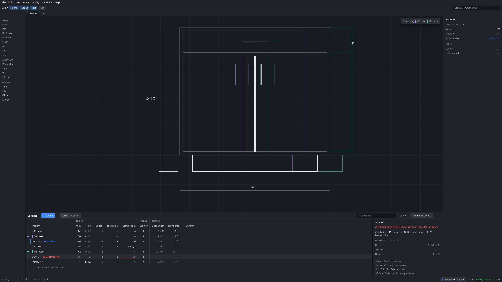
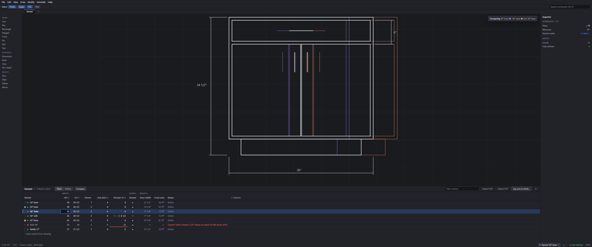
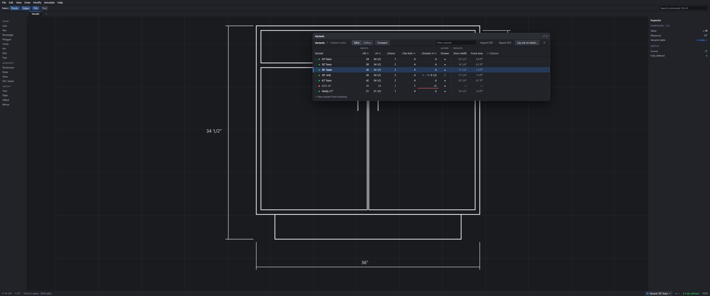
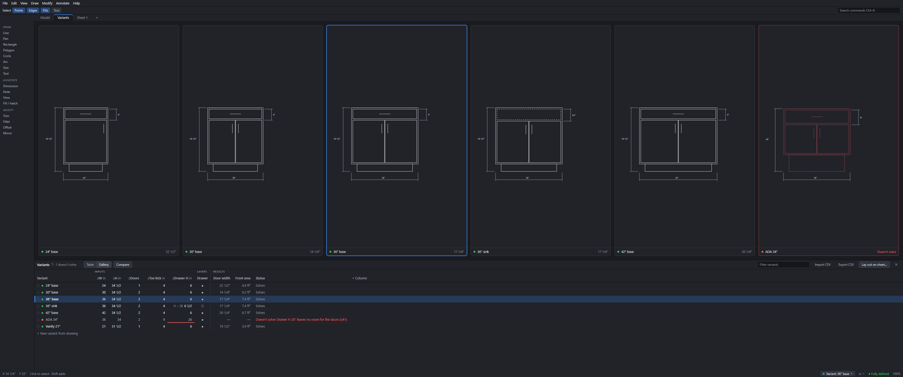

# Variants grid: design pass

Status: proposal, for the owner to decide. No product code. Mockups are in
[`docs/variants-grid/`](variants-grid/), rendered at 3440×1440 and at 3840×2160 (150%).

**The short version.** Variants live in a table that slides up under the canvas
(**Concept A, the bottom drawer**). You open it from a chip in the status bar that always
shows which variant the drawing is in. Each row is a variant and each column is a variable,
a layer that's shown or hidden, or a measured result. Typing in the row that's in the
drawing re-solves the drawing as you type. Every other row is solved in the background,
and a row that doesn't solve says so in place. Hovering a row ghosts it over the drawing,
and Enter applies it. The table builds on today's **Options** (same records, plus an
ordered list of columns) instead of replacing them. drift-mcp gets two tools: `variants`
to read and compare, `set_variants` to change. The Options section leaves the Parameters
pane.



---

## 1. What Drift has today

- **Variables** (`Document::variables`, `crates/drift-core/src/document/variables.rs`):
  name, expression, kind (length / angle / number). Dimensions link to them through an
  expression (`doc.expressions()`). `params::evaluate` works out everything in dependency
  order and reports cycles and bad values for each variable.
- **Options** (`Variant`, ids `k1`, `k2`, …): a name plus either `values`
  (`VariableId → expression text`, applied over the current sketch) or a whole `sketch`
  copy. The editor can save, update, rename, delete and apply them
  (`crates/drift-edit/src/editor/variables.rs`). `active_variant()` works out which option the
  drawing is in by matching values. `variant_geometry()` solves a values option on a copy, for
  ghosts.
- **The Parameters pane** (`crates/drift-app/src/parameters.rs`) stacks Variables (with
  sliders), Options (radio to apply, eye to ghost, Update, ×), Pinned measurements and
  Hatch patterns. Options take a permanent block of the pane.
- **File format**: `options` since v41 (renamed from `variants`), with `values` or a
  `sketch`.
- **drift-mcp** (`apps/mcp`, tools in `crates/drift-app/src/agent/`) has `set_variables`
  but **no tool for options at all**. An assistant can't list, save or apply one today.
- **Halo feature 5** (`docs/halo-features.md` on `claude/halo-features`): "a sheet of
  variants": pick a range or load a CSV, and lay every version out on one sheet or one
  sheet per row, with labeled views. It builds on Options and sheet views.

Things Drift does **not** have, and that this design doesn't invent: a feature tree with
suppression (Drift is a sketcher, so "suppressed features" here means layers shown or
hidden), or per-view variants on sheets (proposed below for halo #5).

## 2. How others do it, and where it hurts

| Product | Model | Where it lives | Hurts |
|---|---|---|---|
| **SolidWorks** design table | Rows = configurations, columns = `D1@Sketch1`, `$STATE@Feature`, embedded **Excel** sheet | Excel opens in place inside the model window (OLE). The newer native Configuration Table is a separate modal dialog | Column names are internal ids. Excel in place is slow and modal, and its menus take over the window. Errors show only after you close Excel and it rebuilds, often as a modal list. Nothing updates while you type. |
| **Fusion** configurations (2023+) | Rows = configurations; columns = parameters, feature suppression, appearance, … Nested tables | A table window docked at the bottom; you pick columns from the timeline or browser | The closest to good. But you add columns through a separate "insert" mode, the active row is set from a separate dropdown, a configuration that fails shows only once you activate it, and the table is a window with Windows-style chrome. |
| **Revit** family types | One type at a time in the modal *Family Types* dialog: a vertical list of parameters, with a dropdown to pick the type. Catalogs are a `.txt` CSV with a header like `Width##length##millimeters` | A modal dialog; Apply to see the result | You never see two types side by side. It's modal, so the model can't be touched. Errors come as modal alerts ("Can't make type"). The catalog format is hostile to users. The most Windows 95 of the three. |
| **Onshape** configurations | Configuration inputs (a list, a checkbox or a variable), each with its own small table; parts have a configuration panel | A panel in the feature list | Modern and web-fast, but split into one table per input, so there's no single grid to read a whole family. |
| **Figma** variables (modes) and component variants | A table of variables with **modes as columns**; any frame can be set to a mode | Opens on demand in a large floating table; each frame picks its mode in the right panel | Excellent: fast inline editing, paste, side by side, nothing modal. **Setting a mode on each frame is exactly the idea halo #5 needs** (a view on a sheet shows one variant). Weak spot: errors barely exist, because nothing has to "solve". |
| **Spreadsheets / Airtable / Notion** | Rows and typed columns | Full screen | They set what people expect from a grid: arrow keys, Tab, Enter, type to replace, Ctrl+V of a block, fill down, sort and filter by column, frozen first column. |
| **Tokens Studio / design-token tables** | A token × theme matrix, exported as JSON/CSV | Plugin panel | Shows that a grid that round-trips cleanly to a text file is worth more than fancy features. |

What to take: Figma's "nothing modal, values side by side, a view picks its variant";
spreadsheet keyboard habits; Fusion's mixed column kinds; Onshape's speed. What to avoid:
internal ids as column names, Excel in place, modal error dialogs, one variant at a time, a
separate mode for adding a column, and failures you only find by activating the row.

**Orientation.** Figma puts variables down the side and modes across the top. The owner asked
for rows = variants, which is also the shape of a CSV with one row per variant (halo #5) and
of every CAD design table. Keep rows = variants. Flipping the table is cheap to offer later
for tables with many variables.

## 3. Interaction concepts

All three share the same grid (§4). They differ in where it lives.

### Concept A: bottom drawer under the canvas (recommended)



The table slides up under the canvas, as wide as the canvas, between the tool rail and the
right dock. It can be resized by its top edge and remembers its height. The canvas shrinks
and stays fully usable.

- **Why it fits:** at 3440 px wide the drawer has room for 15+ columns with no horizontal
  scroll, and a 330 px drawer still leaves about 1000 px of canvas at 3440×1440. At 4K
  (150%) it's the same in points. Final Cut's timeline and Logic's editors sit in the same
  place, so it reads as "a pro tool", not "a dialog".
- **The canvas stays live and uncovered:** you watch the drawing change while you type.
  That is the whole point of a parametric table, and it's what B gives away.
- **Downside:** it takes canvas height. It's toggled, so that only costs while it's open.

### Concept B: floating window



A floating, resizable window over the canvas (Drift's dock can already float panes:
`dock_ui.rs`).

- It works well on a second monitor.
- **It covers the drawing you're changing**, as the mockup shows. It's also another window to
  manage, with chrome that drifts toward the Windows 95 feel we're avoiding.
- Keep it only as a later "tear off to a window" for people with two displays, not as the default.

### Concept C: a Variants tab with a gallery



A tab beside Model and the sheets, holding a gallery of every variant solved as a thumbnail,
with the grid below.

- The gallery is the best way to **see a whole family at once**, and it previews halo #5.
- **The real drawing isn't there**: editing a cell updates a thumbnail, not the drawing.
  It's also a second place to work in, and it fights the "opens on demand, no permanent
  place" requirement less well than a drawer.
- Fold it in instead: the drawer gets a **Table | Gallery** switch, and the gallery
  thumbnails carry over into "Lay out on sheet…".

### Recommendation: A, with C's gallery as a mode and B as a later tear-off

## 4. The grid in detail (Concept A)

### Opening it, and no permanent place

- **Status bar chip:** `● Variant: 36" base ▾`, at the right of the status bar beside
  units and "Fully defined". Click it to toggle the drawer. Its ▾ opens a quick menu to
  switch variant without opening the table. It shows `● edited` (warning color) when the
  drawing has moved off the row it's in. It's hidden while a drawing has no variants, and
  **View ▸ Variants** and the command palette ("Variants", "Design table", "Configurations")
  still open it.
- **Shortcut:** proposed **Shift+V** (free today; V adds a view on a sheet). Esc with focus
  in the table closes it.
- **From the canvas:** right-click a dimension ▸ *Add to variants table*, or the
  Inspector's "Variants table" row (in the mockup) for the picked dimension.
- **The Parameters pane loses its Options section.** It keeps variables and sliders, with
  one link line: "7 variants · Open table (Shift+V)". That fits the dock overhaul
  direction: Parameters can leave the dock later without touching variants.

### Columns

There are three kinds, grouped under small caps headers (**Inputs · Layers · Results**),
never shown as internal ids:

1. **Inputs: variables.** The header is the variable's name and its unit (`W in`). A cell holds an
   expression as Drift accepts it anywhere (`36`, `3' 0"`, `W/2`, `H − 28`). A cell with an
   expression shows the value with a small *ƒ*, and the expression shows while editing and
   in the tooltip.
   - **Driving dimensions become variables.** "Add to variants table" on a dimension makes
     a variable (named from the dimension's label, e.g. `Drawer H`, with a rename field
     focused at once) and links the dimension to it. A dimension never becomes a column of
     its own. So the Parameters pane, the table, sliders and `set_variables` all edit the
     same thing, and there is one way a value reaches the solver.
   - A new column **fills every row with the current value**. There are no blank cells, so
     a row means the same thing whichever row was applied before it. Today's `apply_variant`
     skips variables a values option doesn't list, which makes the result depend on order.
     The grid fixes that.
2. **Layers: shown / hidden.** The cell is the eye glyph used in the Layers panel. Applying
   the row sets those layers' visibility (an undo step like any other). It's Drift's honest
   stand-in for "suppress feature": hidden geometry still solves. A true solver-suppress is
   an owner decision (§8).
3. **Results: read only.** Pinned measurements (and, later, a closed area's size) worked out for
   every row from its solve. *Door width* and *Front area* in the mockup. The CAD tables can't
   do this well, and it's what makes the table a decision tool ("which width keeps doors
   under 18 in?"). The cells are dimmer, behind a divider.

`+ Column` at the end of the header opens a picker: variables not yet in the table, layers,
pinned measurements, and "New variable…". You can drag a header to reorder columns and
right-click it to remove the column (the variable stays).

### Rows, the active row and editing

- **One gutter, one meaning per mark** (UI review fix): an eye to compare (only on hover,
  or colored when on). The name, then `IN DRAWING` (accent) on the active row, or
  `⚠ Doesn't solve` (error color, glyph plus words, never color alone).
- **Active vs selected** are different: the *active* row (the drawing is in it) has a 3 px
  accent bar and bold name. The *selected* row (keyboard cursor) has the faint selected fill.
  Accent fill isn't used for either, in keeping with the "sparing accent" rule.
- **Diff from the active row:** in other rows, a value equal to the active row's is tertiary
  gray, and a value that differs is full strength, so you see at a glance what makes each
  variant different.
- **Editing the active row** behaves like the slider: typing re-solves the drawing live
  (the existing `scrub_variable` / `end_scrub` path), and Enter commits one undo step
  ("Set W in 36\" base"). The variable and the row change together, because the row *is*
  the drawing's state.
- **Editing another row** changes only that row, and that row is re-solved in the
  background (§6). The drawing doesn't move.
- **Moving off a row:** if you edit the drawing (drag, slider, Parameters), the chip and
  the active row show `edited`. The row's context menu offers *Update row from drawing* or
  *Save as new variant*, like today's Update button. The row is never changed silently.
- **Applying:** Enter or double-click on a row's name applies it (one undo step, as
  `apply_variant` does). A row that doesn't solve can't be applied, and the status bar says
  why, with no modal.
- **Keyboard like a spreadsheet:** arrows move, typing replaces, F2 edits, Tab and
  Shift+Tab move across, Enter commits and moves down, Ctrl+D fills down,
  Ctrl+C / Ctrl+V copy and paste a **block of cells as tab-separated text** (from and to
  Excel, Numbers, Google Sheets). Pasting more rows than there are adds rows. A paste is
  one undo step.
- The **name column stays put** when scrolling sideways. Click a header to sort; the filter
  box matches row names.
- `+ Variant` (primary button) saves the drawing as a new row. `+ New variant from drawing`
  at the foot of the table does the same in place. You can drag rows to reorder them, and
  the context menu duplicates, renames (F2 on the name) and deletes.

### A variant that fails to solve: in the row, never a modal

- In the name cell: `⚠ Doesn't solve`. In the cell(s) the solver blames (from the
  conflict set, mapped back to the variables that drive those dimensions), a red underline.
  Results show `—`.
- **A detail strip on the right of the drawer** (it uses the width an ultrawide screen has
  spare) shows the selected row: the full message ("Drawer H 26\" leaves no room for the
  doors"), the conflicting constraints by id and label (click to pick them on the canvas),
  how the row differs from the active row, and the key hints. Narrower windows fold the
  strip into a tooltip on the ⚠.
- A cell whose expression doesn't evaluate (unknown name, cycle) gets the same treatment
  with `params::evaluate`'s message.

### Compare and ghosts

- The eye in the gutter (or Space) turns a row's **ghost** on. It's today's ghost overlay
  (`paint_ghosts`), with the row's ghost color shown as a bar beside its name and a small
  legend at the canvas's top right. Hovering a row previews its ghost for as long as the
  pointer stays.
- **The ghost palette must avoid the skin's accent:** today's orange ghost clashes with the
  Obsidian skin's orange accent (UI review finding). Pick ghost colors per skin.
- The compare set is view state for the session, not saved, as ghosts are today.

### Gallery mode

The **Table | Gallery** switch turns the drawer body into a strip of solved thumbnails, one
per row, with the name and the first result column under each. A failing row has a red frame
and a dimmed sketch. Click to select, double-click to apply. It's the same set and order as
the table.

### CSV import and export

- **Export:** one header row, `Variant,W,H,Doors,Toe kick,Drawer H,Drawer`, then one row
  per variant. Values are written as stored (expressions and units: `34 1/2"`, `W/2`).
  Layer columns are `shown`/`hidden`. Results are left out unless "with results" is
  ticked (then marked read only in the header, e.g. `Door width (result)`).
- **Import** (CSV ▾ ▸ Import, or drop a `.csv` on the drawer): Drift matches columns to
  variables and layers by name. The **preview is in the drawer itself**, not a dialog:
  new rows tinted, changed cells marked, unknown columns shown with "Create variable"
  (kind guessed from units) or "Skip". **Apply** or **Cancel** in the drawer's bar. It's
  one undo step, and every imported row is solved at once, so failures show in place.
- Bare numbers follow the drawing's unit, as everywhere in Drift (#241).
- Clipboard paste from a spreadsheet is the everyday route. CSV files are for exchange and
  for halo #5's "load a CSV".

### Laying variants out on a sheet (halo #5)

**Lay out on sheet…** (on the selected rows, or all of them) opens a small popover:
*One sheet, grid of views* or *One sheet per variant*, which view to repeat (or a region of
the model), and *Add a table of values*. It produces ordinary sheets whose views each **show
one variant**, labeled with the row's name, which is Figma's "a frame picks its mode" idea:

- A view gets an optional `option` (the variant it shows). A view without one shows the
  drawing as it is.
- Those views render that variant's solved geometry (from the same background solve the
  table uses), with dimensions and notes from that solve, so a 30" view's dimension reads
  30".
- "Add a table of values" places a schedule on the sheet, made from the grid's columns.
  It can be a follow-up.

This is the largest piece of work in the design (§7). The table is useful without it, so it
ships last.

## 5. Data model and file format

### Extend Options; don't replace them

The grid is a view over the same `Variant` records. Values options become rows. The
editor's apply, update, rename, delete and the ghost path all keep working. What's
added:

```rust
// drift-core, beside Variant
pub enum OptionColumn {
    Variable(VariableId),
    Layer(LayerId),
    Measurement(MeasurementId),   // a result: read only, never stored per row
}

pub struct Variant {
    pub name: String,
    pub values: BTreeMap<VariableId, String>,   // as today
    pub layers: BTreeMap<LayerId, bool>,         // new: shown / hidden per layer column
    pub sketch: Option<Shared<Document>>,        // as today
}

// on Document
option_columns: Shared<Vec<OptionColumn>>,      // order of the table's columns
active_option: Option<VariantId>,                // the row last applied (new; see below)
```

- **Row order** is the order of `variants()`. Reordering rows needs the table to keep an
  order. Today the map is keyed by id, so either ids are reassigned or an `order` field is
  added. The `order` field is the safer choice.
- **The active row is stored**, not only derived. `active_variant()`'s value matching stays
  as the check that sets `edited`: stored row + values still match = in the row; stored row
  + mismatch = `edited`. Without storing it, two rows with the same values (the "36" base"
  and "36" sink" above differ only by a layer and one expression) can't be told apart.
- **Whole-sketch options don't fit a grid**, because they have no columns. They keep working
  and show in a **Snapshots** group at the foot of the table: name, apply, compare, no
  editable cells. Cells show the values read from the snapshot, dimmed. The owner decides
  whether snapshots stay in this table or move elsewhere (§8).
- **Columns follow their targets:** deleting a variable or layer removes its column (and its
  values from every row) in the same undo step. Renaming carries through, because columns
  hold ids.
- **Validation lives in core**, so the UI and drift-mcp refuse the same things: a duplicate
  row name, a value that doesn't parse for the variable's kind, a column for an id that
  isn't there.

### File format impact

The changes are additive, under rule 1 of `docs/file-format.md`: optional fields that an
older build passes over and keeps.

- Each `options` record gets an optional `layers` (`{"l2": false}`) and `order`.
- A new optional top-level `option_columns`: `[{"var":"v3"},{"layer":"l2"},{"measure":"m1"}]`.
- A new optional `active_option`: `"k3"`.
- For halo #5: a view's optional `option`: `"k3"`.

There's one rule-3 hazard to check in review. An older build that deletes a variable
leaves a column naming an id that isn't there. Reading passes over such a column, says so in
its notes, and the next save writes the table repaired, as v45's annotations do. The
reader stays at its current version unless review finds a case an older build would read
*wrongly* (an older build editing a row's values without knowing `layers` is fine: the
layers keep their own values). This touches `drift-io`, so it's a **gated** PR, and the
format bump is fine during the beta (owner rule).

### Names in the UI

The UI says **Variants** (the table, the chip, the menus), with the tooltip "A variant is
a saved set of values for the drawing; SolidWorks and Fusion call these configurations".
The file keeps `options` (no rename churn). FEATURES.md and the guide change from
"Options" to "Variants". The owner decides (§8).

## 6. Solving every row: performance

- Every committed edit changes the drawing's revision, and every row has to be re-checked
  (it solves on a copy, `variant_geometry`). With 30 rows on a large sketch, that's 30
  solves after each edit.
- **Plan:**
  - Cache each row's result by `(document revision, row values)`.
  - Solve rows **after** an edit commits, never during a drag or scrub. Today's ghosts
    already follow this rule.
  - Solve visible rows first, a few per frame, and show `checking…` in the status until each
    is done.
  - Rows whose values equal the active row's reuse its result.
- The editor isn't `Send` (see drift-mcp's `main.rs`), so background solving means a
  sketch copy handed to a worker, or time-slicing on the UI thread. Time-slicing is simpler
  and enough to start with. A worker thread is a solver-tier change.
- Measure it with the perf baselines (`cargo test -- --ignored`): add a "table of 30 rows,
  edit one cell" baseline before building the background solve.

## 7. drift-mcp tools

The tools run on the same core model and editor calls as the UI: the same validation, the
same undo steps, and the same live updates in a linked window (the user watches rows
appear). They follow the house style of `layers` and `blocks`: one write tool with `op`s,
plus a read-only tool, since `read_only` is per tool.

**`variants`** (read only): list or compare.

```jsonc
// list
{ "op": "list" }
→ { "columns": [ {"id":"v3","kind":"variable","name":"W","unit":"in"},
                 {"id":"l2","kind":"layer","name":"Drawer"},
                 {"id":"m1","kind":"result","name":"Door width","unit":"in"} ],
    "rows": [ {"id":"k3","name":"36\" base","active":true,"edited":false,
               "status":"ok",
               "values":{"W":"36","H":"34 1/2\"","Drawer":"shown"},
               "results":{"Door width":"17 1/4\""}},
              {"id":"k6","name":"ADA 34\"","status":"fails",
               "error":"Drawer H 26\" leaves no room for the doors",
               "conflicts":["c41","c12"],"blame":["Drawer H"], "values":{...}} ],
    "snapshots": [ {"id":"k9","name":"Before client call"} ] }

// compare: values that differ, and results side by side
{ "op": "compare", "rows": ["k3","k5"] }
→ { "differs": {"W":["36","42"]}, "results": {"Door width":["17 1/4\"","20 1/4\""]},
    "status": ["ok","ok"] }
```

**`set_variants`** (writes; each call is one undo step, all or nothing):

| op | args | does |
|---|---|---|
| `create` | `name`, `values?` (`{column: value}`), `from?` (`"drawing"` default, or a row id), `snapshot?` | adds a row (or a whole-sketch snapshot) |
| `edit` | `rows: [{row, name?, values?}]` | changes cells or names, several rows at once |
| `columns` | `add: [{variable \| dimension \| layer \| measure}]`, `remove`, `order` | `dimension: "c12"` makes and links a variable, as the canvas command does |
| `activate` | `row` | applies it; refused with the solver's reason if it fails |
| `update_from_drawing` | `row` | stores the drawing's current values in the row |
| `delete` | `rows` | |
| `import_csv` | `path` or `text`, `create_missing?` | as the UI import, applied at once; returns rows added or changed and any that fail |
| `export_csv` | `path`, `results?` | |
| `lay_out` | `rows?`, `mode: "grid" \| "per_row"`, `view?` or `region?`, `table?` | halo #5; returns the sheets made |

`render` gets an optional `variant: "k5"` (draw that row's solve without applying it) and
`variants: ["k3","k5"]` (ghost overlay). That lets an assistant *look* at a comparison as
the user does. `set_variables` stays as it is. The INSTRUCTIONS text gets one line: "For
families of sizes, use variants: one row per size, columns for the variables that change;
check `variants list` for rows that don't solve."

The script language (`run_script`) could later get `variant "30\" base" W=30 …`. That's out
of scope here.

## 8. Risks

1. **The cost of solving every row** (§6) on big drawings. Background solves need care,
   so they don't slow drags or flicker results. The perf baseline comes first.
2. **Blame mapping**: going from a conflict set to "which cell" is easy for one variable,
   and vaguer when an expression involves several. When unsure, show the message on the
   row and underline nothing, rather than underlining a cell wrongly.
3. **Whole-sketch options** sit awkwardly beside rows. Snapshots keep them working, but
   it's a second concept in one table.
4. **Dimension → variable promotion** renames things the user didn't name. Focusing the
   rename at once and offering an Undo hint keeps that honest.
5. **Layer columns aren't suppression**: someone from SolidWorks may expect hidden
   geometry to stop constraining. The tooltip says so plainly ("Shown or hidden. Hidden
   geometry still solves").
6. **egui has no data grid.** `egui_extras::TableBuilder` would need a new dependency
   (Cargo.toml, so a gated PR), or the table is hand-rolled on Drift's row helpers. Either
   way, spreadsheet keyboard handling and a clipboard block paste are real work, with
   egui text-editing traps (see the editing-pitfalls notes) and kittest coverage.
7. **Per-view variants on sheets** (halo #5) reach into sheet rendering, PDF export and
   sheet annotations tied through views. It's the largest piece, and it ships last.
8. **Tiers**: the core model and the editor are auto tier, unless the editor's apply path
   is in the solver tier's drag/solve files. The file format and drift-io are gated.
   Background solving may be solver tier.

### Suggested PR order

Each PR is usable on its own.

1. **Core:** `option_columns`, `layers`, `order`, `active_option`. Format additions and
   their tests (gated).
2. **drift-mcp:** `variants` and `set_variants` (minus `lay_out`). Agents get the model
   first, and the tests pin the behavior the UI will use.
3. **Drawer:** grid, chip, Shift+V, active-row live edit, diff shading. Options leave the
   Parameters pane. Rows are solved on the UI thread with a cap.
4. **Failures in place:** status, blame, detail strip. Ghost on hover, compare eye, ghost
   palette per skin.
5. **Clipboard and CSV:** block paste, fill down, CSV import preview and export.
6. **Gallery mode.**
7. **Halo #5:** a view's `option`, Lay out on sheet, then a values table on the sheet.

## 9. UI review findings, folded in

The `ui-design-review` pass ran on the first three mockups at 3440×1440 and 3840×2160. The
revised Concept A mockup (top of this doc, and `a-drawer-revised-3440x1440.png`) applies the
first group:

**Fixed in the revised mockup**
- Two tiny marks per row (an empty compare swatch that read as a checkbox, plus a status
  dot): now one gutter. The eye shows on hover or when on, and failure is a ⚠ glyph with
  words, not color alone.
- The active row and the cell being edited both used the accent, so "in the drawing",
  "selected" and "editing" looked alike. Now: a bar and `IN DRAWING` for active, a neutral
  fill for selected, and an outlined cell for editing.
- The error message sat in a Status column 1500 px from the bad cell at 3440 wide, and
  "Solves" was repeated on every good row. Now `⚠ Doesn't solve` sits by the name, good rows
  say nothing, and the full message is in the detail strip.
- The italic *x* kind glyph read as part of the name (`xW`). It's gone; the group headers
  already say Inputs / Layers / Results.
- No primary action: "new variant" was only a ghost row at the bottom. Now there's a
  `+ Variant` primary button by the title.
- Five equal-weight buttons in the bar: Import and Export are folded into `CSV ▾`, and
  Compare moved to the eye in each row.
- The expression cell `H − 28 6 1/2` read as one number. Now it's `ƒ 6 1/2`, with the
  expression shown when editing.
- Layer cells were ●/○ bullets. Now they use the Layers panel's eye glyph.

**Still to do when built**
- Ghost colors per skin, avoiding the accent (orange ghost vs Obsidian's orange accent).
- At 3440 wide the free width to the right of the columns is now the detail strip. Check
  that a narrow window (the dock at its widest, or a 2560 screen) folds it into a tooltip
  cleanly.
- Keyboard focus ring on cells uses the same 1.5 px accent outline as fields elsewhere.
- Concept B covers the drawing, and Concept C hides the real drawing while editing (both
  shown in the mockups). That's why A is recommended.

**What works:** dense 26 px rows and right-aligned fractions read like a pro table.
Grouping Inputs / Layers / Results makes the table explain itself. The status bar chip
gives variants a home without a pane. Compare ghosts over the live drawing are easy to read.

## 10. Decided (owner, 2026-11-22)

The owner took every recommended default.

1. **Where the table lives:** the bottom drawer under the canvas.
2. **The name in the UI:** "Variants".
3. **Whole-sketch options:** they become *Snapshots* at the foot of the table.
4. **Layer columns:** shown/hidden only. No solver suppress.
5. **Driving dimensions:** always promoted to a variable when added to the table.
6. **Shortcut:** Shift+V.
7. **Active row:** stored in the file (`active_option`).
8. **Scope of the first build:** PRs 1–5 (table, MCP, failures, CSV). Gallery and halo #5
   sheets come after.
